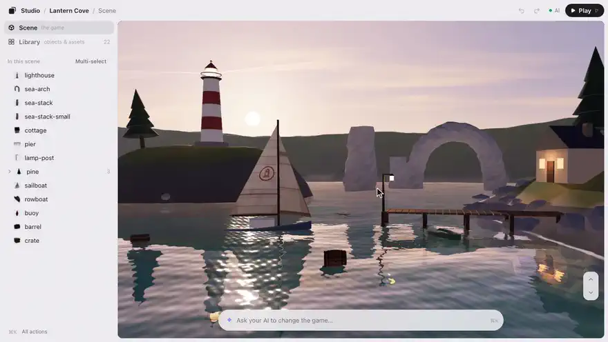

# KUMODeck Game Studio



**Turn your Claude or Codex into a game studio.** Game Studio is a free editor for web games that runs on your
computer, right next to your AI: drag things around in your game, ask your AI for changes, and click **Save**.
Install it by pasting one line into your AI (below), then type `/arrange` in Claude Code or `$arrange` in
Codex.

Drag, turn and resize the objects in your web game, and see every asset it uses. When you click **Save**, the editor
writes `placement.json` / `library.json`; your AI reads them and updates your code. No more "move the tree a bit to
the right… no, less."

- **Free and local.** No account needed. The editor runs on your computer (`127.0.0.1`), sends nothing anywhere, and
  only reads and writes inside your game folder.
- **Any web game.** three.js works out of the box. For Phaser, PixiJS, plain canvas or DOM games, your own engine, or a
  Godot web export, your AI reads the game and writes a small adapter from the bundled examples, then the editor
  checks that it works.
- **Your code stays yours.** The editor never edits your code. On your first save, your AI adds one line that loads
  `placement.json` when the game starts. Want the numbers written into the code instead? Tell your AI.

> **Want more?** Sign in with [KUMODeck](https://kumodeck.com) to make images and 3D models with AI, paid with
> KUMODeck credits. Your AI can also publish your game and add online multiplayer and saves with it. All optional:
> everything above works without an account.

## Install

You need [Node.js](https://nodejs.org) 22.13 or newer (`node --version`). Nothing else is installed.

**Paste this into Claude Code or Codex** (in the Claude app or a terminal):

```
Install KUMODeck Game Studio for me by following https://github.com/kumodeck/game-studio/blob/main/INSTALL.md
```

Your AI installs Game Studio and opens the editor, with a sample game if your folder is empty
([what it does](INSTALL.md)). Next time, start a new session and type `/arrange` (Codex: `$arrange`).

Or install it yourself. **Claude Code**, in your terminal:

```
claude plugin install game-studio --marketplace kumodeck/game-studio
```

(Or inside Claude Code: `/plugin marketplace add kumodeck/game-studio`, then `/plugin install game-studio@game-studio`.)

**Codex**, in your terminal:

```
codex plugin marketplace add kumodeck/game-studio && codex plugin add game-studio@game-studio
```

(Or inside Codex: `/plugins`, choose **KUMODeck Game Studio**.) Start a new session afterwards.

### Uninstall

**Claude Code:** `claude plugin uninstall game-studio@game-studio && claude plugin marketplace remove game-studio`

**Codex:** `codex plugin remove game-studio@game-studio && codex plugin marketplace remove game-studio`

Your game folder keeps what the editor wrote (`placement.json`, `library.json`, `.studio/`). Delete them if you like.

## Try it in 5 minutes

No game yet? Open your AI in an **empty folder** and type `/arrange` (Codex: `$arrange`). It asks one question,
"Want to start from a sample? Pick 3D or 2D," copies a small sample game into the folder and opens the editor. Then: click
anything and drag it, ask your AI for a change in the box at the bottom ("add 3 more like this"), and click **Save**.
The sample already loads `placement.json`, so your layout is in the game right away.

## Use it

Open your AI in the folder of your game (the one with `index.html`), or in an empty folder to start from a sample.

| | Claude Code | Codex |
|---|---|---|
| Arrange objects | `/arrange` | `$arrange`, or just ask: "open the arrange editor" |
| Asset library | `/arrange library` | `$arrange library`, or "show me every asset my game uses" |

You can also just say what you want ("I want to fix where the trees are"); the agent picks the skill by itself.

1. Your AI checks how the game is built (and writes an adapter if needed), then starts the editor and opens it in your
   browser.
2. The game fills the window. The editor is three things: the column on the left (**Scene** and **Library**), a small
   card over the game's top right corner while something is selected, and one input at the bottom. Two colors mean one
   thing each: **orange is your hand** (what you selected: its outline, its name tag), **violet is your AI's hand**
   (what its last change touched).
   - Click an object to select it, then drag it to move it. The strip under it moves, lifts (3D), turns and resizes
     (keys 1–4): press a button and drag. In 3D, the ▾ in the corner of Turn chooses turn in place, tilt forward or tilt
     sideways (it turns around the middle of the object, so it stays where it is). With several selected, the ▾ on Size
     resizes them **together** (the gaps grow too) or **each in place**. The card shows its exact numbers (drag a letter
     left or right, or type).
   - Duplicate it (Cmd/Ctrl+D, or Cmd/Ctrl+C then Cmd/Ctrl+V) to lay out more of the same, delete what you don't need,
     or select several (Shift-click, drag a box, or click a "crate ×4" group in the list) to move, turn and resize them
     together. Undo and Redo are in the top bar (Cmd/Ctrl+Z, Shift+Cmd/Ctrl+Z).
   - Right-click anything (long-press on a phone) for what you can do with it right there: Ask your AI…, Rename…,
     Duplicate, Delete, and more.
   - In 3D, fly the camera with W A S D (E / Q for up and down) when nothing is selected; with something selected, hold
     the right mouse button while you press them. The ↑↓ buttons in the corner also raise and lower the camera. Press
     **?** for every shortcut.
   - The input at the bottom is for your AI: type what you want about what's selected ("add 3 more in a row") or
     about the whole game ("add three lighthouses around the island") and press Enter. You see at once that your AI
     has it (or, if it isn't watching, what to do); a violet light runs round the input while it works, and its
     one-line reply shows right above. When it's done the game updates by itself — no reload — with the camera and
     your selection kept, and only what changed glows violet. Don't like it? **Undo AI change** puts the game back
     in one press (**Redo** brings the change back).
   - **⌘K / Ctrl+K** is the list of every action (Play, Open the Library, Show all, Editor view…). Typing a word that
     names one ("library", "play") also suggests it; a sentence always goes to your AI.
   - Switch from **Scene** to **Library** to see every object and every image, model and sound in one list (All, 3D,
     2D, Sound, Other): which object uses which file, which files are unused or missing. Swap a file (Replace…), bring in
     new ones (Add files), or put one in the game: **Add to scene** on an object places a duplicate where you're looking;
     on a file, it asks your AI to add it. Select something there and the input at the bottom asks your AI about it.
     The two are linked: a selected object's card has **Show in Library →**, and a file's detail says how many objects
     use it ("In the scene: 2", press it to select them).
3. Click **Save** (top bar, "Save · 3" shows how many changes aren't saved yet; Cmd/Ctrl+S) and go back to your AI.
   Until then your changes are kept as a draft, so closing the tab loses nothing. Your AI reads the files and updates
   the game (the first time, it adds the one line that loads `placement.json`), and the editor shows the new game by
   itself. Play it with **Play** (or P).

On a phone: ask your AI to open the editor "for my phone". It starts with `--lan` and shows a QR code for the same
Wi-Fi network.

There is one skill, `arrange`, shared by both agents. Claude Code offers it as the `/arrange` command (also
`/game-studio:arrange`); Codex plugins do not add slash commands, so in Codex you mention the skill (`$arrange`) or
use plain words.

## Make it fit

Ask your AI in plain words; it writes small files under `.studio/` in your game folder, and the editor itself never
changes.

- **Fit it to your game:** "snap to the 1 m grid", "only turn by 90°", "keep things inside the arena", "lock the
  ground", "add a tool to draw the race course". (`.studio/studio.json`, `.studio/tools.js`)
- **Make the editor yours:** "put the list on the right", "make it light", "bigger buttons", "hide the ideas".
  (`.studio/ui/`) You can also change the basics yourself: ⌘K → **Editor view…**. To get the original look back,
  add `&ui=off` to the editor URL or delete `.studio/ui/`.

## What your AI reads

`placement.json` (only the objects you changed; `was` holds the old values so the AI can find the numbers in the
code):

```json
{
  "version": 1,
  "tool": "placement",
  "dim": "3d",
  "space": "local",
  "objects": {
    "tree-01": { "p": [3.25, 0, -4.1], "r": 1.5708, "s": 1.2,
                 "was": { "p": [2.0, 0, -4.1], "r": 0, "s": 1 }, "label": "tree-01" }
  },
  "added":   [ { "key": "tree-02", "from": "tree-01", "p": [5.25, 0, -4.1], "r": 1.5708, "s": 1.2 } ],
  "removed": [ { "key": "old-sign", "was": { "p": [0, 0, 3], "r": 0, "s": 1 } } ]
}
```

`added` and `removed` appear only when you duplicated or deleted objects; your AI adds those duplicates to the code (with the
same keys) and takes the deleted objects out.

`library.json` (assets you swapped, files you added, files nothing uses):

```json
{
  "version": 1,
  "tool": "library",
  "replace": [ { "from": "assets/tree.png", "to": "assets/tree-autumn.png", "usedBy": ["tree-01"] } ],
  "added":   [ { "file": "assets/rock.glb", "place": { "key": "added-1", "p": [1, 0, 2], "r": 0, "s": 1 } } ],
  "unused":  [ "assets/old-bg.png" ]
}
```

The AI asks you before deleting any file. Clicking **Delete** on an unused file in the Library sends it to your AI
the same way; the editor itself never deletes files.

Give important objects a stable name so the editor and your AI always agree on which one is which:
`object.userData.studioKey = 'tree-near-gate'` (three.js), or the equivalent mark for your engine. The skill tells
your AI how.

## Connect KUMODeck (optional)

KUMODeck is a backend for web games and apps. With it, your AI can publish the game to a private test URL and then to
everyone, add online multiplayer (rooms, quick match, invite links), save data and leaderboards, and make 3D models
with AI. It needs a KUMODeck account and prepaid credits; usage is charged at cost.
See [pricing](https://kumodeck.com/docs/pricing/).

The editor's **Ideas for your AI** list (Publish to KUMODeck, Add online multiplayer, Add saves and a leaderboard,
Make 3D models and images with AI) does nothing by itself: it sends the steps to your AI, and the AI asks you before installing, signing in or uploading
anything. To connect, add the KUMODeck plugin:

```
/plugin marketplace add kumodeck/kumodeck-plugin          # Claude Code
/plugin install kumodeck@kumodeck

codex plugin marketplace add kumodeck/kumodeck-plugin     # Codex
codex plugin add kumodeck@kumodeck
```

or connect `https://mcp.kumodeck.com/mcp` as an MCP server, or use the CLI (`npx kumodeck login`).

### Make images and 3D models with AI (optional sign-in)

The editor is free and works fully without an account. If you sign in with KUMODeck, the **Library** can also make
an image (textures, backgrounds, skies) or a 3D model from a sentence, paid with your KUMODeck credits at the AI
provider's price with no markup.

1. Sign in once in a terminal: `npx kumodeck login` (open the link it prints, click Allow).
2. In the editor: **Library → Make with AI**. It shows your credits and the price before you click **Make**; if you
   don't have enough, it stops and says so. The first time, you agree to the AI part of the KUMODeck terms (once).
3. The result is a new file in `assets/` (never overwriting), like **Add files**. Place it, or ask your AI to use it.

How it stays safe: the editor's local server reads the sign-in the KUMODeck CLI saved (`~/.kumo/credentials.json`)
and calls KUMODeck itself. The key never reaches the browser page. The game folder's `kumo.json` names the project
(otherwise you choose one of yours). Nothing is sent until you click Make.

Try the screens without an account or any cost (a fake KUMODeck on your computer):
`node test/kumo-try.mjs <a copy of examples/canvas-stars>` and open the printed link.

## What is inside

| Path | What it is |
|---|---|
| `skills/arrange/` | The skill both agents read: how to start the editor, write an adapter, and apply the results |
| `skills/arrange/adapters/` | Example adapters (Phaser, PixiJS, plain canvas, DOM, Godot) your AI starts from |
| `skills/arrange/bin/` | The local server (one file, no dependencies), the editor, and the optional `studio-placement.js` loader |
| `.claude-plugin/` | Plugin manifest and marketplace list for Claude Code |
| `.codex-plugin/`, `.agents/plugins/` | Plugin manifest and marketplace list for Codex |
| `CONTRACT.md`, `src/` | The editor's source and the port adapters talk to |
| `docs/VOICE.md` | How the editor's words are written (for anyone changing them) |

## Privacy and safety

- The server listens on `127.0.0.1` only (or your local network with `--lan`), with a one-time passcode in the URL.
- It serves files only from your game folder and writes only `placement.json`, `library.json`, new files under
  `assets/` (never overwriting), and notes under `.studio/`.
- No telemetry and no account. The only network calls are the optional KUMODeck ones above, and only after you click
  **Make with AI** (signed in with the KUMODeck CLI); the key stays in the local server, never in the page.

## Help

support@kumodeck.com

## Development

```
node scripts/build.mjs        # build the editor into dist/ (Node >= 22.13, no dependencies)
node scripts/build.mjs --watch
node --experimental-strip-types --test test/<file>
tsc -p .                      # optional type check, any TypeScript >= 5.8 (not a dependency)
node scripts/build-web-demo.mjs --out <dir>   # browser-only demo: one static folder
```

The web demo (`src/hosts/browser/`) is the same editor on the two starters
(Lantern Cove, Firefly Ruins; `starters/`) as plain static files: no server, no passcode,
no AI. Everything a visitor changes stays in their browser (IndexedDB).
Serve the folder with any static server and open `index.html`.

Read `CONTRACT.md` first: it is the promise between the editor, the
adapters, the host and the result files (`src/contract.ts` has the types).

## License

MIT, see [LICENSE](LICENSE).
