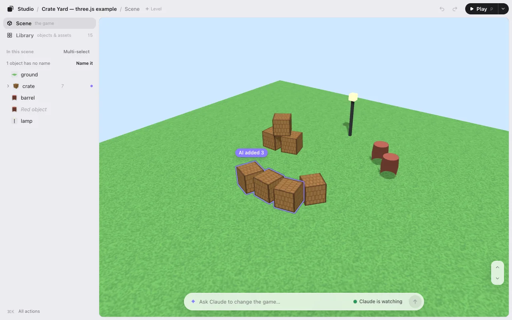

# Make a game with Claude Code

Claude Code writes your game’s code. Game Studio is where you see the game and fix it by hand: drag a tree, turn a door, ask Claude for three more lighthouses, and click **Save**. Claude puts what you did into the code.

It’s a free Claude Code plugin. It runs on your computer and needs no account.

## What you need

- **Claude Code on your computer:** in the Claude app (desktop, Code tab, a local session), in a terminal, or in an IDE. Plugins don’t load in cloud sessions.
- **Node.js 22.13 or later** (`node --version`). Nothing else is installed.

## Install

Paste this into Claude Code:

```
Install KUMODeck Game Studio for me by following https://github.com/kumodeck/game-studio/blob/main/INSTALL.md
```

Claude installs the plugin and opens the editor. It asks you once whether new versions should install by themselves. Prefer to do it yourself? See [Getting started](getting-started.md#or-install-it-yourself).

## From an idea to a game you can arrange

1. **Have Claude make the game.** In an empty folder, ask for it: “Make a small three.js game: a harbor at dusk, boats you can sail.” Or type `/arrange` there and pick a sample on the editor’s shelf.
2. **Open it in the editor.** In the game’s folder, type `/arrange`. The editor’s link is on the first line of Claude’s reply, and it opens in your browser by itself.
3. **Arrange it by hand.** Click anything and drag it. The strip under it moves, lifts, turns and resizes. See [Editing](editing.md).
4. **Ask Claude in the same window.** Type in the box at the bottom, like “add 3 more like this,” and press <kbd>Enter</kbd>. The box says **● Claude is watching** when Claude will get it within seconds.
5. **Click Save.** The editor writes `placement.json`. Claude reads it and puts your changes into the code. The first time, it adds one line that loads `placement.json` when the game starts.



## While Claude works

- A violet light runs round the box, and Claude’s one-line reply shows above it. The full reply is in Claude’s window: the line says **More in Claude**.
- When Claude is done, the game updates by itself, with your camera and selection kept. Only what changed glows violet. **Undo AI change** puts it back in one press.
- Something’s off while you play? Press <kbd>`</kbd>, type it, and press <kbd>Enter</kbd>. Claude gets your words with a picture of that moment. See [Play](play.md#ask-while-you-play).

## Why use an editor with Claude Code

Telling Claude “move the tree a bit to the right… no, less” takes many turns. Dragging it takes one. Claude still writes every line of code: the editor never edits it. Your layout lives in `placement.json`, or, if you ask, as numbers in the code. See [How it works](how-it-works.md).

## Next

- [Make a game with Codex](codex.md): the same editor with Codex.
- [A level editor for three.js games](threejs-level-editor.md) and [Phaser, PixiJS, canvas and Godot web games](phaser-pixijs-godot.md): what works with your engine.
