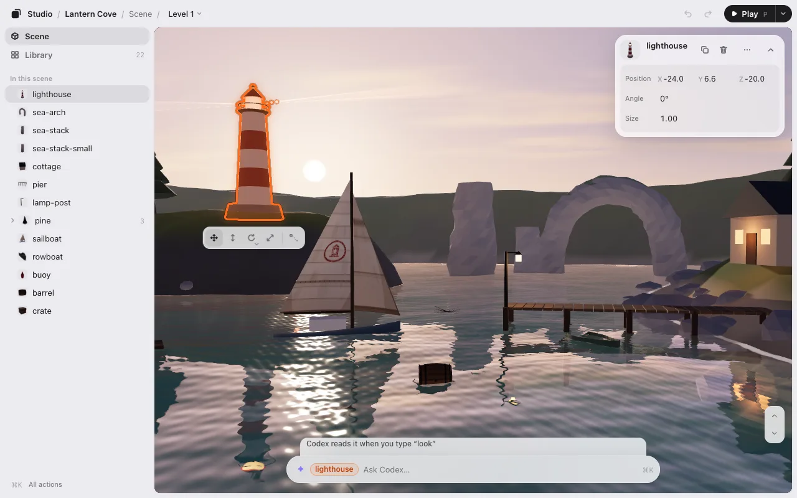

# Make a game with Codex

Codex writes your game’s code. Game Studio is where you see the game and fix it by hand: select something, drag it, turn it, ask Codex for a change, and click **Save**. Codex puts what you did into the code.

It’s a free Codex plugin. It runs on your computer and needs no account.

## What you need

- **Codex on your computer:** the CLI, the app or an IDE. Plugins don’t run in Codex cloud.
- **Node.js 22.13 or later** (`node --version`). Nothing else is installed.

## Install

Paste this into Codex:

```
Install KUMODeck Game Studio for me by following https://github.com/kumodeck/game-studio/blob/main/INSTALL.md
```

Codex installs the plugin and opens the editor. Or install it yourself, in a terminal:

```
codex plugin marketplace add kumodeck/game-studio && codex plugin add game-studio@game-studio
```

Then start a new session.

## Open your game

Open Codex in your game’s folder (the one with `index.html`) and type `$arrange`, or just ask: “open the arrange editor.” Codex plugins don’t add slash commands, so it’s `$arrange`, not `/arrange`. In an empty folder, it starts you off with a sample game.



## How Codex works with the editor

- **Type “look” in Codex.** Codex has no hooks, so it doesn’t watch the editor by itself. What you send from the editor’s box waits for it, and the box says so: **Codex reads it when you type “look”**. Type `look` in Codex and it reads everything you sent.
- **Save works the same.** The editor writes `placement.json`; ask Codex to apply it (or type `look`). The first time, it adds one line that loads `placement.json` when the game starts.
- **The AI’s line** in the editor says **More in Codex**: the full reply is in Codex’s window.
- **Updates** don’t install by themselves. To update: `codex plugin marketplace upgrade game-studio`.

Everything else is the same as with Claude Code: [Editing](editing.md), [Play](play.md), [Motion](motion.md), [Levels](levels.md).

## Next

- [A level editor for three.js games](threejs-level-editor.md)
- [Phaser, PixiJS, canvas and Godot web games](phaser-pixijs-godot.md)
- [FAQ](faq.md#codex)
