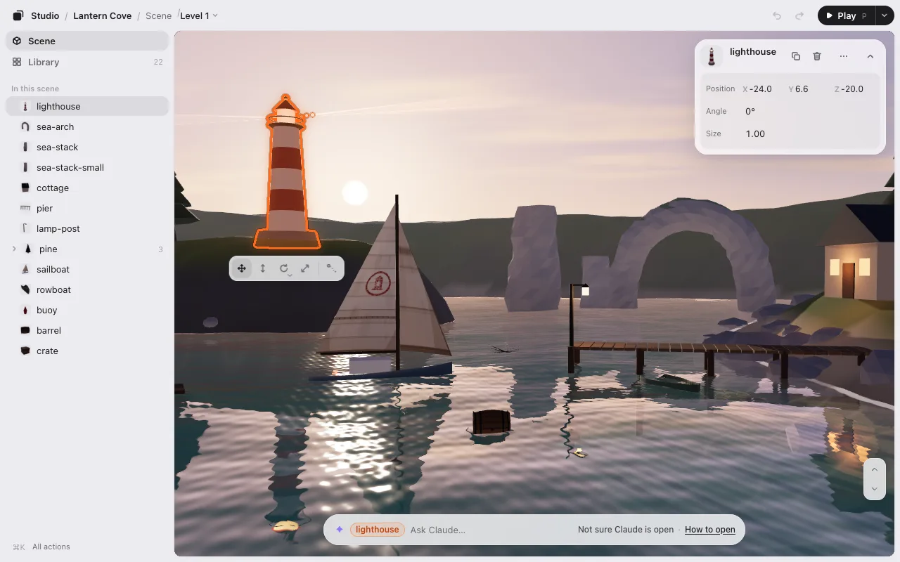
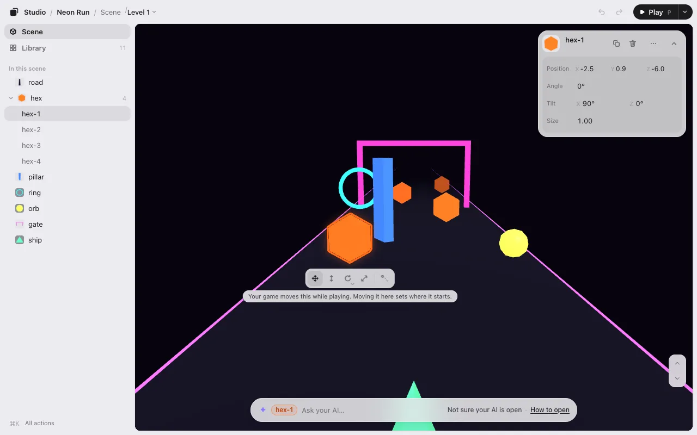
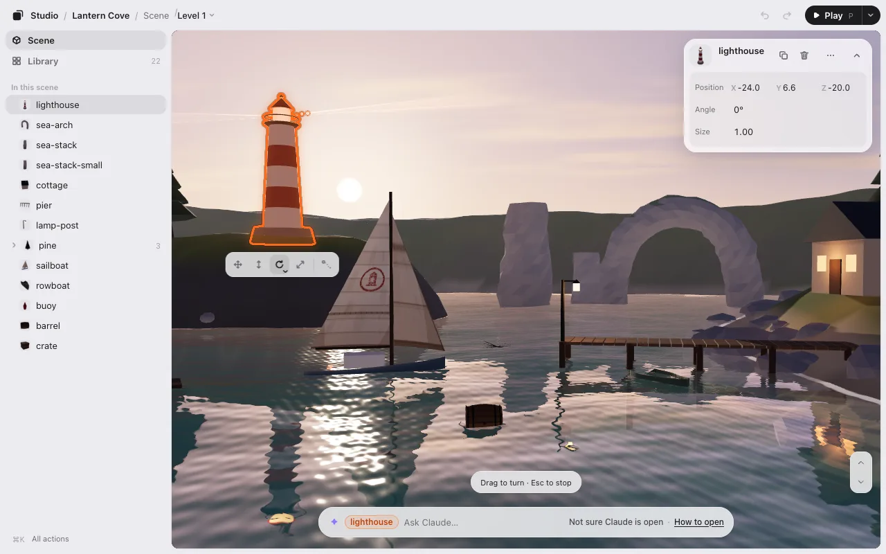
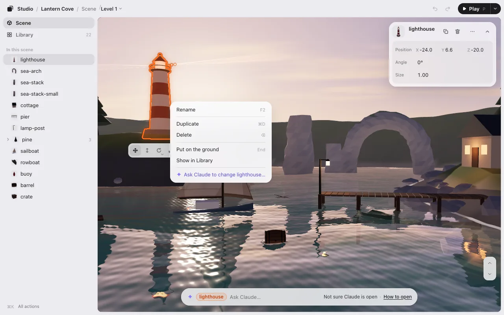
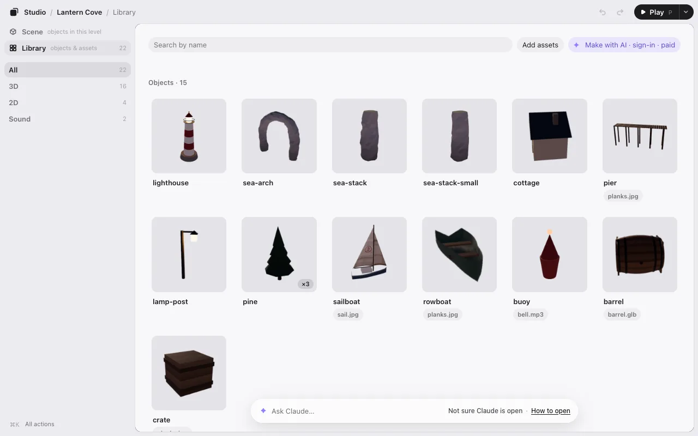
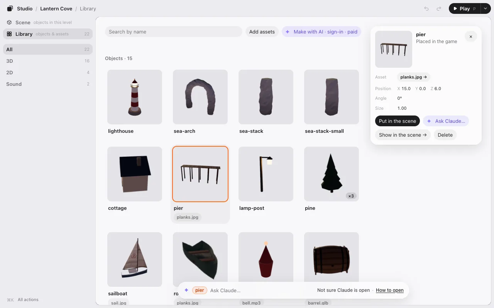
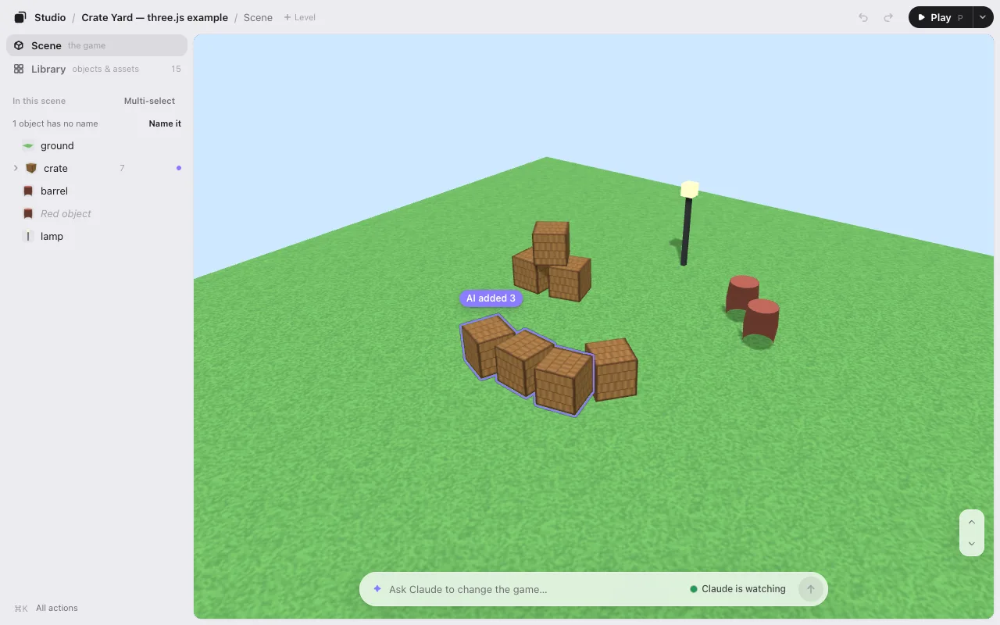
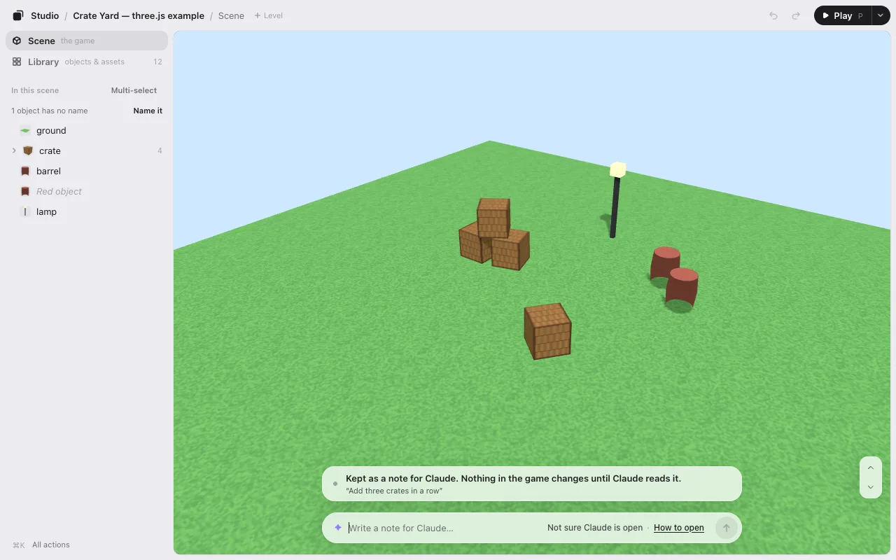
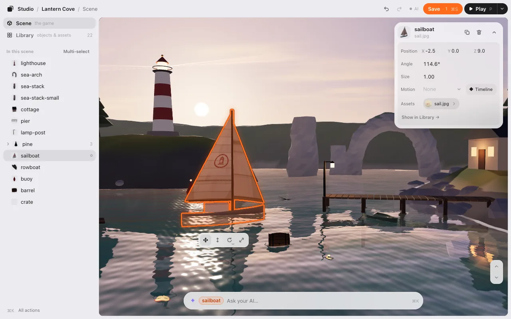
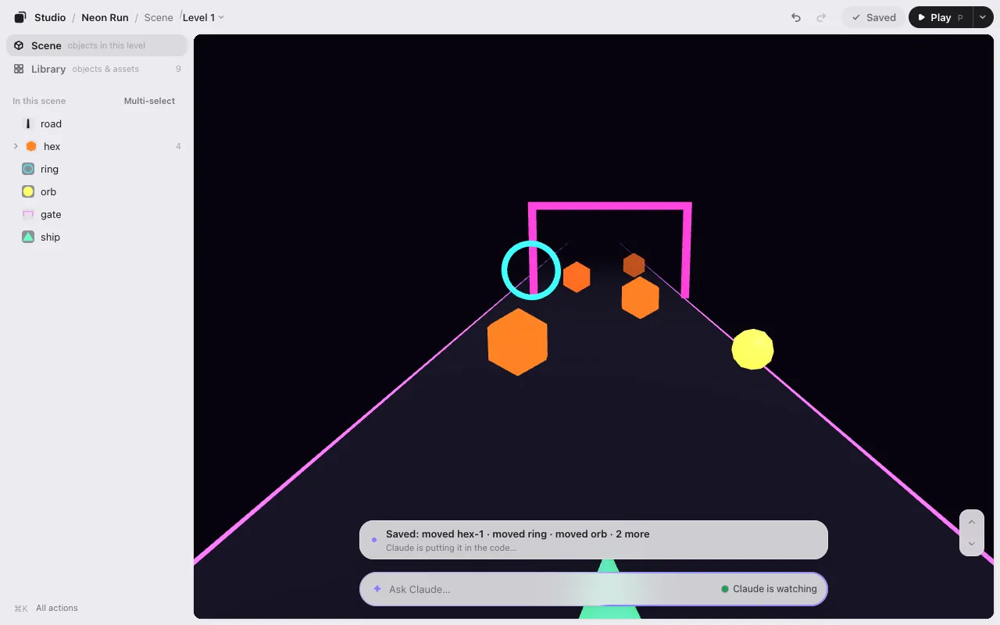

# Editing

Click something in your game and drag it. That’s most of it. This page covers the rest: the tools under a selected object, the camera, the menus, the Library and Save.

The editor has three parts: the column on the left (**Scene** and **Library**), the game in the middle, and one box at the bottom for your AI. Two colors mean one thing each: **orange is your hand** (what you selected), **violet is your AI’s hand** (what its last change touched).

## Select

- **Click** (or tap) an object to select it. Click the same spot again to select the one behind it.
- **Click nothing** (the sky, the sea, the ground) to deselect. Big things like the ground are selected from the Scene list instead, so you don’t grab them by accident.
- Selecting from the **Scene** list (or ⌘K, or **Show in game** in the Library) doesn’t move your camera when the object is already on screen. Only when it’s out of sight does the view slide to it, and never so far that it ends up tiny. Deselecting never moves the camera either.
- <kbd>Esc</kbd> steps back: it closes an open menu, then puts the tool down, then deselects.

## Move, lift, turn and resize

Drag a selected object to move it. The strip under it has four tools. Press one, then drag anywhere (not just on the object):

| Tool | Key | Drag |
|---|---|---|
| Move | <kbd>M</kbd> or <kbd>1</kbd> | Moves it along the ground. |
| Height (3D) | <kbd>H</kbd> or <kbd>2</kbd> | Up and down. |
| Turn | <kbd>T</kbd> or <kbd>3</kbd> | Left and right turns it, in 15° steps. |
| Size | <kbd>S</kbd> or <kbd>4</kbd> | Right or up makes it bigger. |

The tool stays chosen until you press <kbd>Esc</kbd> or choose another. A readout next to the strip shows the numbers as you drag.

**Things your game moves, and tools that don’t work.** The four tools are always there, in the same places, with the same pictures. When there is something to know about what you picked, one small line shows right under (or over) the strip.

- **Your game moves it** (a runner’s obstacles, a spinning coin): **Move** works as always. Where you put it is where it starts; when the game plays, it moves it on from there.
- If your game turns or resizes it, **Turn** or **Size** is dimmed and pressing it does nothing. To change that, ask AI in the box below.
- **A ground, road or sky** is locked so a stray drag can’t move it. The line under the tool strip says so, and its **Unlock** frees it.
- **Your game’s rules lock it**: the tools are dimmed, and the same line says why.

**More ways to turn and resize.** The small ▾ in the corner of **Turn** and **Size** (or a long press on the button) opens the choices:

- In 3D, Turn has **Turn**, **Tilt forward** and **Tilt sideways**. <kbd>R</kbd> goes to the next one. It turns around the middle of the object, so it stays where it is.
- With several selected, **Together** turns or resizes them as one group (the gaps change too). **Each in place** keeps each one where it is.

**From the keyboard.** The arrow keys nudge (<kbd>Shift</kbd> for a smaller step). <kbd>Q</kbd> and <kbd>E</kbd> turn 15°. <kbd>Page Up</kbd> and <kbd>Page Down</kbd> raise and lower. <kbd>+</kbd> and <kbd>−</kbd> resize.

**Exact numbers.** The card at the top right shows **Position**, **Angle** and **Size**. Drag a number left or right to change it (hold <kbd>Shift</kbd> for finer steps), or click it and type. The card’s **–** folds it to one line.

## Snap into place

In 3D, things land on what’s under them:

- Dragging **Height** down stops on the first surface below. Keep pulling a little further to go through it.
- <kbd>End</kbd> drops the selected object to the floor (on a Mac laptop, <kbd>fn</kbd><kbd>→</kbd>). It’s in the right-click menu too.
- Hold <kbd>Ctrl</kbd> or <kbd>⌥</kbd> while you drag to move without snapping.

Want a grid, or only 90° turns? Ask your AI: “snap to a 1 m grid.” It sets that up for your game.

## Look around (3D)

| To | Do this |
|---|---|
| Look around | Drag where nothing is selected. With a tool chosen: <kbd>⌥</kbd>-drag, right-drag, or two fingers. |
| Zoom | Scroll, or pinch. |
| Fly | <kbd>W</kbd> <kbd>A</kbd> <kbd>S</kbd> <kbd>D</kbd> with nothing selected. With something selected, hold the right mouse button too. <kbd>Shift</kbd> goes faster. |
| Go up and down | <kbd>E</kbd> and <kbd>Q</kbd> (nothing selected), or the ↑ ↓ buttons in the game’s corner. |
| See everything | <kbd>F</kbd> |
| Back to where you started | <kbd>Shift</kbd><kbd>F</kbd> |

<kbd>W</kbd> and <kbd>S</kbd> stay level: looking down, you glide over the scene at the same height.

## Undo, duplicate, delete

| | Mac | Windows |
|---|---|---|
| Undo | <kbd>⌘</kbd><kbd>Z</kbd> | <kbd>Ctrl</kbd><kbd>Z</kbd> |
| Redo | <kbd>⇧</kbd><kbd>⌘</kbd><kbd>Z</kbd> | <kbd>Ctrl</kbd><kbd>Y</kbd> |
| Duplicate | <kbd>⌘</kbd><kbd>D</kbd> | <kbd>Ctrl</kbd><kbd>D</kbd> |
| Delete | <kbd>⌫</kbd> | <kbd>Delete</kbd> |
| Select all | <kbd>⌘</kbd><kbd>A</kbd> | <kbd>Ctrl</kbd><kbd>A</kbd> |

**Undo** and **Redo** are also in the top bar. **Duplicate** puts the copy next to the original; press it again for another at the same spacing.

## Right-click menu

Right-click anything (long-press on a phone) to see what you can do with it right there.

- **On an object:** Rename, Duplicate, Delete, Put on the ground, Show in Library. In 2D: Bring to front and Send to back. Then **✦ Ask Claude to change the lighthouse…** (your AI’s name).
- **On an empty spot:** Paste, Select all, Deselect, Show all. Then **✦ Ask Claude to change the game…**.

The menus have two kinds of rows, and you can tell them apart before you press:

- **Plain rows** happen right away in the editor. <kbd>⌘</kbd><kbd>Z</kbd> undoes them. They never type anything in the box at the bottom.
- **✦ rows** (violet, “Ask Claude to …”) only put a request in the box at the bottom, with the cursor there, for you to change or finish. Nothing is sent until you press <kbd>Enter</kbd>.

**Rename** (or <kbd>F2</kbd>) turns the name on the object’s card into a text field. <kbd>Enter</kbd> keeps the new name, <kbd>Esc</kbd> cancels. The new name shows everywhere at once, and when you save, your AI renames the object in the code too. An object without a name in the code has **✦ Ask Claude to name it…** instead.

## Select several

- <kbd>Shift</kbd>-click to add or take away one.
- <kbd>Shift</kbd>-drag from an empty spot to draw a box.
- On a phone, use **Multi-select** in the list, then **Done**.
- The card’s **⋯** has **Select all like this**: every object of the same kind (and **Show in Library**).

Several selected move, turn and resize together.

## Every action, and every key

- <kbd>⌘</kbd><kbd>K</kbd> (<kbd>Ctrl</kbd><kbd>K</kbd>) opens the list of every action. Type a word to find one, like “library” or “play.” A sentence goes to your AI.
- <kbd>?</kbd> shows every keyboard shortcut.
- <kbd>P</kbd> plays the game. While you play, <kbd>P</kbd> pauses and resumes; the **Edit** button takes you back. More in [Play](play.md).

## The Library

Switch from **Scene** to **Library** on the left to see everything your game is made of: its objects, and every image, model and sound it uses. The filters on the left narrow it: **All**, **3D**, **2D**, **Sound**, **Motion**, **Other**.

Click a tile to see its detail: which objects use a file, which files are unused or missing.

- **Put in the scene** on an object puts a duplicate where you’re looking. A file needs new code to become an object, so its button is **✦ Ask Claude to put it in the scene…**: the request goes in the box at the bottom, and nothing is sent until you press <kbd>Enter</kbd>.
- **Replace…** swaps a file for another. **Add assets** brings new ones in.
- **Show in the scene** goes back to the Scene with it selected.
- Select a tile and type in the box at the bottom to ask your AI about it.

## Ask your AI

The box at the bottom is for your AI. Type what you want and press <kbd>Enter</kbd>:

- About what’s selected: “add 3 more in a row,” “make it glow.”
- About the whole game: “add three lighthouses around the island.”

Before you type, the right end of the box says whether your AI is there (above the box on a narrow window):

- **● Claude is watching**: what you send reaches it within seconds. **● Claude is working**: it’s on a request.
- **Not sure Claude is open** or **Claude isn’t watching**: you can still write. It’s kept as a note, and nothing in the game changes until Claude reads it. **How to open** says what to do.
- With Codex: **Codex reads it when you type “look”**.

The name is your own AI, or “your AI” when the editor can’t tell. Press the words for one line on what they mean.

When your AI is there, the line above the box says **Claude is on it**, then its own words, then its reply.
When it isn’t, the line says what happened: **Kept as a note for Claude. Nothing in the game changes until Claude reads it.**

 A violet light runs round the box while it works, and its one-line reply shows above. When it’s done, the game updates by itself, with your camera and selection kept, and only what changed glows violet. Don’t like it? **Undo AI change** puts it back in one press.

## Save

When you change something, **Save · 1** shows up in the top bar, beside **▶ Play**. The number is how many changes aren’t saved yet.

Click **Save** (or <kbd>⌘</kbd><kbd>S</kbd>). The line over the ask box says what you saved, by name, and then when it’s in the game:

- **Saved: moved gate · gate’s motion · …** with **Claude is putting it in the code…** under it. More than three things: the first three and **2 more**.
- **✓ In the game (5)** when your AI is done, with **▶ Play** to try it and **Undo AI change**.
- If your AI isn’t open: **Saved. Claude puts it in the code when it opens**. Nothing is lost; the words under the ask box say how to open it.

### What Save does

Your game is code, and the editor never changes your code. Instead:

1. **Save writes down what you changed** in a small file in your game folder, `placement.json`. Think of it as a list: “the lighthouse is now here, turned this much, this big.” For each change, it also notes where the thing was before, so your AI can find it in the code.
2. **Your AI reads that list** and puts it into the game. The first time, it adds one line to your game that reads `placement.json` when the game starts. From then on, every Save shows up in the game. Prefer the numbers written straight into the code? Tell your AI.

Files you swapped or added in the Library go in a second list, `library.json`, the same way. More in [How it works](how-it-works.md).

### You won’t lose work

- Until you click Save, your changes are kept as a draft. Closing the tab loses nothing.
- A big change, like the ground moved or something 25 m away, asks first: **Check before you save**. You can **Put back and save** or **Save anyway**.

Next: [Play](play.md).
