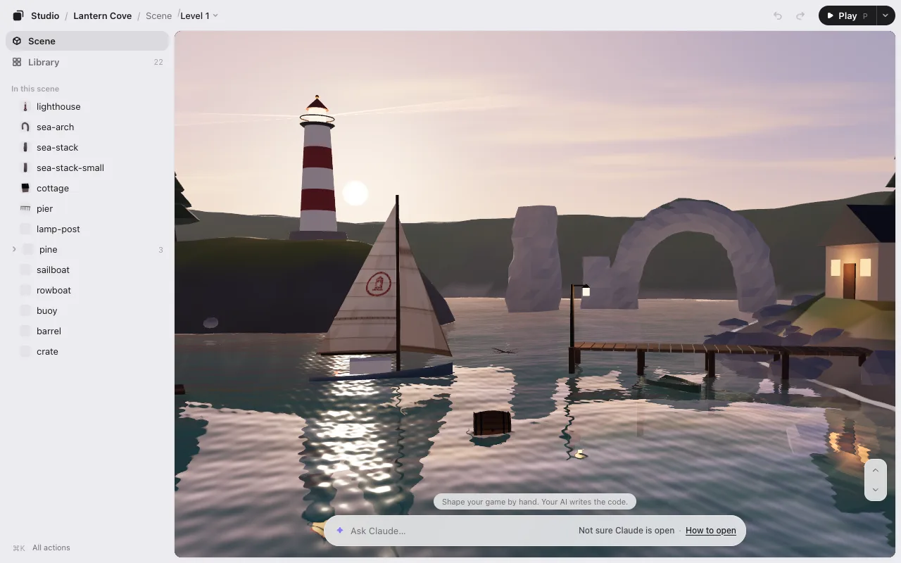

# Getting started

Install Game Studio with one line, then open your game with `/arrange`. It takes about two minutes.

## What you need

- **Claude Code** (in the Claude app or a terminal) or **Codex**, running on your computer. Plugins don’t load in cloud sessions.
- **Node.js 22.13 or later.** To check, run `node --version` in a terminal. If it’s older, get the latest LTS from [nodejs.org](https://nodejs.org).
  **Please update Node.js to 22.23.4 or later (24.22.1 or later on Node 24).** These include the [October 2026 security fixes](https://nodejs.org/en/blog/vulnerability/october-2026-security-releases).

That’s all. Game Studio installs nothing else.

## Install with one line

Paste this into Claude Code or Codex:

```
Install KUMODeck Game Studio for me by following https://github.com/kumodeck/game-studio/blob/main/INSTALL.md
```

Your AI installs Game Studio and opens the editor. If your folder is empty, it starts you off with a sample game.

In Claude Code, it asks you one question: “Install new versions of Game Studio automatically when they come out?” Say yes and new versions arrive by themselves (they load in your next session). You can change your mind later. See [Updates](#updates).

### Or install it yourself

**Claude Code**, in a terminal:

```
claude plugin install game-studio --marketplace kumodeck/game-studio
```

Or inside Claude Code: `/plugin marketplace add kumodeck/game-studio`, then `/plugin install game-studio@game-studio`.

**Codex**, in a terminal:

```
codex plugin marketplace add kumodeck/game-studio && codex plugin add game-studio@game-studio
```

Or inside Codex: type `/plugins` and choose **KUMODeck Game Studio**. Start a new session afterwards.

## Open your game

Open your AI in your game’s folder (the one with `index.html`) and type:

| Claude Code | Codex |
|---|---|
| `/arrange` | `$arrange`, or just ask: “open the arrange editor” |

You can also say what you want in your own words, like “I want to fix where the trees are.” Your AI checks how the game is built, starts the editor, and opens it.



Until you pick something, one line under the game says what the editor is for: **Shape your game by hand. Your AI writes the code.** It goes away with your first pick, and doesn’t come back for that game.

### No game yet?

Open your AI in an **empty folder** and type `/arrange`. It asks one thing: “Want to start from a sample? Pick 3D or 2D.” It copies a small sample game into the folder and opens it. Then try three things:

1. Click anything and drag it.
2. Type a change in the box at the bottom, like “add 3 more like this,” and press Enter.
3. Click **Save**.

The samples already read your layout when they start, so what you saved is in the game right away.

## The editor’s link

The editor runs on your computer, at an address like `http://127.0.0.1:…`. Your AI puts the link on the first line of its reply, every time.

- It opens in your usual browser (Chrome or another) by itself: in a terminal, in Codex and in the Claude app alike.
- In the Claude app, want it in the pane next to the chat? Tell your AI “open it in the app.” It remembers that for this game. Can’t see it? Press <kbd>⌘</kbd><kbd>⇧</kbd><kbd>B</kbd> (<kbd>Ctrl</kbd><kbd>Shift</kbd><kbd>B</kbd> on Windows). The pane is narrow: everything at the bottom is one sheet that shows one thing at a time (see [the side window and phones](editing.md#the-side-window-and-phones)), and **Open large** (↗, top right) opens the same editor in a big window.
- Where no browser can open (over SSH, for one), open the link from the first line of the reply in your browser.

The link has a pass in it (the part after `?t=`), so it only works on your computer. Don’t share it. Lost it? Ask your AI for the link again. More in the [FAQ](faq.md#the-editors-link).

## Updates

**Claude Code:** if you said yes during the install, updates come by themselves. To turn them on or off later, type `/plugin`, then go to **Marketplaces → game-studio → Enable auto-update** (or **Disable auto-update**). To update now:

```
claude plugin update game-studio@game-studio
```

**Codex** doesn’t update plugins by itself. To update:

```
codex plugin marketplace upgrade game-studio
```

## Uninstall

**Claude Code:**

```
claude plugin uninstall game-studio@game-studio && claude plugin marketplace remove game-studio
```

**Codex:**

```
codex plugin remove game-studio@game-studio && codex plugin marketplace remove game-studio
```

Your game folder keeps what the editor wrote (`placement.json`, `library.json` and the `.studio` folder). Delete them if you like.

Next: [Editing](editing.md).
