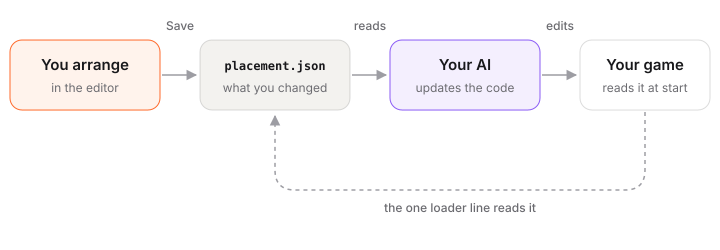

# How it works

Game Studio never edits your game’s code. It writes down what you changed, and your AI puts it in the code. Here’s how that works.



## placement.json

When you save, the editor writes `placement.json` in your game folder. It lists only what you changed:

```json
{
  "version": 1,
  "tool": "placement",
  "dim": "3d",
  "objects": {
    "tree-01": { "p": [3.25, 0, -4.1], "r": 1.5708, "s": 1.2,
                 "was": { "p": [2.0, 0, -4.1], "r": 0, "s": 1 } }
  }
}
```

- Each object goes by its name in the game (`tree-01`).
- `p` is where it is, `r` is how far it’s turned, `s` is its size.
- `was` is where it was before you changed it. Your AI looks for those numbers in the code to find the right line.
- Duplicates you made are in `added`, deleted objects in `removed`. The loader shows them right away (a look-alike duplicate, the deleted one hidden), and your AI puts them in the code so a duplicate acts like the original.
- Motions, levels and UI are in the same file. The full shape is in [CONTRACT.md](../../../../CONTRACT.md).

**`library.json`** does the same for files: the ones you swapped (`replace`), added (`added`), and the ones nothing uses (`unused`). The editor never deletes a file. If you press Delete on one, your AI asks you first.

## Two ways into the game

**1. The loader (the usual way).** The first time you save, your AI adds a small file, `studio-placement.js`, and one line that reads `placement.json` when the game starts:

```js
await applyPlacement(scene, './placement.json');
```

From then on, every Save shows up in the game without changing the code again. If `placement.json` isn’t there, the line does nothing. The samples already have it.

**2. Numbers in the code.** Prefer no extra file? Tell your AI “write the numbers into the code.” It finds each `was` in the code and puts the new numbers there instead, and keeps doing that for this game. Godot games always work this way.

## The .studio folder

The editor and your AI keep their notes in `.studio/` in your game folder:

| File | What it is |
|---|---|
| `adapter.js` | How the editor talks to your game, for engines other than three.js. Your AI writes it. |
| `tools.js`, `studio.json` | What you asked for to fit the editor to your game: a grid, 90° turns, locked ground. |
| `ui/` | How the editor looks, if you changed it. |
| `requests/` | Each Save and each thing you asked your AI. |
| `chat/` | Your talks with your AI while paused. |
| `play/` | Pictures sent while playing (the newest 24). |

## How the editor sees your game

The editor opens your game inside it and adds a small edit script to each page. The script only wakes up inside the editor. Outside it, your game runs exactly as before. three.js games work right away. For Phaser, PixiJS, plain canvas, HTML games or a Godot web export, your AI writes a small adapter from the examples that come with Game Studio, and the editor checks that it works.

## What stays on your computer

- The editor runs on your computer, at `127.0.0.1`. Nobody else can open it.
- It only reads and writes inside your game folder: `placement.json`, `library.json`, new files in `assets/`, and notes in `.studio/`.
- It sends nothing anywhere. No tracking, no account.
- The one exception is [Make with AI](make-with-ai.md): when you press **Make**, your description goes to KUMODeck to make the file.

Next: [FAQ and troubleshooting](faq.md).
