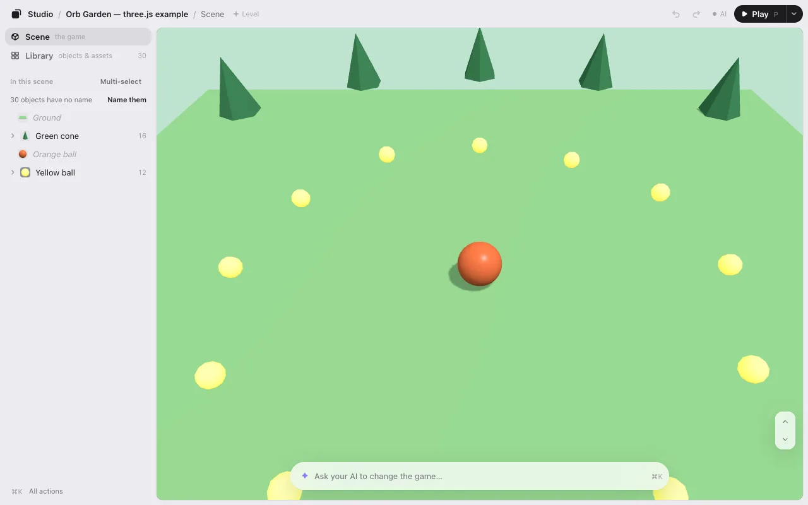

# Levels

The level you’re on is the last part of the path at the top of the editor: **Studio / Three Isles / Scene / Meadow ⌄**, that is the game, the scene and the level. Switch between levels, make a new one, duplicate one, rename them and put them in order.

## Switch levels

Press the level’s name in the path at the top (**Meadow ⌄**) to open the levels menu, and pick another. The game opens on that level. Hover over the name to see where it is in the list, like “Level 1 of 3.”

With a keyboard, <kbd>]</kbd> goes to the next level and <kbd>[</kbd> to the one before. The menu shows these keys next to those levels, and **All actions** (<kbd>⌘K</kbd>) lists **Levels…**, **Previous level** and **Next level**.

Each level keeps its own layout, its own motions and its own undo. A move you made on one level still counts on **Save · N** while you’re on another.

## Make, rename, reorder

The menu has:

- **New level**: a blank level, named “Level 4” (the next number). The ground, the sky and the lights stay; everything placed on them is gone. It opens right away. Things your game moves by itself, or brings in later, are hidden too while you look at this level. When you save, your AI builds the empty level in the code.
- **Duplicate**: a copy of the level you’re on, named “Meadow 2.” It opens right away.
- **Rename…**: type the new name in place. <kbd>Enter</kbd> keeps it, <kbd>Esc</kbd> cancels.
- **Move up** and **Move down**: change the order.
- **Delete level**: you go to the level next to it. If the level is in your game’s code, your AI asks you once before it takes it out.
After **New level** or **Duplicate**, one line at the top says “Level 4 made. ⌘Z to undo.” Changed your mind? Press <kbd>⌘</kbd><kbd>Z</kbd> (on a phone, **Undo** on that line). To make the new level different, change things by hand, or tell your AI in the box at the bottom what it should be.

Each of these counts as one change on **Save · N**. When you save, your AI adds the new levels, names and order to the game.

## Play a level

**▶ Play** plays the level on screen, so you can test the one you’re working on. While you play, the path shows the level’s name without the ⌄: switch levels after you go back to editing.

## Add levels to a game without them

A game without levels has one: the path at the top says **Studio / Neon Orb / Scene / Level 1 ⌄**. Press **Level 1 ⌄** to open its menu. Nothing happens until you choose:

- **New level**: what’s on screen becomes Level 1, and a blank Level 2 opens right away (the ground, the sky and the lights stay).
- **Duplicate**: what’s on screen becomes Level 1, and Level 2 opens right away as a copy of it.

A line at the top says “Level 2 made. ⌘Z to undo.” When you save, your AI adds the few lines that let your game switch levels. Until then your game outside the editor plays Level 1, as before.

On a phone there’s no room for **Level 1 ⌄** at the top: open **…** (All actions) and choose **Levels…**.

## No levels showing?

The editor needs your game to tell it which levels it has. Press **Level 1 ⌄** and make Level 2, or ask your AI: “show my levels in Game Studio.” It adds a few lines where your game picks its level.

Next: [UI editing](ui.md).
