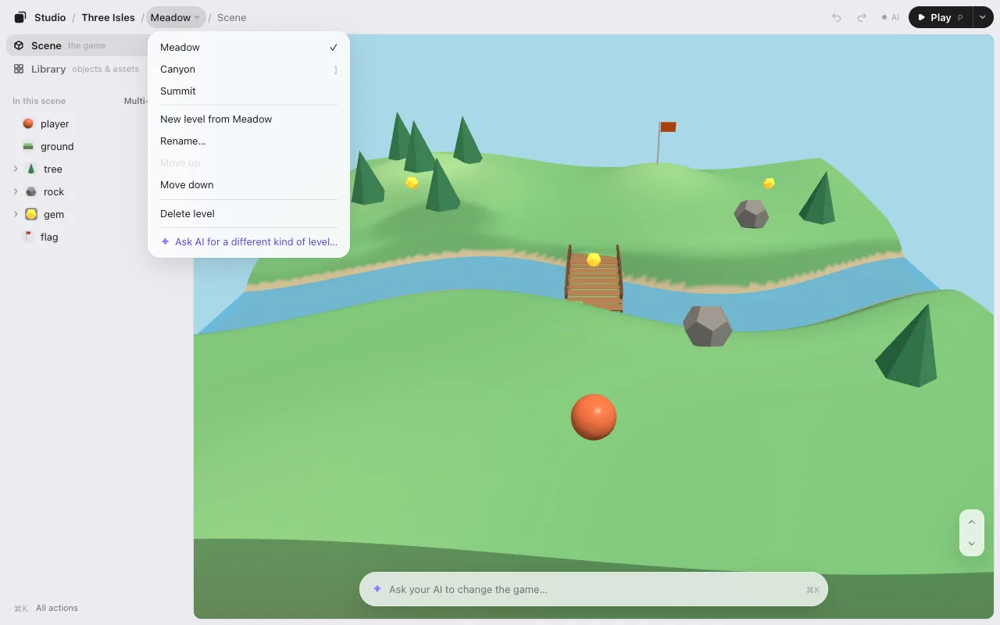

# Levels

If your game has levels, the editor shows them at the top of the Scene list. Switch between them, copy one to start a new level, rename them and put them in order.

## Switch levels

At the top of the list, where it usually says **In this scene**, you see the level you’re on and where it is, like **Meadow ⌄ 1 of 3**. Press it to open the levels menu and pick another. The game opens on that level.

Each level keeps its own layout, its own motions and its own undo. A move you made on one level still counts on **Save · N** while you’re on another.

## Make, rename, reorder

The menu has:

- **New level from Meadow**: a copy of the level you’re on, named “Meadow 2.” It opens right away.
- **Rename…**: type the new name in place. <kbd>Enter</kbd> keeps it, <kbd>Esc</kbd> cancels.
- **Move up** and **Move down**: change the order.
- **Delete level**: you go to the level next to it. If the level is in your game’s code, your AI asks you once before it takes it out.

Each of these counts as one change on **Save · N**. When you save, your AI adds the new levels, names and order to the game.

## Play a level

**▶ Play** plays the level on screen, so you can test the one you’re working on.

## No levels showing?

The editor needs your game to tell it which levels it has. Ask your AI: “show my levels in Game Studio.” It adds a few lines where your game picks its level. A game with one level shows no menu.

Next: [UI editing](ui.md).
