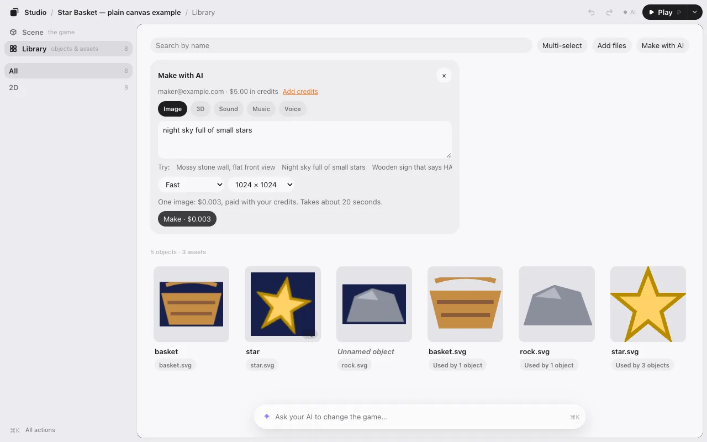
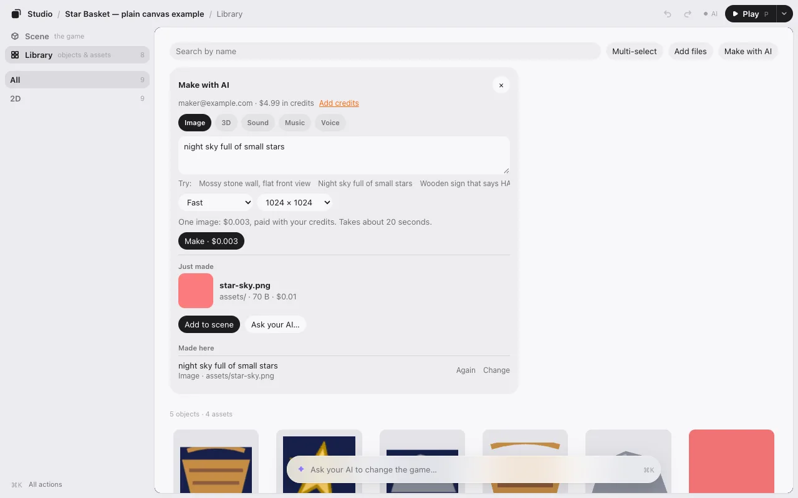
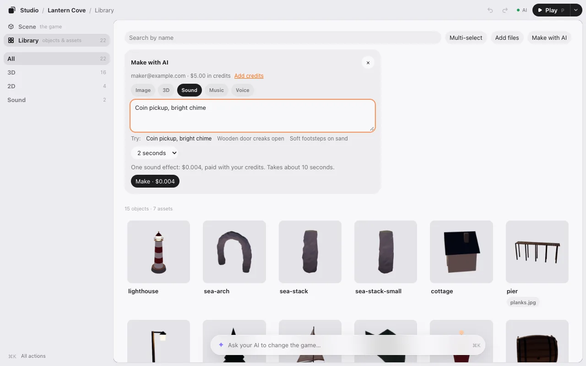

# Make with AI

Need a picture, a 3D model or a sound? Make it right in the Library. This is optional: it needs a KUMODeck account and costs credits. Everything else in Game Studio is free and works without an account.

## What you can make

| Kind | What you get | Usually takes |
|---|---|---|
| **Image** | A picture: fast, fine detail, or a seamless tile. 512, 1024 or 2048 px. | About 20 s |
| **3D** | A model, with colors or shape only. | About 3 min |
| **Sound** | A sound effect, 1, 2 or 5 s. | About 10 s |
| **Music** | A piece, 15, 30 or 60 s, and it can loop. | Up to a minute |
| **Voice** | A line spoken in one of five voices. | About 10 s |

## Sign in with KUMODeck

1. Open the **Library** and press **Make with AI** (on a phone, it’s under **+**).
2. The first time, it asks you to sign in. Run this in a terminal, click **Allow** in the browser, then come back:

```
npx kumodeck login
```

3. Press **I’ve signed in**.

Your sign-in stays on your computer. The editor never shows it to the page or your game.

## Make something



1. Choose the kind, then describe it under **What to make**. There are examples to start from.
2. Choose the options. The price is on the button: **Make · $0.004**.
3. Press **Make**. Nothing is sent, and nothing costs anything, until you do.

The first time, it asks you to agree to the AI part of the KUMODeck terms: you choose what to make, you don’t pass off what you make as made by a person or as a real photo, and the cost comes out of your credits.

Each result is a new file in your game’s `assets` folder. Nothing is overwritten. Press **Add to scene** to put it in the game, or ask your AI to use it.



**Made here** keeps what you made. **Again** and **Change** put the same words and choices back in the form.



## Prices

You pay what the AI provider charges, with no markup, in US dollars from your KUMODeck credits.

| Kind | Price |
|---|---|
| Image, fast | $0.003 per megapixel (1024 × 1024 is 1) |
| Image, fine detail | $0.03, plus $0.015 per extra megapixel |
| Image, seamless tile | $0.02 per megapixel |
| 3D model | $0.20 with colors, $0.10 shape only |
| Sound effect | $0.002 per second |
| Music | $0.0376 a piece |
| Voice | $0.05 per 1,000 characters |

Not enough credits? The form says how much it needs and how much you have, and **Add credits** takes you there.

Next: [How it works](how-it-works.md).
