# Motion

Make a boat sail, a door open, a coin spin. You set where a thing is at a few moments in time, and the editor fills in the movement between them. Motion works in 3D games.

## Start from the tool strip

The quickest way: select something in the game, then press **Motion** at the right end of the tool strip under it (or press <kbd>A</kbd>).

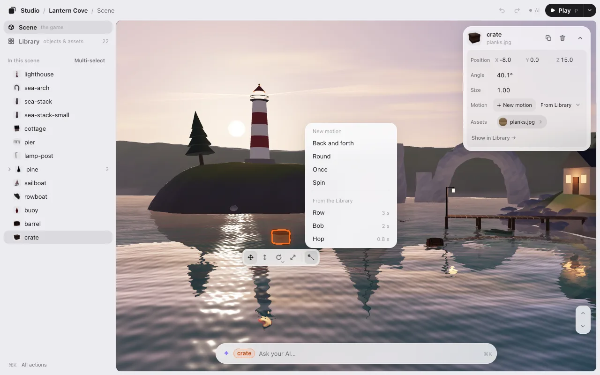

There are two ways in, and no list of ready-made kinds: you make a motion by showing it.

- **Make a motion**: where the thing stands now is the start (0 s). The timeline opens small at the bottom and one line says **Drag it to where it should move (Esc to cancel)**. Drag it there and let go: that is where it is at 1 s, and the motion plays right away to show you. That one drag is one change (**Save · 1**) and one <kbd>⌘</kbd><kbd>Z</kbd> takes it all back.
- Keep going: each time you move, turn or resize it again, a point is added one second after the last, and that second plays. **Done** (or <kbd>Esc</kbd>) stops adding. <kbd>⌘</kbd><kbd>Z</kbd> takes one step back at a time.
- **Use a saved motion**: choose one you already made (only when the Library has some).

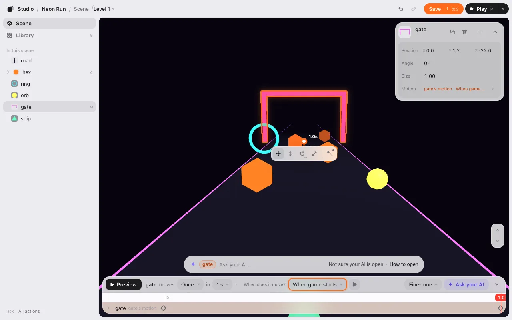

After **Done**, the timeline’s top line is where you change how it repeats and when it moves:

**▶ Preview** · Repeat **[Once ▾]** · When does it move? **[When game starts ▾]**

- **Repeat** is **Once**, **Loop** or **Back and forth**.
- **When does it move?** is [when it starts](#when-it-starts).
- **How long** it takes is where its last point is on the timeline: the seconds are on the ruler, and only there. Drag the last point right to make it longer, left to make it shorter (the ruler has a little shaded room past the end for that).

The Library’s **+ Make a motion** does the same. Once something has a motion, its card shows one line with the motion’s name, like **Motion  ship’s motion ›**; press it to open the motion on the timeline, where the top line says when it plays. A thing with no motion has no such line: the strip’s Motion button is the way in. To change the timing of one point, drag it along the ruler.

Once something has a motion, the button shows a small dot, and pressing it opens that motion on the timeline.

## Remove or delete a motion

Right-click the **Motion** line on the card, or press the **⋯** at its right end.
- **Remove from this object**: only this object stops moving; the motion stays in the Library (and on other objects).
- **Delete motion** (red): the motion is gone from the Library and from every object. If other objects have it, one line asks first (**It also comes off 2 other objects**). Both are undone with <kbd>⌘</kbd><kbd>Z</kbd>. The <kbd>Delete</kbd> key still deletes the selected object, never its motion.

## The timeline

Select something with a motion, then press its **Motion** line on the card or the Motion button on the strip (or find **Timeline** in <kbd>⌘</kbd><kbd>K</kbd>). The timeline opens at the bottom of the game (above the card on a phone).

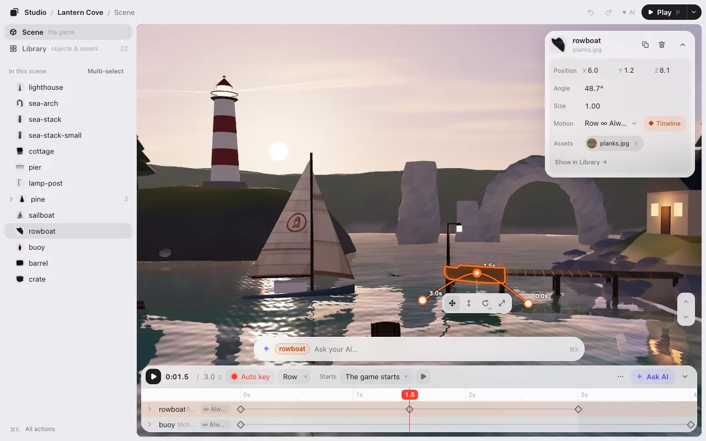

Its top is one line: **▶ Preview** (or <kbd>Space</kbd>), **Repeat** (*[Once ▾]*), **When does it move?**, then **Fine-tune**, **✦ Ask Claude** (your AI’s name) and **⌄** to fold it. Nothing on it is ever cut short, at any width (a narrow one takes two rows: ▶ is its icon there). Under it is always the timeline itself: the ruler, the rows and their points. The motion’s name is at the left of its row, next to the object’s.

- The **ruler** is time. Drag on it to see that moment; the red line shows it in seconds. The motion lasts up to its last point; the ruler is shaded after that. <kbd>←</kbd> <kbd>→</kbd> move 0.1 s (<kbd>Shift</kbd> for 1 s).
- The rows are the **selected object** (with several selected, each of them), and the objects you [link](#linking-several-things-in-one-motion) to it. Open a row to see **Position**, **Angle** and **Size** on their own rows.
- **Fine-tune** opens the finer settings beside the rows, in the timeline itself: **● Rec motion**, **Motion** (which of this object’s motions, **+ Make a motion**, **Rename**, **Take it off this object**), **Loop & End**, **Trigger** (other ways to start), **Try**, and **Moving objects** (**+ Link an object** and **Show all moving objects**: every moving object’s row; **Show only the selected one** goes back). Once you open it, the timeline opens with it open next time too; press **Fine-tune** again to close it.

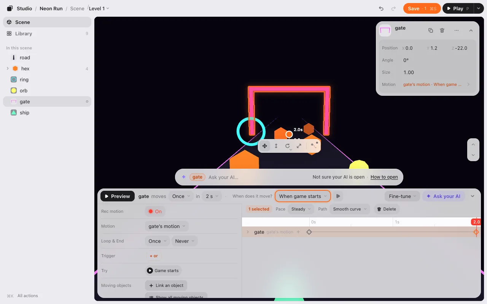

## Points

A **point** says “at this time, be here.”

1. Move the time line to a moment, like 2 s.
2. Move, turn or resize the object.

With **● Rec motion** on (it is, to start; it is in **Fine-tune**), that adds a point at the time line. The first one also adds a point at 0 s, where the object started. Press <kbd>K</kbd> to add a point without moving anything.

To change points, click them (<kbd>Shift</kbd> or <kbd>⌘</kbd> adds more, or drag a box):

- Drag them along the ruler to change their time.
- <kbd>Delete</kbd> (or **Delete** on the picked points’ row) removes them. <kbd>⌘</kbd><kbd>C</kbd> and <kbd>⌘</kbd><kbd>V</kbd> copy them to the time line.
- Every change is one undo step.

**● Rec motion** off, or the timeline folded: moving the object moves its whole motion with it.

## The path

In 3D, the object’s way through its position points is drawn in the scene, with a dot for each point and a dashed line down to the ground. Drag a dot to move that point across the ground. <kbd>Shift</kbd>-drag moves it up and down.

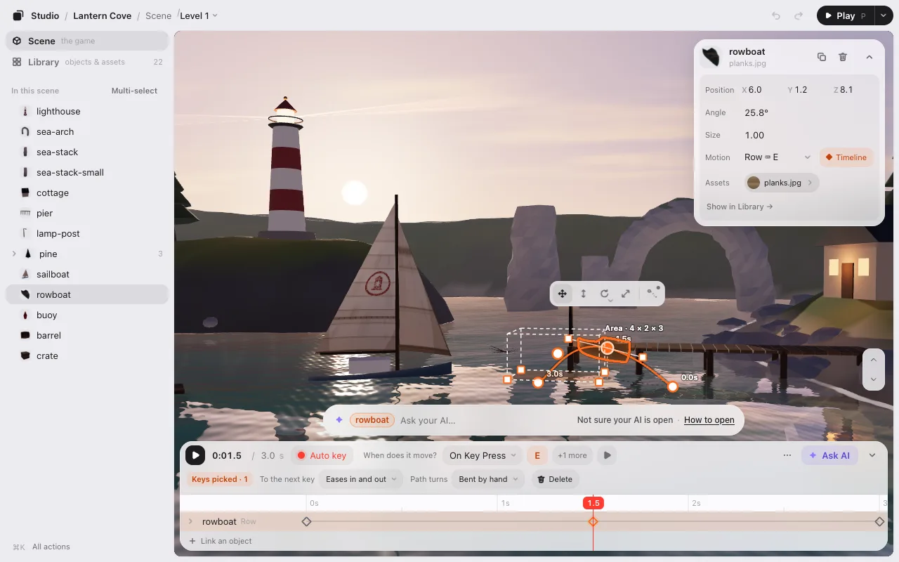

- **Bend the path.** Select a point (on the timeline or its dot) and two **handles** show. Drag one to bend the path there; the other one follows. <kbd>Alt</kbd>-drag moves only one, for a sharp turn.
- **Make a corner.** Double-click a dot (or choose **Path → Sharp corner** on the picked points’ row). The path comes straight in and goes straight out. Double-click again for a smooth point.
- **Add a point on the path.** Point at the line: a **+** follows it with the time. Click to add a point at that moment, without changing the path’s shape.

## How points flow into each other

Select points and a **1 selected** row shows under the top line. **Pace** chooses how they go on to the next one:

- **Smooth (slow start & stop)**: starts slow, ends slow. The default.
- **Steady**: the same speed all the way.
- **Hold, then jump**: stays put, then jumps to the next point.

The same row has **Path** (with position points picked: **Smooth curve** or **Sharp corner**) and **Delete**.

**Repeat [Once ▾]** in the top line (also under **Loop & End** in **Fine-tune**) sets what happens at the end: **Once**, **Loop**, or **Back and forth**.

## When it starts

**When does it move?**, on the timeline’s top line, chooses when a motion begins. The **▶** next to it tries that moment. Right after a motion is attached or made, this menu has an orange ring: it is the next thing to decide.

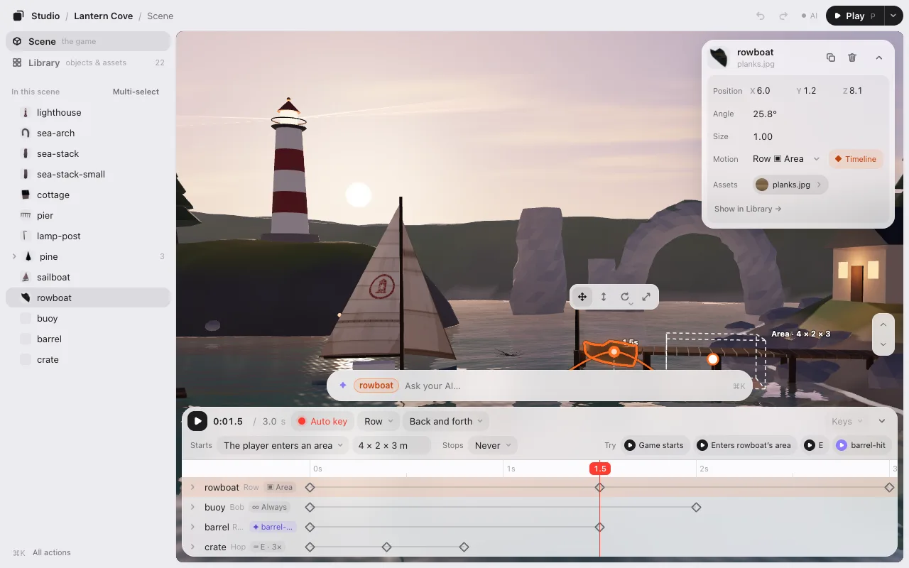

Under **Trigger**:

- **When game starts**: from the moment the game starts.
- **When tapped**: when the player touches or clicks this.
- **When player gets near**: when the player comes within a distance. A box shows in the scene. Drag its white point to place it (<kbd>Shift</kbd>-drag for up and down). Drag a corner to resize it from the opposite corner (<kbd>Shift</kbd>-drag for its height).
- **When key pressed**: when a key or an on-screen button is pressed.
- **After delay**: a number of seconds after the game starts.
- **After last motion**: when another motion ends (only when there is another one).

Under **Ask Claude to set up** (your AI’s name):

- **Custom…**: the chat box at the bottom opens with this motion in it. Say when, like “when it is hit, turn red and blow up,” and your AI writes the rule into the game’s code. The menu then says **Custom**. A motion your AI already set up shows it, like **When it bumps into something (AI)** or **When signaled (AI)**.

In **Fine-tune**, **Trigger**’s **+ Another trigger** adds another way to start, like “a key is pressed **or** this is clicked.” Any one of them starts it. **×** removes one. The top line then says **+1 more**.

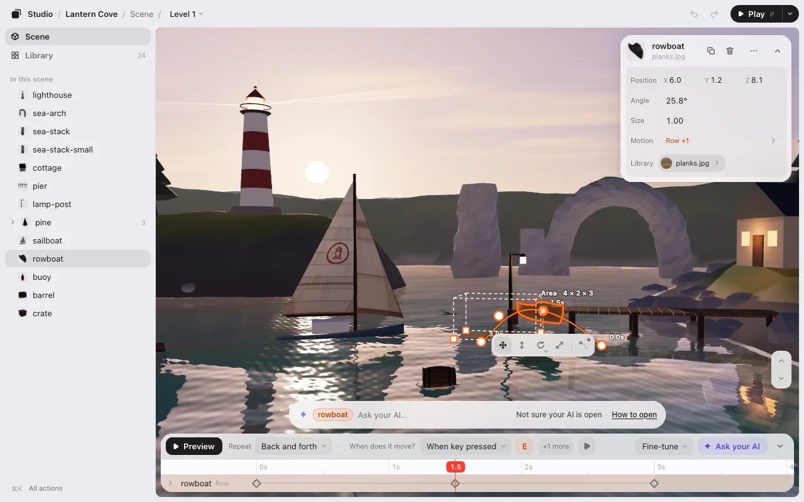

For a motion set to **Loop** or **Back and forth**, **Stops** (in **Fine-tune**, under **Loop & End**) chooses when it ends (a motion that plays **Once** ends by itself, so it has no Stops): **Never**, **After some rounds**, or **When signaled**. Then it **Stays there** or **Goes back**.

## Try it

The **▶** next to **When does it move?** runs the scene as if this motion’s start just happened. Press it again to stop. (On a phone it is in **Fine-tune** only.)

**Try** in **Fine-tune** shows one ▶ for each way a motion can start in this scene, like “Game starts” or “Click boat.” Press one to run the scene as if that just happened. **Stop** ends it.

## Linking: several things in one motion

The timeline shows the selected object only. When a motion should move other things too, like a short cutscene (the crate hops, the buoy dips, the barrel rolls off the pier), link them to it.

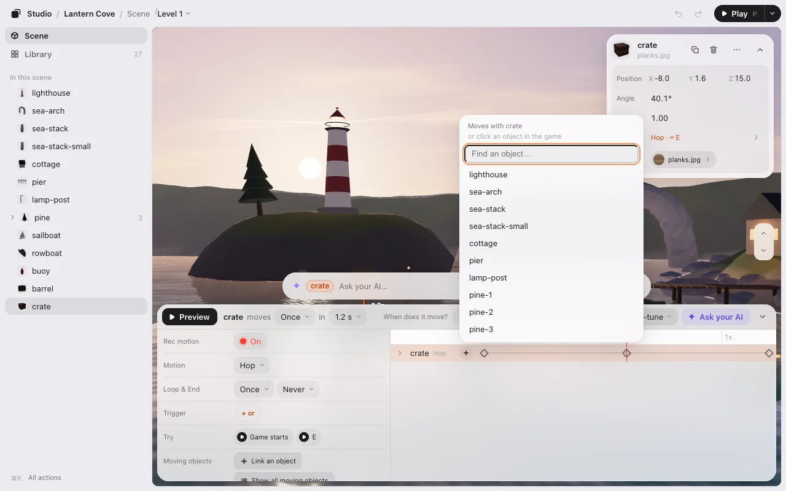

1. Open **Fine-tune** and press **+ Link an object** under **Moving objects** (or the **+** that shows at the right end of the selected object’s row while Fine-tune is open).
2. Choose one from the list (type to find it by name), or click it in the game while the list is open. The selected object stays selected.
3. It gets a row of its own on the same time line. Move it with **● Rec motion** on to add its points. The rows’ top-left corner says **Linked · 2**.

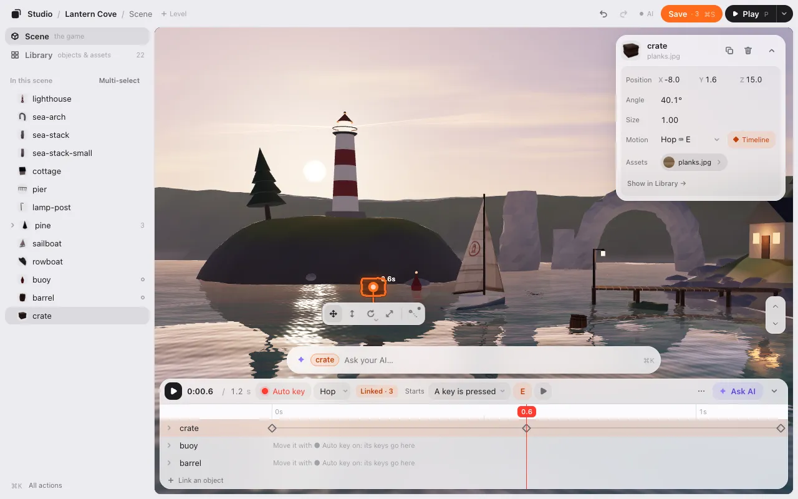

**When does it move?** and **Stops** are shared: all of them start together. Selecting a linked object shows the same rows in the same order (its row lights up). Drag the **⠿** at a row’s left to change the order (saved with the motion). **×** on a linked row unlinks it (its own motions stay). Unlink the last one and the motion is the selected object’s alone again.

You can also drop a linked motion from the Library onto an object to link it.

## The motion Library

Every motion is in the Library, under **Motion**. Each tile draws the path and plays it when you point at it.

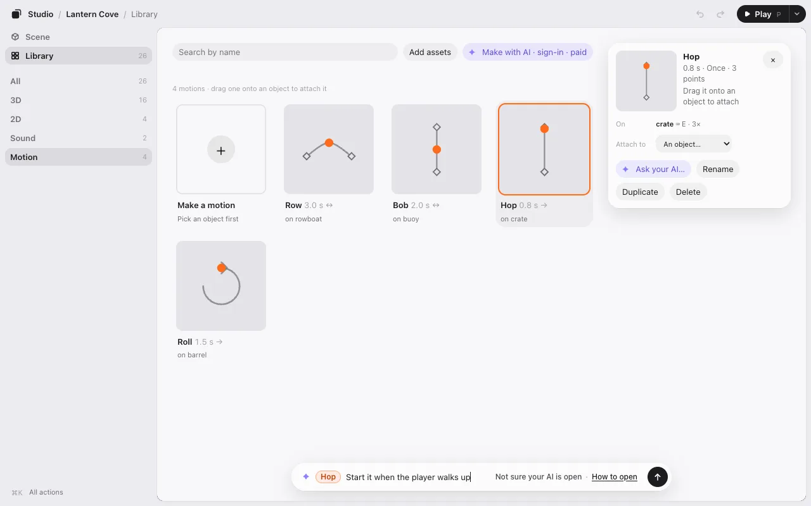

- **Attach to…** puts the same motion on another object. Change its points once and every object that uses it changes.
- **Duplicate** makes a copy to change on its own.
- **Ask your AI…** puts the motion in the box at the bottom, so you can ask for something like “make it bob more.”

## Ask your AI for a motion

You don’t have to add points yourself. Two ways to use your AI:

- **Use a motion you made.** Press **✦ Ask Claude** on the timeline (or a right-click on the object, or the motion in the Library). The chat box at the bottom gets a chip with both names, like **crate · Hop**, and the cursor. Say what you want: “start it when the player walks up,” then “a bit slower.” Your AI connects that moment in the game’s code.

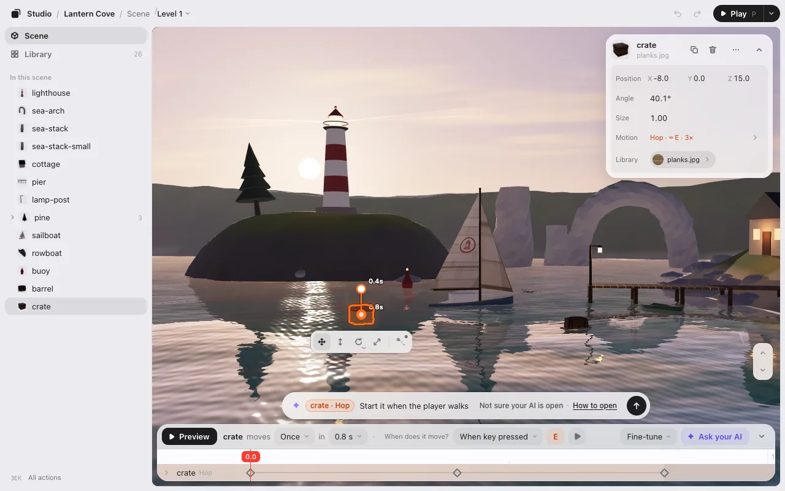
- **Describe it.** Select something and ask in the box at the bottom: “make the boat rock gently,” “spin the pillar in a spiral.” A motion of places (from here to there, a hop) your AI makes from points, on the timeline like yours. A motion said by numbers (a spiral, a wave, round and round) or one that follows the game (chasing the player) it writes as a **code motion**: the motion’s shape is in the game’s code, and it is on the timeline under its name, with no points. It plays in **▶ Play** and in the game, and <kbd>⌘</kbd><kbd>Z</kbd> takes it off. To change its shape, ask your AI again.
- **Lay things out.** “Ten street lamps along the road, 6 m apart”: your AI writes the row in the game’s code and shows it in the editor at once. The list shows the lamps under the row’s name (**Street lamps 1**, **2** …). Ask “a bit closer together” and the row changes on screen (one <kbd>⌘</kbd><kbd>Z</kbd> takes it back, and it counts on **Save**). Places to keep clear (“not on the road”, “not near the player”) work the same way.

## In the game

Motions are saved in `placement.json` with the rest of your layout. When the game starts, the line that reads your layout plays them too. In **▶ Play**, you see them as they’ll be in the game.

Next: [Levels](levels.md).
