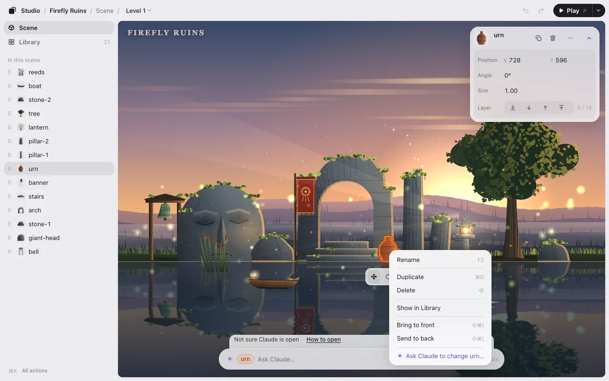

# Phaser, PixiJS, canvas and Godot web games

three.js games open in the editor right away. For a 2D game, your AI first writes a small adapter: a file that tells the editor where your game keeps its objects. It starts from the examples that come with Game Studio, and the editor checks that it works. Then you select, drag, turn and resize things as in a three.js game.

## Engines

| Your game | Your AI starts from | Sample games |
|---|---|---|
| Phaser 3 or 4 | `phaser.js` | [phaser-garden](../../../../examples/phaser-garden/), [phaser-runner](../../../../examples/phaser-runner/), [phaser-v3-hop](../../../../examples/phaser-v3-hop/) |
| PixiJS v8 | `pixi.js` | [pixi-garden](../../../../examples/pixi-garden/), [pixi-bubbles](../../../../examples/pixi-bubbles/), and the 2D starter Firefly Ruins |
| Plain canvas (`getContext('2d')`, p5.js, a small engine of your own) | `canvas.js` | [canvas-stars](../../../../examples/canvas-stars/) |
| HTML elements (DOM) | `dom.js` | [dom-board](../../../../examples/dom-board/) |
| Godot 4, exported for the web (2D) | `godot/` | [godot-garden](../../../../examples/godot-garden/) |

The examples are in [`skills/arrange/adapters/`](../../../../skills/arrange/adapters/).

## How to start

Open your AI in the game’s folder and type `/arrange` (Codex: `$arrange`). Your AI looks at how the game is built, writes the adapter to `.studio/adapter.js`, and opens the editor. You can also ask for it: “write the Game Studio adapter for this game.”

The adapter is in your game folder, not in your game: your game runs exactly as before outside the editor.

## Godot web exports

A Godot web export runs as WebAssembly, so the adapter has two halves: a small GDScript autoload in your Godot project, and a JavaScript file in the export folder. Your AI asks you before adding the autoload. After that, export for the web again.

When you click **Save**, your AI writes the new positions into your scenes (`.tscn` files) and exports for the web again (or tells you what to export, when Godot isn’t on this computer). Only 2D scenes (`Node2D`) work for now.

## What works in 2D

- Select, move, turn and resize, select several, undo. Bring to front and send to back from the right-click menu. See [Editing](editing.md).
- The Library: every image and sound your game uses, and which object shows which image. See [The Library](editing.md#the-library).
- **Play**, and asking your AI while you play: it gets a picture of that moment and what’s on screen.
- **Save**: `placement.json`, or numbers in your code if you ask. See [How it works](how-it-works.md).

Motion with the timeline works in 3D games only.

## Not supported yet

Babylon.js, PlayCanvas, Unity WebGL and Godot 3D scenes. Your AI tells you so instead of opening an editor that shows nothing.

Using three.js? See [A level editor for three.js games](threejs-level-editor.md).
