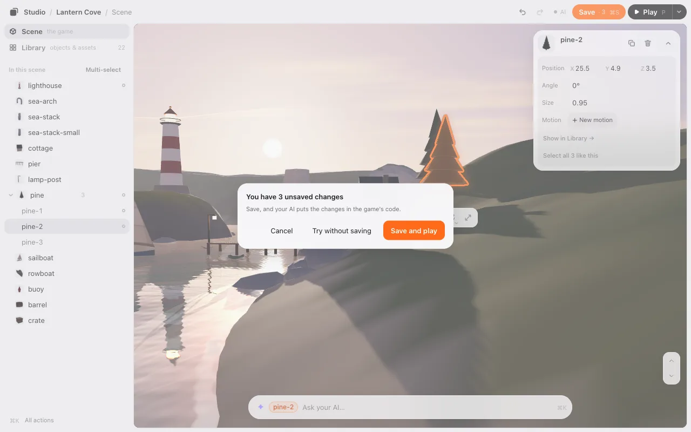
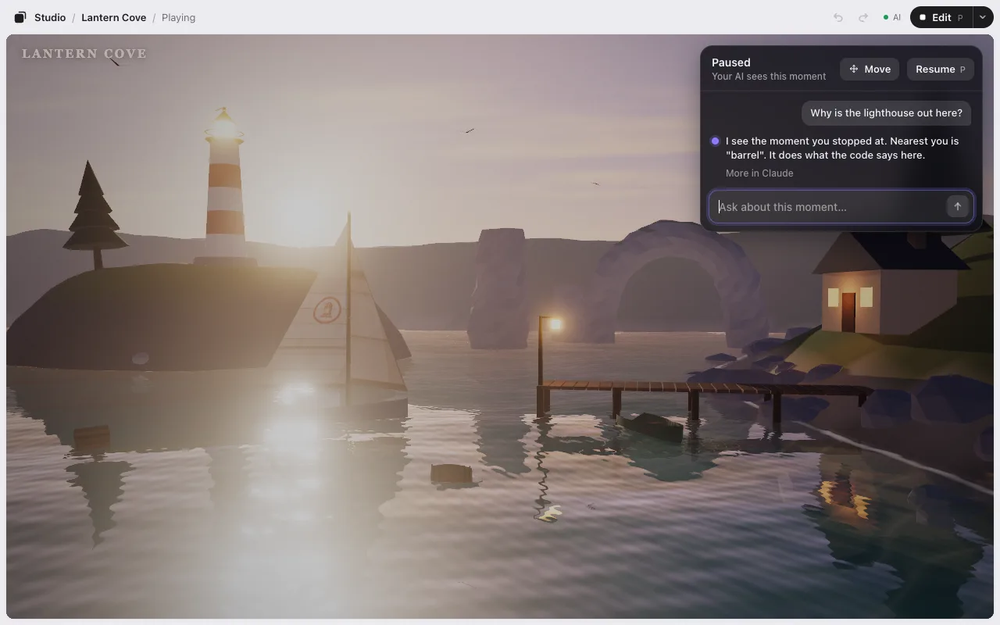

# Play

Press **▶ Play** to play your game right where you’re editing it. Press **Edit** to go back. It’s the same page, so nothing reloads.

## Play and Edit

- **▶ Play** (or <kbd>P</kbd>) plays the game as you arranged it, saved or not. The top bar says **Playing**.
- **Edit** in the top bar takes you back to the scene you were editing, not to the moment you stopped playing. Everything is where it was before you pressed Play: your layout, your camera, what you selected, the timeline and its time, the level. Anything the game moved while you played (the hero, an enemy) goes back too, and in a 3D game so does what it added or took away (a bullet, a coin you picked up). Play again and the game gets those back.
- Your [motions](motion.md) play too, whatever starts them: the start, a time, a key, a click, an area, or a cue from your game’s code. Back in Edit they stop, and everything is back in its place. Still the same page.
- The game’s own state, like the score or a timer, isn’t part of your layout. To start that over, use **Play from the start** in Play’s ▾ menu (or <kbd>⌘</kbd><kbd>K</kbd>). It opens the game fresh.

### Changes you haven’t saved

If you press Play with changes that aren’t saved, the editor asks first:

- **Save and play** (<kbd>Enter</kbd>) saves, so your AI puts the changes in the game’s code, then plays.
- **Try without saving** plays with your changes. They’re still there when you come back to Edit, and **Save · 3** stays.
- **Cancel** (or <kbd>Esc</kbd>) stays in Edit.

Going back from Play to Edit never asks.

A game with an older copy of the loader (`studio-placement.js`) plays in the same page too: in the editor it runs with the editor’s own loader. The file in your game isn’t changed, so outside the editor (a published game) your game still uses its copy. Before you publish a game with motions, ask your AI to copy the new loader into it.

## Pause and talk to your AI

Something odd happens? Press <kbd>P</kbd> or the **❚❚** button. While you play, <kbd>P</kbd> only pauses and resumes, wherever you last clicked; it never takes you back to Edit (that’s the **Edit** button). The game stops right there: its clock, its timers, its sound, everything. A chat opens beside it.

Ask about what you see: why it happened, how it works, what to change. Your AI sees the moment you paused: a picture of the game, where your camera was, what was near you, and any errors. Send as many messages as you like.

To go on, press <kbd>P</kbd>, <kbd>Esc</kbd> or **Resume**. The game goes on from the exact frame it stopped on.

On a phone or in a narrow window, **❚❚** is in the top bar and the chat opens at the bottom.

## Move things where you paused

While paused, press **Move** (or <kbd>M</kbd>). Now you can select and drag things at that moment, with the same tools as in Edit. The camera stays the player’s. Resume, and the game goes on from there.

A thing you move this way is **Only in this play**: it’s gone the next time the game opens. To keep it:

- **Save new position** makes it the object’s place, just like a move in Edit. It counts on **Save · N**.
- **Revert** returns it to where it was at the pause.

Some things can’t stay: if the game moves something itself, the move is **Just for this moment**.

Press **Chat** (or <kbd>Esc</kbd> with nothing selected) to go back to the chat.

> **Edit vs Move.** Pressing **Edit** while paused takes you back to your layout, not to the paused moment. To change things at that moment, use **Move**.

## Ask while you play

You don’t have to stop. Press <kbd>`</kbd> (the key left of 1; <kbd>Shift</kbd><kbd>@</kbd> on a Japanese keyboard) or the small ✦ mark in the corner, type what’s wrong, and press <kbd>Enter</kbd>. The game keeps running, even full screen.

Your AI gets your words with that moment. A small line at the top says what it’s doing: **Your AI is looking**, **Fixing it**, then its reply. The game never reloads under you. When you want the fix, press **Reload** (or <kbd>`</kbd> then <kbd>Enter</kbd>). Or keep playing.

If your AI asks you something, the answers show up as buttons right there. For the whole story, the line says **More in Claude** (or Codex): the full reply is in your AI’s window.

Next: [Motion](motion.md).
