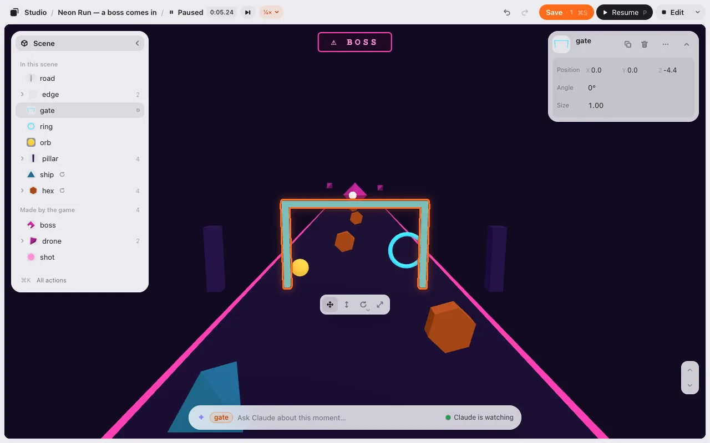
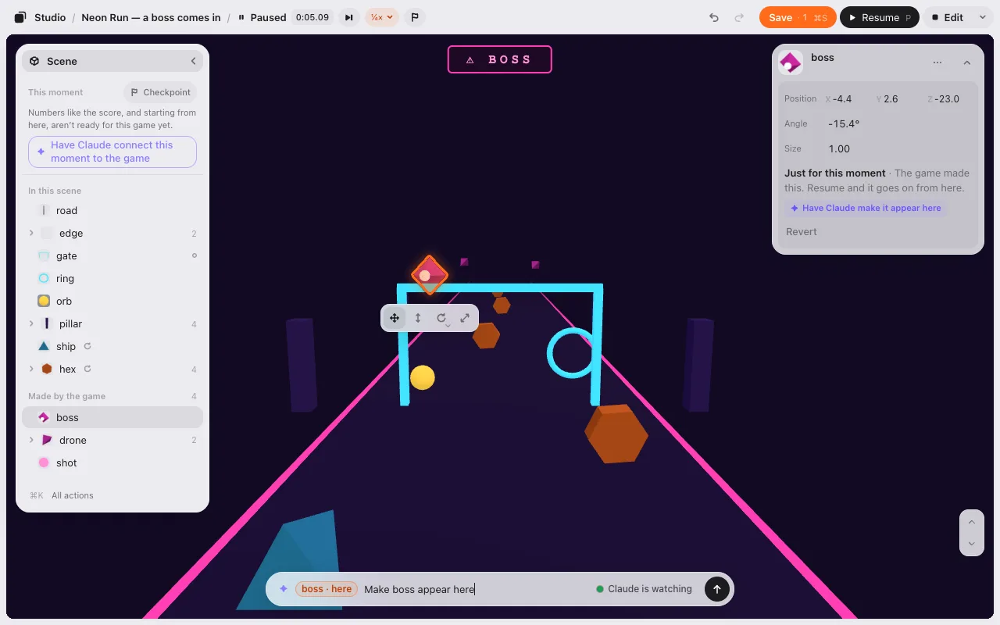
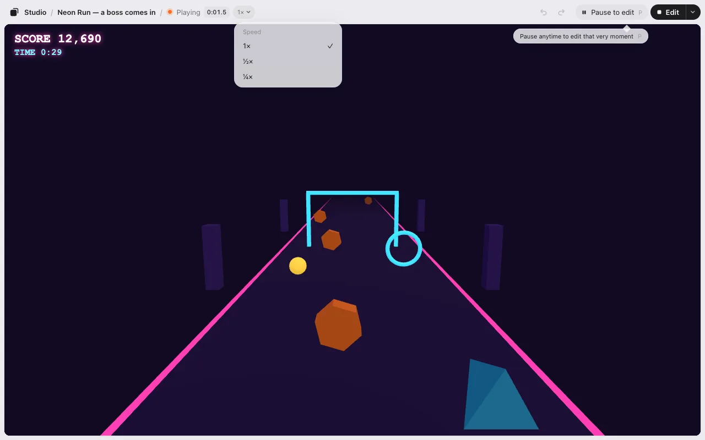

# Play

Press **▶ Play** to play your game right where you’re editing it. Press **Edit** to go back. It’s the same page, so nothing reloads.

## Play and Edit

- **▶ Play** (or <kbd>P</kbd>) plays the game as you arranged it, saved or not. The top bar says **Playing**.
- **Edit** in the top bar takes you back to the scene you were editing, not to the moment you stopped playing. Everything is where it was before you pressed Play: your layout, your camera, what you selected, the timeline and its time, the level. Anything the game moved while you played (the hero, an enemy) goes back too, and in a 3D game so does what it added or took away (a bullet, a coin you picked up). Play again and the game gets those back.
- Your [motions](motion.md) play too, whatever starts them: the start, a time, a key, a click, an area, or a cue from your game’s code. Back in Edit they stop, and everything is back in its place. Still the same page.
- The game’s own state, like the score or a timer, isn’t part of your layout. To start that over, use **Play from the start** in Play’s ▾ menu (or <kbd>⌘</kbd><kbd>K</kbd>). It opens the game fresh.

### Changes you haven’t saved

If you press Play with changes that aren’t saved, the editor asks first:

- **Save and play** (<kbd>Enter</kbd>) saves, then plays. The line over the ask box says what was saved and when it’s in the game ([Save](editing.md#save)).
- **Try without saving** plays with your changes. They’re still there when you come back to Edit, and **Save · 3** stays.
- **Cancel** (or <kbd>Esc</kbd>) stays in Edit.

Going back from Play to Edit never asks.

A game with an older copy of the loader (`studio-placement.js`) plays in the same page too: in the editor it runs with the editor’s own loader. The file in your game isn’t changed, so outside the editor (a published game) your game still uses its copy. Before you publish a game with motions, ask your AI to copy the new loader into it.

## Pause to edit

Press <kbd>P</kbd> or **❚❚ Pause to edit** in the top bar, next to **Edit**. It’s in the same place on every screen. The first time you play, one line under it says what it does. The game stops on that exact frame: its clock, its timers, its sound, everything. And that moment becomes the editor.

You get the same tools as in Edit, on the frame you stopped on: the list (it floats over the game, so the picture doesn’t move; **‹** folds it), the card, the strip under what you select, the ask box at the bottom, Undo / Redo and Save. The game’s own score, timer and banners stay on screen as they were (you can’t press them). The top bar says **❚❚ Paused 0:42.30**: the game’s time since you pressed Play, to a hundredth of a second so each frame shows. While you play it says **● Playing 0:41.8**.

### What you placed, and what the game made

- **Things you placed** (a gate, a pillar, a platform) move just like in Edit. The move is in your scene: it counts on **Save · N**, the list shows its dot, <kbd>⌘</kbd><kbd>Z</kbd> undoes it, and it’s still there when you go back to Edit.
- **Things the game moves or made** (the player, an enemy, a boss, a bullet) say **Just for this moment** on their card. Move one and the game goes on from there when you resume, but it’s not part of your scene. **Revert** puts it back where it was when you paused. In the list, what the game moves has a small **↻**, and what the game made is listed apart under **Made by the game**, with how many on the right (the same name is one row: **drone** with **2**; **▸** opens it). These have no Copy or Delete: the game’s code still has them. To change them for good, ask your AI.

To change where the game makes something, drag it to where it should appear and press **✦ Have Claude make it appear here** on its card. The ask box gets **Make boss appear here** with the chip **boss · here**. Send it, and Claude changes the game’s code. Its reply shows over the ask box with **Reload**: press it to leave the paused moment and play the game again with the change (your **Save · N** stays). The boss comes in where you put it. If you resume instead, **Reload** is on the line over the game.

### Ask about this moment

The ask box says **Ask Claude about this moment…** (your AI’s name, if it isn’t Claude). Your AI sees the moment you paused: a picture of the game, where your camera was, what was near you, and any errors. Ask why it happened, how it works, or what to change. Send as many messages as you like; **▴ Earlier · 2** shows what you said before in this pause.

### Slow it down, one frame at a time

- **Speed** (**1× ⌄** in the top bar) plays at **1×**, **½×** or **¼×**. Set it before the boss comes and the moment is easy to catch. Every game slows the same way, because Studio holds the game’s clock. Sound is off while it’s slow. The next ▶ Play starts at 1× again.
- **▶| Next frame** (or <kbd>.</kbd>) steps one frame while paused: the time moves by 0:00.01 or 0:00.02. Hold it down to go on at the speed you chose. The first time you pause, a small label under **▶|** says **Next frame .**

### The ways out of a paused moment

| | ▶ Resume (<kbd>P</kbd>) | Edit | Play from the start (<kbd>⌘</kbd><kbd>K</kbd>) |
|---|---|---|---|
| Things you placed and moved | where you moved them | where you moved them (in your scene, **Save · 1**) | where you moved them |
| Things the game moves or made | the game goes on from where you put them | not there: your scene before Play | not there yet |
| Score, time left | as they were | — | the game’s own start |

**▶ Resume** goes on from the exact frame you stopped on. **Edit** goes back to your scene, not to the paused moment (that’s what **❚❚ Pause to edit** is for); while paused it’s the quieter button. Back in Edit, your AI’s reply about the moment is gone from over the ask box. <kbd>Esc</kbd> doesn’t resume: like in Edit, it clears what you selected.

**▶ Play** from Edit goes on with the same game (the score and the boss go on), and so does the time in the top bar. **Play from the start** and **Reload** start again at **0:00**.

On a phone or in a narrow window, the top bar shows the time, the speed, **❚❚** and **Edit**; paused, **▶ Resume**. The list opens as a sheet from the bottom. Select something the game moves or made and one line over the ask box says **Just for this moment** (after you move what the game made: **✦ Have Claude make it appear here**). In full screen, **❚❚** is in the game’s corner (the top bar isn’t visible): pressing it leaves full screen and opens the paused moment.

The web demo pauses too, with **Neon Run**, where a boss comes in. There’s no AI there, so there’s no ask box and no ✦.

## Ask while you play

You don’t have to stop. Press <kbd>`</kbd> (the key left of 1; <kbd>Shift</kbd><kbd>@</kbd> on a Japanese keyboard), type what’s wrong, and press <kbd>Enter</kbd>. The game keeps running, even full screen. It’s a key only (on a phone, **✦** in the top bar); <kbd>?</kbd> lists it as **Ask Claude without pausing**.

Your AI gets your words with that moment. A small line at the top says what it’s doing: **Your AI is looking**, **Fixing it**, then its reply. The game never reloads under you. When you want the fix, press **Reload** (or <kbd>`</kbd> then <kbd>Enter</kbd>). Or keep playing.

If your AI asks you something, the answers show up as buttons right there. For the whole story, the line says **More in Claude** (or Codex): the full reply is in your AI’s window.

Next: [Motion](motion.md).
