# Play

Press **▶ Play** to play your game right where you’re editing it. Press **Edit** (or <kbd>Esc</kbd>) to go back. It’s the same page, so nothing reloads.

## Play and Edit

- **▶ Play** (or <kbd>P</kbd>) plays the game as you arranged it, saved or not. The top bar says **Playing**.
- **Edit** in the top bar takes you back to the scene you were editing, not to the moment you stopped playing. Everything is where it was before you pressed Play: your layout, your camera, what you selected, the timeline and its time, the level. Anything the game moved while you played (the hero, an enemy) goes back too, and in a 3D game so does what it added or took away (a bullet, a coin you picked up). Play again and the game gets those back.
- Your [motions](motion.md) play too, whatever starts them: the start, a time, a key, a click, an area, or a cue from your game’s code. Back in Edit they stop, and everything is back in its place. Still the same page.
- The game’s own state, like the score or a timer, isn’t part of your layout. To start that over, use **Play from the start** in Play’s ▾ menu (or <kbd>⌘</kbd><kbd>K</kbd>). It opens the game fresh.

### Changes you haven’t saved

If you press Play with changes that aren’t saved, the editor asks first:

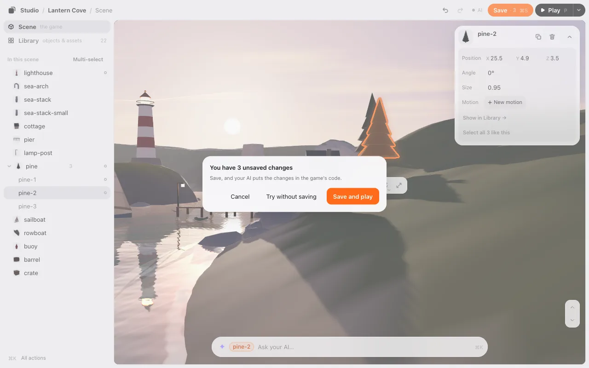

- **Save and play** (<kbd>Enter</kbd>) saves, then plays. The line over the ask box says what was saved and when it’s in the game ([Save](editing.md#save)).
- **Try without saving** plays with your changes. They’re still there when you come back to Edit, and **Save · 3** stays.
- **Cancel** (or <kbd>Esc</kbd>) stays in Edit.

Going back from Play to Edit never asks. If your game uses <kbd>Esc</kbd> itself (its own menu, say), <kbd>Esc</kbd> stays the game’s and one line says **Esc is the game’s · ■ Edit to stop**.

A game with an older copy of the loader (`studio-placement.js`) plays in the same page too: in the editor it runs with the editor’s own loader. The file in your game isn’t changed, so outside the editor (a published game) your game still uses its copy. Before you publish a game with motions, ask your AI to copy the new loader into it.

## Pause to edit

Press <kbd>P</kbd> or **❚❚ Pause to edit** in the top bar, next to **Edit**. It’s in the same place on every screen. The first time you play, one line under it says what it does. The game stops on that exact frame: its clock, its timers, its sound, everything. And that moment becomes the editor.

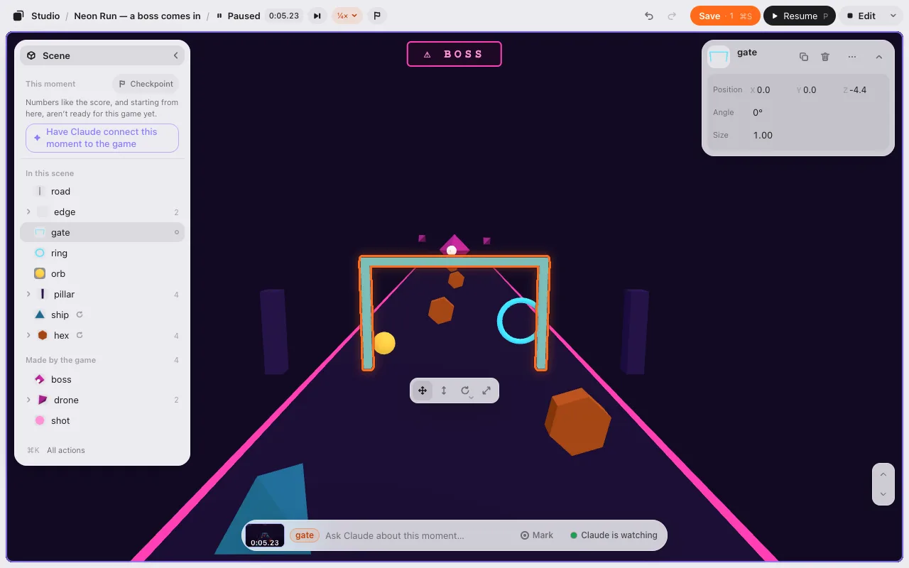

You get the same tools as in Edit, on the frame you stopped on: the list (it floats over the game, so the picture doesn’t move; **‹** folds it), the card, the strip under what you select, the ask box at the bottom, Undo / Redo and Save. The game’s own score, timer and banners stay on screen as they were (you can’t press them). The top bar says **❚❚ Paused 0:42.30**: the game’s time since you pressed Play, to a hundredth of a second so each frame shows. While you play it says **● Playing 0:41.8**.

### What you placed, and what the game made

- **Things you placed** (a gate, a pillar, a platform) move just like in Edit. The move is in your scene: it counts on **Save · N**, the list shows its dot, <kbd>⌘</kbd><kbd>Z</kbd> undoes it, and it’s still there when you go back to Edit.
- **Things the game moves or made** (the player, an enemy, a boss, a bullet) say **Just for this moment** on their card. Move one and the game goes on from there when you resume, but it’s not part of your scene. **Revert** puts it back where it was when you paused. In the list, what the game moves has a small **↻**, and what the game made is listed apart under **Made by the game**, with how many on the right (the same name is one row: **drone** with **2**; **▸** opens it). These have no Copy or Delete: the game’s code still has them. To change them for good, ask your AI.

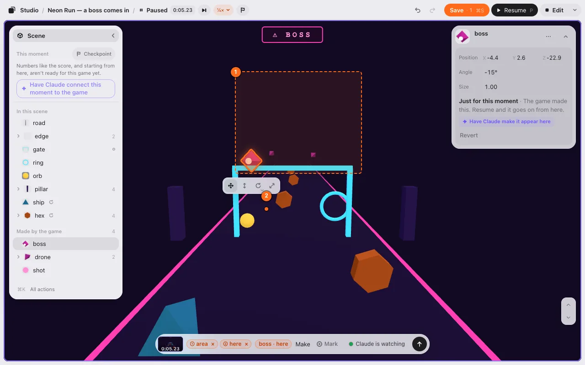

To change where the game makes something, drag it to where it should appear and press **✦ Have Claude make it appear here** on its card. The ask box gets **Make boss appear here** with the chip **boss · here**. Send it, and Claude changes the game’s code. Its reply shows over the ask box with **▶ Try from 0:05.02**: press it to see the change from the same moment (see [Try the fix from the same moment](#try-the-fix-from-the-same-moment)). Your **Save · N** stays. If you resume instead, **Reload** is on the line over the game.

### This moment

At the top of the list, **This moment** shows your game’s own numbers on the frame you stopped on: the score, the time left, your health, whatever your game counts. **⚑ Checkpoint** at its right keeps the moment (see [Checkpoints](#checkpoints)). Change one the way you change a number on a card: drag left or right, or click it and type. The game draws that same frame again with the new number, and its time doesn’t move. Set **Time left** to 5 and resume, and you see the end of the run five seconds later.

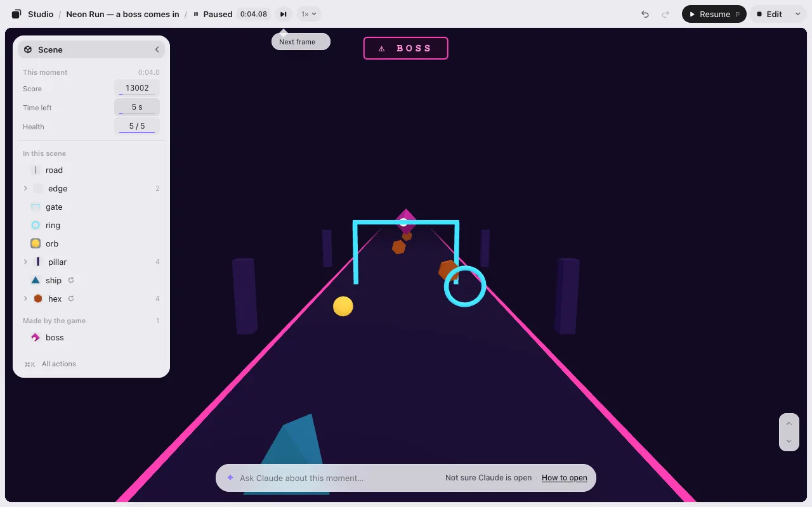

- **Just for this moment.** It isn’t part of your scene: it doesn’t count on **Save · N** and isn’t written anywhere. <kbd>⌘</kbd><kbd>Z</kbd> undoes it while you’re paused. Resume, and the game goes on from the new number. To change how the game starts (90 seconds instead of 30), ask your AI.
- **Ask for it too.** “Give me 5 seconds left” in the ask box: your AI sets it in This moment for you, and <kbd>⌘</kbd><kbd>Z</kbd> undoes it.
- A number in gray is one you can see but not change here.

Your AI connects the moment to your game once: these numbers and the checkpoints, in one go. Until it does, the list starts with a quiet **✦ More with Claude ›**. Open it to see **Numbers like the score, and starting from here, aren’t ready for this game yet.** and press **✦ Have Claude connect this moment to the game**: the ask box gets **Show this moment’s numbers and let the game start from here** with the chip **This moment**. Send it. When Claude is done, press **▶ Try from …** on its reply. Claude also connects it by itself the first time it fixes something you asked about from a paused moment. In the web demo, **Neon Run** already has them; a game there without numbers shows no **This moment**.

### Ask about this moment

When you pause, the cursor is already in the ask box at the bottom, so you can just type. The box says **Ask Claude about this moment…** (your AI’s name, if it isn’t Claude). At its left is a small picture of the frame you stopped on, with its time, like **0:05.02**: that picture goes to your AI with your words. A thin violet line around the game shows you’re in a paused moment (Edit has no line).

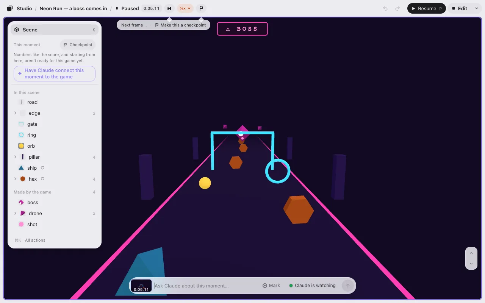

Your AI sees the moment you paused: that picture of the game, where your camera was, what was near you, and any errors. Ask why it happened, how it works, or what to change. Send as many messages as you like; **▴ Earlier · 2** shows what you said before in this pause.

Changed your mind? Press <kbd>P</kbd> right away and the game goes on: until you type a letter or click the ask box, <kbd>P</kbd>, <kbd>.</kbd>, <kbd>N</kbd> and <kbd>Esc</kbd> still work as keys. Once you type, they’re letters; press <kbd>Esc</kbd> or click the game, and they work again. On a phone, the keyboard doesn’t open by itself: tap the ask box when you want to type. A narrow box says just **Ask Claude…**.

#### Point at the frame

To say “here,” press **◎ Mark** in the ask box (or <kbd>N</kbd>). Click the game to mark a spot, or drag to circle an area. Each mark gets a number on the frame and a chip in the box, like **① here** and **② area**, so you can write “bring the boss in from ①.” Press **×** on a chip or <kbd>⌘</kbd><kbd>Z</kbd> to take a mark away; the others are numbered again. Press **◎ Mark** or <kbd>N</kbd> again (or <kbd>Esc</kbd>) to stop marking; sending your words stops it too. Once you send, the marks fold into **+ same mark**, so your next words go without them. Press it to send the same marks again (“a bit more to the left of ①”); a new mark starts again at ①. On a phone, **◎** shows its name until you’ve used it once.

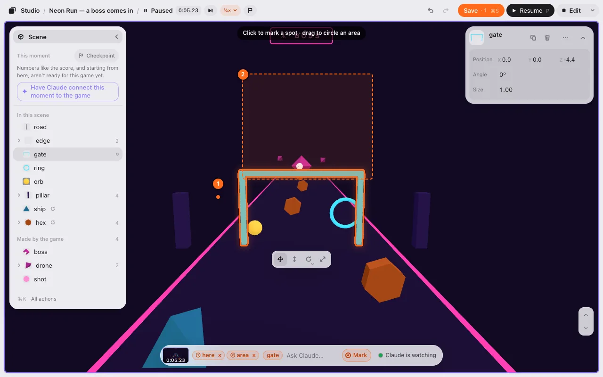

#### What your AI gets

Click the small picture in the ask box to see what goes with your words: the frame (and a copy with your marks drawn on), what you selected or marked, with what the game made first and the line of your game’s code that makes it, like **Made at** `game.js:121` (a mark on an empty spot says where it is, like **① a spot on the ground**), this moment’s numbers and any errors, and **Kept to replay from 0:05.02**: the editor keeps the moment you asked from, so you can try the fix from it. A game that can’t start mid-run yet says **Time only: 0:05.02**. <kbd>Esc</kbd> closes it. Your AI looks at both the picture and the code before it changes anything, opens the same moment with its change to check it, and replies in one line with what it did.

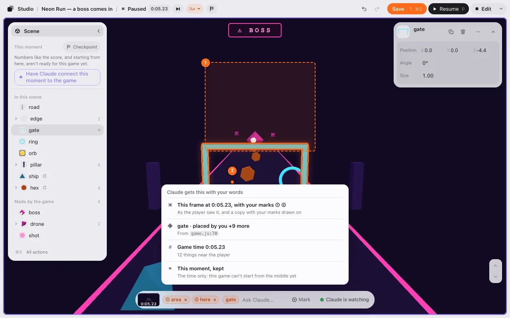

#### Try the fix from the same moment

When your AI changes the game, its reply is one line: what it did, and under it, small, the files it changed. Next to it:

- **▶ Try from 0:05.02** opens the game again with the new code, at the moment you asked from, and stays paused there. Your talk is still there (and your marks, behind **+ same mark**), so you can say “a bit more to the left” right away. The editor never reloads by itself: you choose when to try.
- **Before / After** puts the frame you asked from (with your marks) next to the same moment with the new code. If you haven’t tried it yet, it tries it first. **Keep · Resume** plays on from there; **Undo Claude’s change** puts the code back. On a phone, Undo gets its own row under the other two.
- **↶ Undo** puts the game’s files back to before your AI’s change, right away, and you stay in the paused moment. Press **▶ Try from …** to see it. It takes back the change of that reply only: after “a bit more to the left,” Undo goes back to the first fix, not to the game before both.

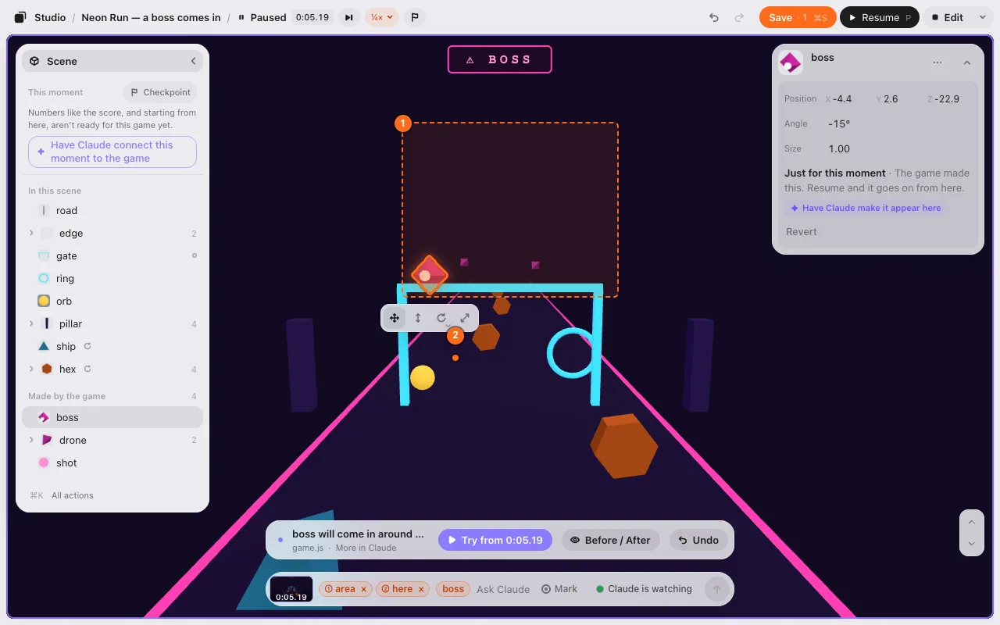

The same moment means the same state: the score, the time left and what the game made are as they were. So a change to where the game makes something (a boss already on screen) shows from the next one on, after you resume. **▶ Try** says so, like **Already out: boss, so your change shows from the next one.**, and so does **Before / After** under the After, with **▶ Resume to see it**. If your game can’t start from the middle yet, **▶ Try** plays the new code from the start and stops at the same time, and says **New code, played from the start to 0:05.02**. Your AI adds what’s needed to start from the middle along with its first fix from a paused moment, so the next try opens the very moment.

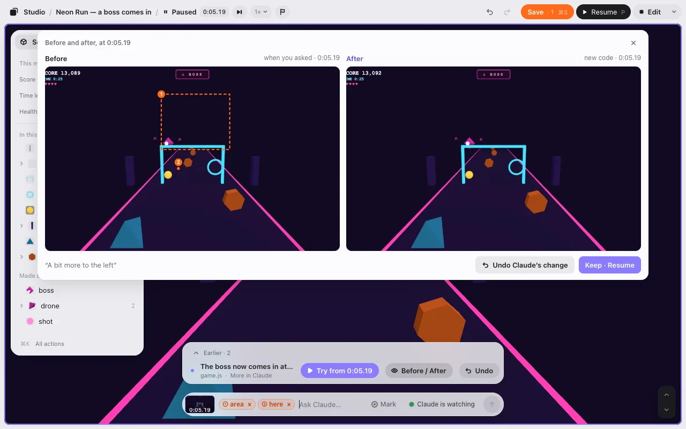

### Slow it down, one frame at a time

- **Speed** (**1× ⌄** in the top bar) plays at **1×**, **½×** or **¼×**. Set it before the boss comes and the moment is easy to catch. Every game slows the same way, because Studio holds the game’s clock. Sound is off while it’s slow. The next ▶ Play starts at 1× again.
- **▶| Next frame** (or <kbd>.</kbd>) steps one frame while paused: the time moves by 0:00.01 or 0:00.02. Hold it down to go on at the speed you chose. The first time you pause, a small label under **▶|** and **⚑** says **Next frame . · ⚑ Make this a checkpoint**.

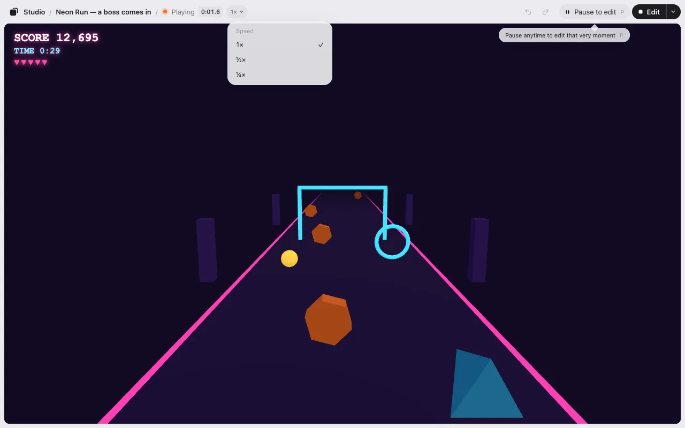

### Checkpoints

Paused just before the boss? Keep that moment, and next time start right there instead of playing back to it.

1. Press **⚑ Checkpoint** at the right of **This moment** (or **⚑** right of the speed in the top bar). A name field opens under it with the game’s time, like **0:04**. Type a name, like **Before the boss**, and press <kbd>Enter</kbd>. The ask box says **Checkpoint “Before the boss” kept**.
2. Change what you like: move things in Edit, or ask your AI to change the boss.
3. Open **▶ Play ⌄** and choose **⚑ Play from Before the boss** (it’s in <kbd>⌘</kbd><kbd>K</kbd> too). The game opens on that moment: the same score, time left, enemies and boss, and the time in the top bar goes on from there.

- **What you moved and set is kept too.** Moved the boss to the left lane and set **Time left** to 10 before keeping it? The checkpoint opens with the boss on the left and 10 seconds left. The field says so under the name.

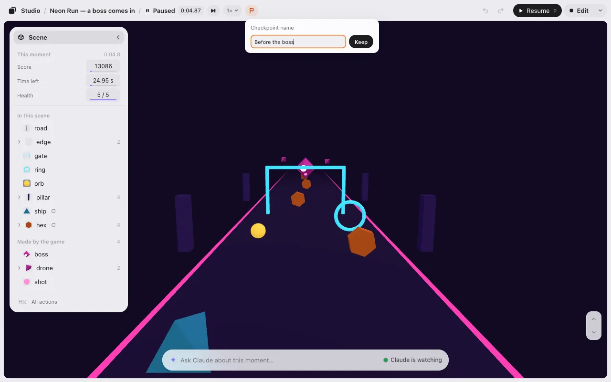

- **Your scene is always the current one.** A checkpoint keeps the game’s moment, not your layout: a gate you moved after keeping it stands where you moved it.
- **Rename or delete** with **⋯** on its row in **▶ Play ⌄**. **Play ⌄** lists the checkpoints of the level you’re on, newest first.
- **After your AI fixes something**, press **▶ Try from …** on its reply to see the fix at the moment you asked from, or choose **⚑ Play from Before the boss** in **▶ Play ⌄** to open the fixed game right at the boss.
- Checkpoints stay in the editor (in the game folder’s `.studio/checkpoints/`). They’re never part of your published game.

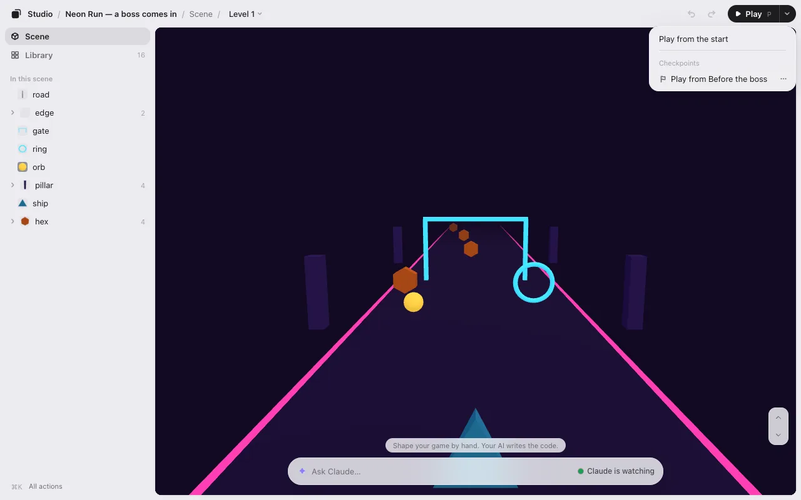

Your AI adds this to the game together with **This moment**. Until it does, **⚑** says **This game can’t start from the middle yet.** with the same **✦ Have Claude connect this moment to the game**: send it, and when Claude is done press **▶ Try from …** on its reply. The web demo keeps no checkpoints (**⚑** says so); your own Studio does.

If your game changes so much that a checkpoint can’t open, the game starts from the beginning instead and a line at the top says **The game changed, so this checkpoint can’t open**. Press **✦ Have Claude fix it**: the game pauses and the ask box gets the request. Claude makes the game read the old checkpoint again.

### The ways out of a paused moment

| | ▶ Resume (<kbd>P</kbd>) | Edit | Play from the start (<kbd>⌘</kbd><kbd>K</kbd>) |
|---|---|---|---|
| Things you placed and moved | where you moved them | where you moved them (in your scene, **Save · 1**) | where you moved them |
| Things the game moves or made | the game goes on from where you put them | not there: your scene before Play | not there yet |
| Score, time left | as they were (or as you set them in **This moment**) | — | the game’s own start |

**▶ Resume** goes on from the exact frame you stopped on. **Edit** goes back to your scene, not to the paused moment (that’s what **❚❚ Pause to edit** is for); while paused it’s the quieter button. Back in Edit, your AI’s reply about the moment is gone from over the ask box. <kbd>Esc</kbd> doesn’t resume: like in Edit, it clears what you selected.

**▶ Play** from Edit goes on with the same game (the score and the boss go on), and so does the time in the top bar. **Play from the start** and **Reload** start again at **0:00**.

On a phone or in a narrow window, the top bar shows the time, the speed, **❚❚** and **Edit**; paused, **▶ Resume**. The list opens as a sheet from the bottom, with **This moment** folded to one line (press it for the numbers) and **⚑ Checkpoint** at its right. Back in Edit, **⚑ Checkpoints · 1** at the top of the list opens your checkpoints (a phone has no **▶ Play ⌄**). Select something the game moves or made and one line over the ask box says **Just for this moment** (after you move what the game made: **✦ Have Claude make it appear here**). In full screen, **❚❚** is in the game’s corner (the top bar isn’t visible): pressing it leaves full screen and opens the paused moment.

The web demo pauses too, with **Neon Run**, where a boss comes in: set **Time left** to 5 in **This moment** and resume. The paused moment has the ask box with its picture, so you can see how asking works, but the demo isn’t connected to an AI: when you send, one line says **This demo isn’t connected to an AI. Open your game with Claude Code or Codex to ask.** and nothing is sent. There’s no ✦ there.

## Ask while you play

You don’t have to stop. Press <kbd>`</kbd> (the key left of 1; <kbd>Shift</kbd><kbd>@</kbd> on a Japanese keyboard), type what’s wrong, and press <kbd>Enter</kbd>. The game keeps running, even full screen. It’s a key only (on a phone, **✦** in the top bar); <kbd>?</kbd> lists it as **Ask Claude without pausing**.

Your AI gets your words with that moment. A small line at the top says what it’s doing: **Your AI is looking**, **Fixing it**, then its reply. The game never reloads under you. When you want the fix, press **Reload** (or <kbd>`</kbd> then <kbd>Enter</kbd>). Or keep playing.

If your AI asks you something, the answers show up as buttons right there. For the whole story, the line says **More in Claude** (or Codex): the full reply is in your AI’s window.

## Make a clip

Want to show what you made or fixed? Press **● Clip** in the top bar, right of Undo and Redo. The next 8 seconds of the game become a video you can post on X.

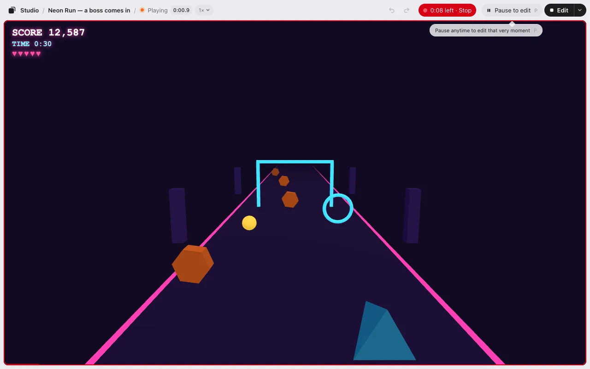

- While it records, the button is red and says the time left (**0:05 left · Stop**). On a phone, the round **●** shows the seconds left. A red frame goes round the game: only what’s inside it is in the video. Your game’s picture and its HTML (the score, the health bar) are in it. The editor, the address and your folder names aren’t.
- Press it again to stop early. The video ends one second after your press, even when the computer is busy. The button says **Ending…**, then **Saving…**.
- In Edit, **● Clip** starts Play first. A paused game goes on.
- **⌄** picks the shape (**Wide 1280×720**, or **Tall 720×1280** for a phone screen), the length (6, 8 or 12 seconds; a Before / After adds 2) and whether the last second says **Made with KUMODeck Game Studio**. It remembers what you pick. On a phone, there’s no **⌄**: hold **●** instead.
- **Tall** isn’t a crop. While it records, the editor gives your game a tall window, so a game that fits itself to its window lays out tall. On a phone, clips are Tall unless you pick Wide.

When it’s done, one line shows where it went and the post to go with it:

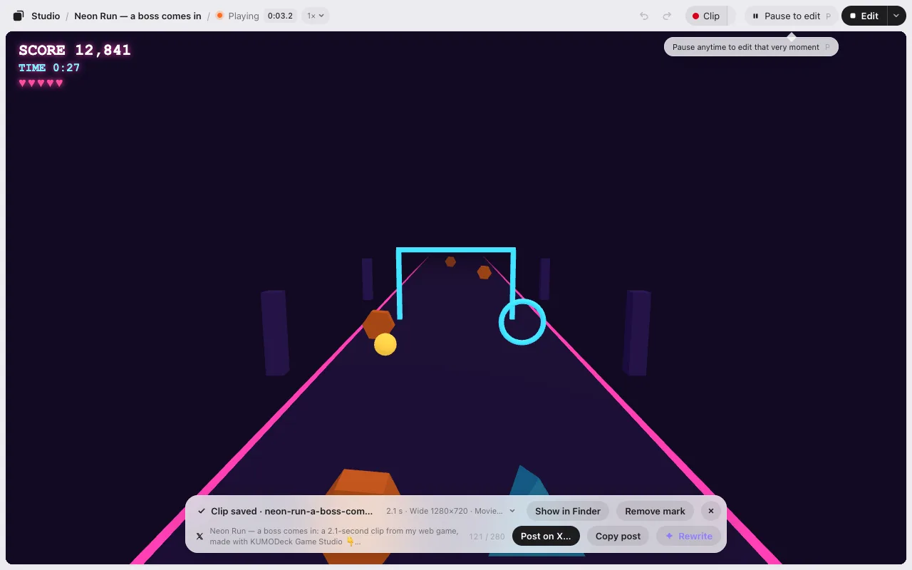

- **Saved to Movies › KUMODeck** (Windows and Linux: **Videos › KUMODeck**). Point at it to see the file’s name, like neon-run-clip-1.mp4. It’s never put in your game’s folder. **Show in Finder** opens it.
- The post under it is ready, in the editor’s language, with its length as X counts it (**102 / 280**). **Post on X…** opens X with the post written and shows the video in its folder: drag it in and post. **Copy post** copies the post if you’d rather paste it yourself.
- The length and shape (**8 s · Wide 1280×720 ⌄**) open the same choices as **⌄**, for your next clip.
- **✦ Rewrite** asks your AI for a better post. Its post replaces yours only if it fits X’s 280. You only see **✦ Rewrite** when an AI is connected.
- On a phone, **Share…** opens the phone’s share sheet with the video, so you can pick X there. A phone that can’t share videos shows **Save to this phone** instead.
- The last second of the video says **Made with KUMODeck Game Studio** and the address, small, in the corner, and so does the post. **Remove “Made with”** takes both off this clip, and new clips leave them off until you turn the mark back on in **⌄**.
- Nothing leaves your computer. The editor doesn’t post anything; you do.

It’s a 1280 × 720 MP4 (H.264) at 30 frames a second, with no sound. A few things don’t record yet: a game that draws with WebGPU, and a game that draws images from another site. Clip says so over the game, with **✦ Ask Claude**: it pauses the game and puts the request in the field (switch to WebGL, or move the images into the game’s folder). You send it. The HTML over your game is drawn the same way as the picture your AI gets: boxes, text and images, without shadows or gradients.

In the web demo, the video downloads instead (**Downloaded to your Downloads**).

### Clip a fix: Before / After

You paused, asked your AI for a fix, and it fixed the code ([Ask about this moment](#ask-about-this-moment)). Open **Before / After** on its reply. Once the After is there, press **● Clip Before / After**:

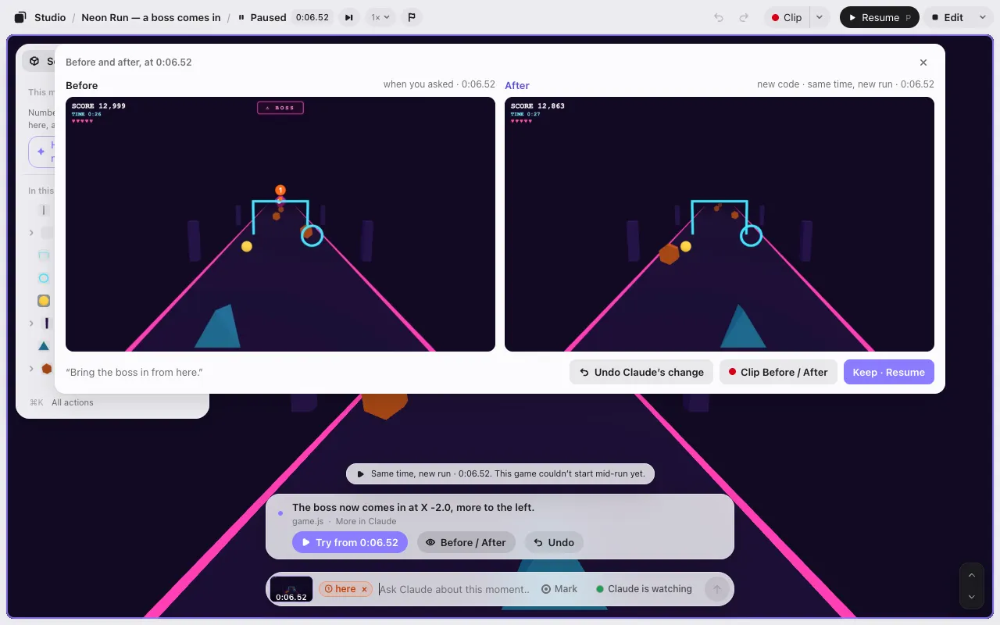

- You get a 10-second video (with the 8-second length; the Before adds 2 seconds to the length you picked). First the frame you asked from, with your marks and your words, for 2 seconds (**Before**). Then a wipe, and the same moment with the new code, playing for the length you picked (**After**). The last second has the mark.
- The video shows three bits of text at most: **Before**, **After** and what you asked. To leave your words out, turn off **Show my words on Before / After** in **⌄**.
- The post is written for you: “Paused my game at 0:05, marked a spot and told Claude “bring the boss in from here”. It fixed the code. Before → After 👇”. **✦ Rewrite** works here too.
- You can steer during the After. If you don’t, the game just goes on.

Next: [Motion](motion.md).
