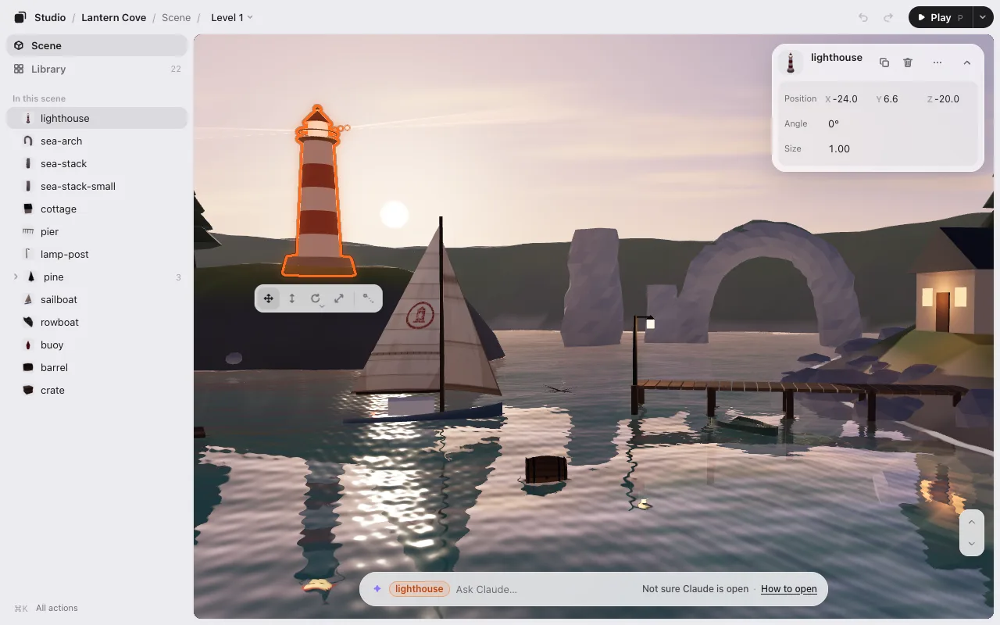

# A level editor for three.js games

Game Studio opens your three.js game as it is, running, and lets you lay it out by hand: select an object, drag it, turn it, resize it, and save. There’s nothing to add to the game first. It’s free, runs on your computer, and works next to Claude Code or Codex: your AI puts your layout into the code.



## What you can do

- **Select and move.** Click an object in the game and drag it. The strip under it moves, lifts, turns and resizes it (keys <kbd>1</kbd>–<kbd>4</kbd>); the card shows its exact numbers. See [Editing](editing.md).
- **Look around.** With nothing selected, fly the camera with <kbd>W</kbd> <kbd>A</kbd> <kbd>S</kbd> <kbd>D</kbd> (<kbd>E</kbd> / <kbd>Q</kbd> for up and down). See [Look around](editing.md#look-around-3d).
- **Snap, duplicate, select several.** Things land on what’s under them. Duplicate one for a row of the same, select several and move them together. See [Snap into place](editing.md#snap-into-place).
- **Switch levels.** Move between your game’s levels, make a new one, duplicate, rename and reorder them. See [Levels](levels.md).
- **See every asset.** The Library lists every model, image and sound your game uses, which object uses which file, and the files nothing uses. See [The Library](editing.md#the-library).
- **Make things move.** A boat that sails, a door that opens: set where it is at a few moments, the editor fills in the rest. See [Motion](motion.md).
- **Play and pause.** Play the game where you edit it, pause on a frame, and move what the game made. See [Play](play.md).

## How it fits a three.js game

- **Your objects, by name.** The editor finds the objects in your scene and lists them by their names (`lighthouse`, `tree-01`). Objects without names work too.
- **Your code stays yours.** The editor never edits your code. **Save** writes `placement.json` with only what you changed, and your AI adds one line that loads it when the game starts:

```js
await applyPlacement(scene, './placement.json');
```

- **Or numbers in the code.** Prefer no extra file? Tell your AI “write the numbers into the code.”
- **Things laid out by a rule.** When your AI lays things out by a rule (“four hexagons in a row, 6 m apart”), they stay a rule: drag one and the rule’s numbers change. See [Things laid out by a rule](editing.md#things-laid-out-by-a-rule).

More in [How it works](how-it-works.md).

## How it differs from the three.js editor

The three.js editor builds a scene of its own and saves it as JSON. Game Studio works on your game as it already runs, with your own code, physics and loading, and your AI writes the changes into your project. Use whichever fits: they don’t conflict.

## Try it

- **In your browser, no install:** the demo on this site runs the editor on sample games. It isn’t connected to an AI, and what you change stays in your browser.
- **On your own game:** see [Getting started](getting-started.md), then [Claude Code](claude-code.md) or [Codex](codex.md).

Not three.js? See [Phaser, PixiJS, canvas and Godot web games](phaser-pixijs-godot.md).
