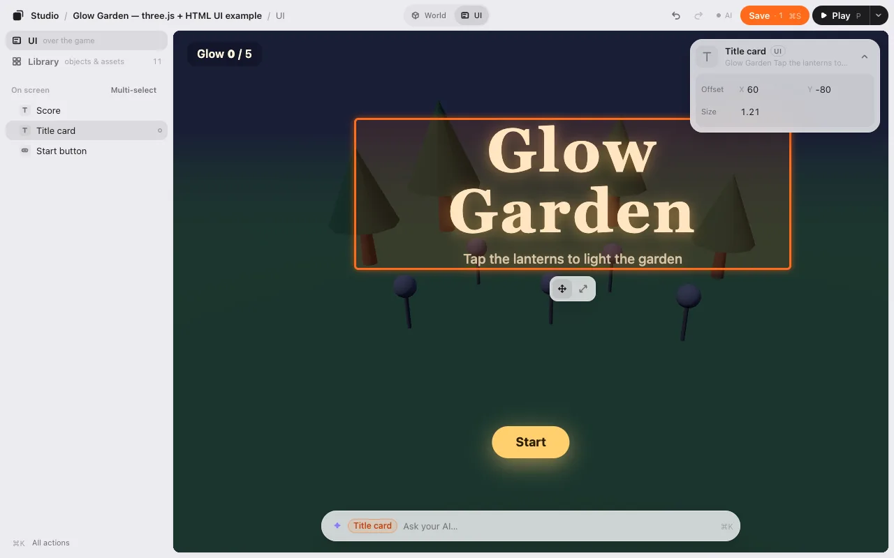
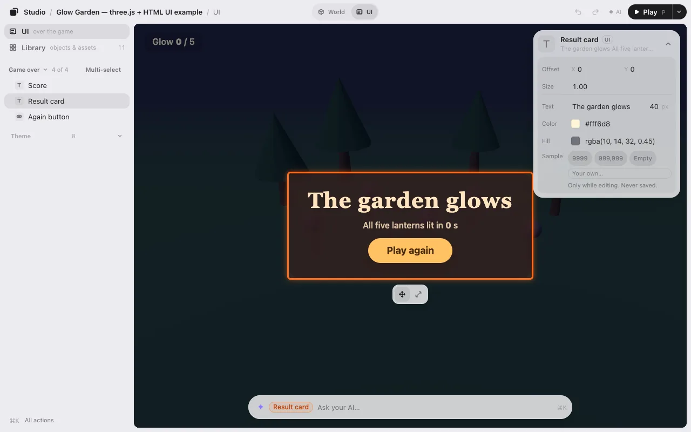
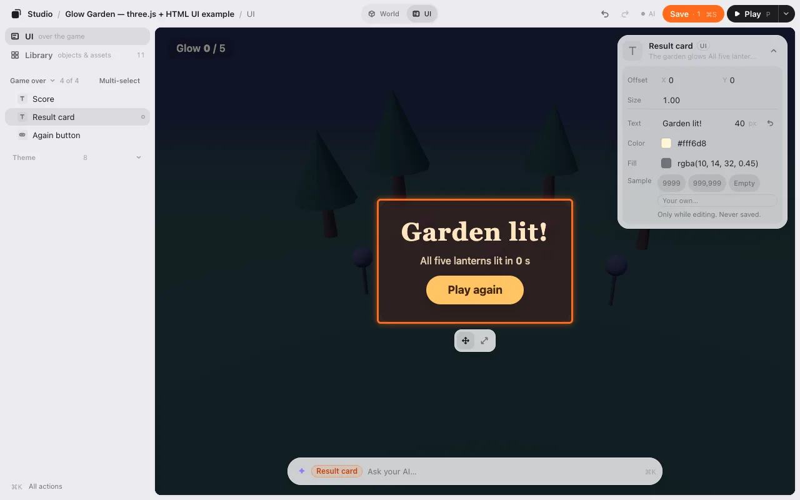
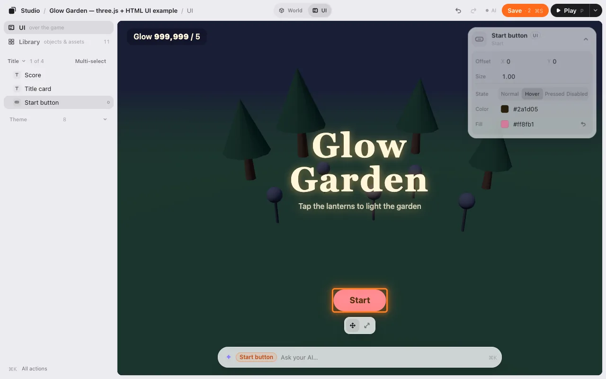
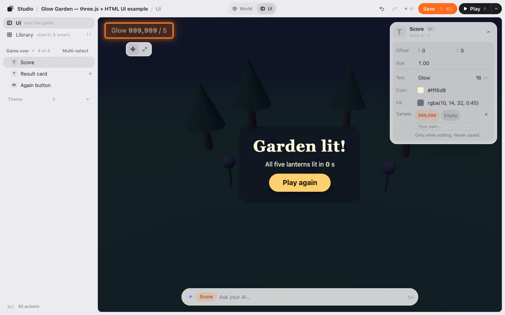
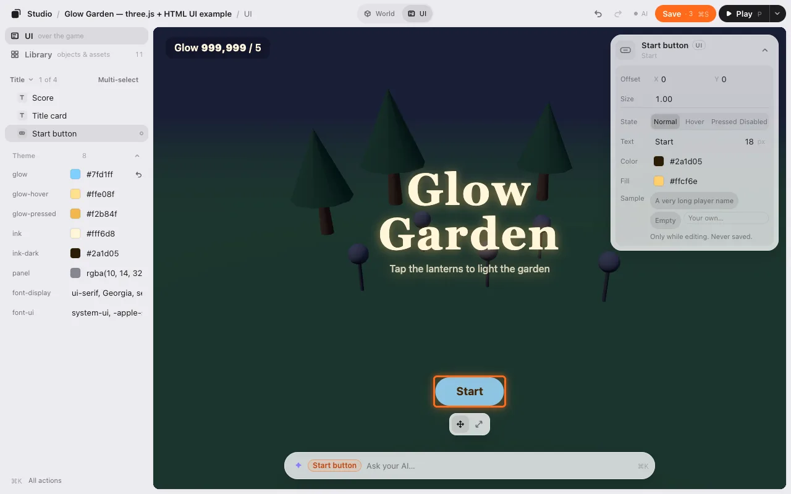

# UI editing

Many games have a layer of text and buttons over the world: a title, a score, a Start button. You can move and resize those too, change their words and colors, and look at every screen of your game: the title, the game itself, the pause screen, game over.

It works on UI made with HTML. Read [what it can’t do yet](#what-it-cant-do-yet).

## Scene and UI

If your game has UI the editor can edit, the top bar shows **Scene | UI**. Press **UI** (or <kbd>U</kbd>) to edit the UI. The scene dims, and the list shows the **UI**.

- Click a piece of UI to select it, and drag it to move it.
- The strip under it has **Move** and **Size**. <kbd>+</kbd> and <kbd>−</kbd> resize too, or type a number in **Size** on the card. Its middle stays where it is.
- Undo and Redo work across both layers.

Press **Scene** (or <kbd>U</kbd>) to go back. While you edit the scene, the game’s UI is hidden so it isn’t in your way. The eye next to the switch (or <kbd>Shift</kbd><kbd>U</kbd>) shows it faded. Clicks still go through to the scene.

On a phone, the switch is two icons at the top of the game.

## Screens

If your game has more than one screen, the top of the list names the one you see: **Title ⌄ 1 of 4**. Press it and pick another screen (**Playing**, **Paused**, **Game over**). The game shows that screen, and the list shows what’s on it. Your game doesn’t run for this: when you press Play, it starts on its own first screen again.

## Words and colors

Select a piece of UI. Under its offset and size, the card shows what you can change:

- **Text**: its words, and their size in px.
- **Color**: the color of the words. **Fill**: the color of the box (for a button, or a box with a background).
- **↺** puts a value back to your game’s own.

Each change is one step of Undo and one change to Save.

### Buttons: Normal, Hover, Pressed, Disabled

A button also has **State**. Press **Hover** to see the button as it looks under the mouse, **Pressed** as it looks while pressed, and **Disabled** as it looks when it can’t be used. You can still move it. Change **Color** or **Fill** there, and you change only that look.

## Sample values

Your game stands still while you edit, so the score says 0. To check that a big number or a long name still fits, select the score and pick a **Sample**: **999,999**, **A very long player name**, **Empty**, or type your own. Samples are only there while you edit. They’re never saved.

## Theme

If your game keeps its colors and fonts in CSS variables, **Theme** under the list shows them. Change one, and every piece of UI that uses it changes at once.

## No Scene | UI switch?

The editor only shows UI your game has marked. Ask your AI: “let me edit the UI in Game Studio.” It marks each piece (the title, the score) in your game’s HTML, and each screen. Ask it to put your colors in a theme, too, if you want the **Theme** rows.

## Save

Save writes where you moved each piece, how big it is, its new words and colors, and the theme. Your game reads it when it starts, like the rest of your layout, so the title is where you put it and says what you wrote, with or without the editor. Your AI can then write it into your game’s code.

## What it can’t do yet

- Only HTML UI. A HUD drawn inside the game (in Phaser, PixiJS or three.js) comes in a later stage.
- No turning, duplicating or deleting, and no new text, buttons or pictures yet.
- One size for every screen width: no separate phone layout yet.
- Pieces whose position the game changes itself (an animated score, say) aren’t listed.

Next: [Make with AI](make-with-ai.md).
