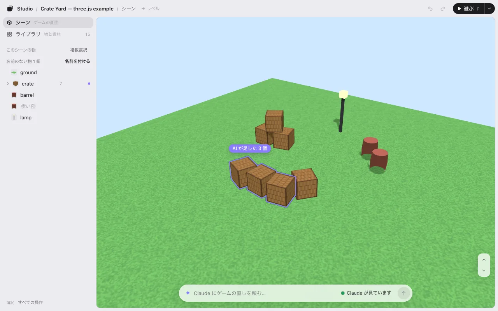

# Claude Code でゲームを作る

ゲームのコードは Claude Code が書きます。ゲームスタジオは、そのゲームを見ながら手で直す場所です。木をドラッグし、扉を回し、「灯台をあと 3 つ」と Claude に頼み、**保存** を押す。あとは Claude がコードに入れます。

Claude Code の無料のプラグインです。手元のパソコンで動き、アカウントは要りません。

## 必要なもの

- **手元のパソコンの Claude Code:** Claude アプリ（デスクトップの Code タブ、ローカルのセッション）、ターミナル、または IDE。クラウドのセッションではプラグインが読み込まれません。
- **Node.js 22.13 以降**（`node --version`）。ほかに入れるものはありません。

## 入れる

Claude Code に、この 1 行を貼ってください。

```
Install KUMODeck Game Studio for me by following https://github.com/kumodeck/game-studio/blob/main/INSTALL.md
```

Claude がプラグインを入れて、エディタを開きます。新しい版を自動で入れるかを 1 度だけ聞かれます。自分で入れたいときは [はじめる](getting-started.md#自分で入れる) を見てください。

## 思いつきから、手で直せるゲームまで

1. **Claude にゲームを作ってもらう。** 空のフォルダで頼みます。「three.js で小さなゲームを作って。夕暮れの港で、舟を動かせる」。または、そこで `/arrange` と打って見本（3D か 2D）から始めます。
2. **エディタで開く。** ゲームのフォルダで `/arrange` と打ちます。エディタのリンクは Claude の返事の 1 行目にあり、ブラウザでひとりでに開きます。
3. **手で並べる。** どれかをクリックしてドラッグ。下の帯で動かす・持ち上げる・回す・大きさを変える。[編集](editing.md) を見てください。
4. **同じ画面で Claude に頼む。** 下の欄に「これをあと 3 つ」のように書いて <kbd>Enter</kbd>。Claude に数秒で届くときは、欄に **● Claude が見ています** と出ます。
5. **保存を押す。** エディタが `placement.json` を書き、Claude がそれを読んでコードに入れます。最初の 1 回は、ゲームの始まりに `placement.json` を読む 1 行を足します。



## Claude が作業している間

- 欄のまわりに紫の光が走り、Claude のひとことの返事が上に出ます。くわしい返事は Claude の窓にあります（行に **詳しくは Claude で** と出ます）。
- 終わるとゲームはひとりでに新しくなり、カメラも選択もそのまま、変わった物だけが紫に光ります。**AI の変更を元に戻す** の 1 回で元どおりです。
- 遊んでいておかしい所があれば、<kbd>`</kbd> を押して書き、<kbd>Enter</kbd>。その瞬間の絵といっしょに Claude に届きます。[遊ぶ](play.md#遊びながら頼む) を見てください。

## Claude Code にエディタを足すわけ

「木をもう少し右に… いや、もう少し左」と Claude に言うと、何往復もかかります。ドラッグなら 1 回です。コードを書くのは、これまでどおり Claude です。エディタがコードを書き換えることはありません。配置は `placement.json` に入ります（頼めばコードの数字に入れます）。[しくみ](how-it-works.md) を見てください。

## 次へ

- [Codex でゲームを作る](codex.md): 同じエディタを Codex で。
- [three.js のレベルエディタとして使う](threejs-level-editor.md)・[Phaser・PixiJS・canvas・Godot のウェブゲーム](phaser-pixijs-godot.md): あなたのエンジンで何ができるか。
