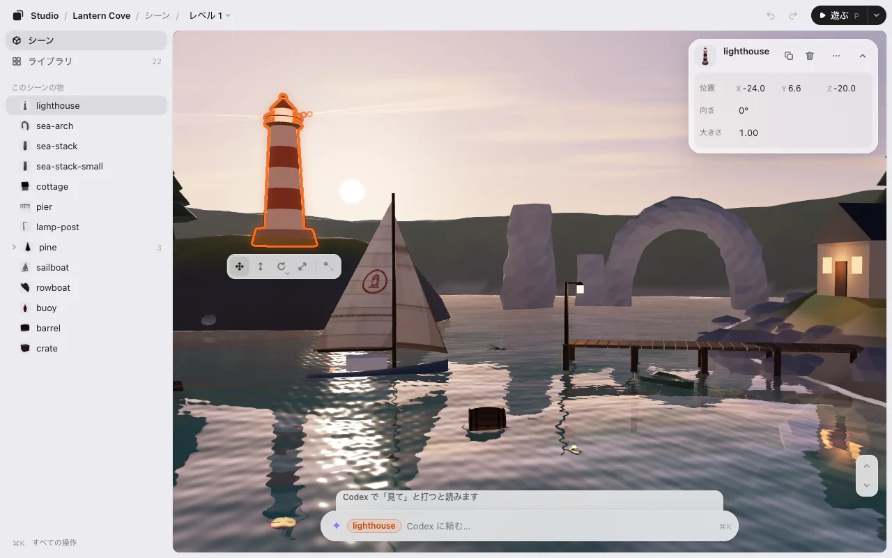

# Codex でゲームを作る

ゲームのコードは Codex が書きます。ゲームスタジオは、そのゲームを見ながら手で直す場所です。物を選んでドラッグし、回し、Codex に頼み、**保存** を押す。あとは Codex がコードに入れます。

Codex の無料のプラグインです。手元のパソコンで動き、アカウントは要りません。

## 必要なもの

- **手元のパソコンの Codex:** CLI・アプリ・IDE のどれか。Codex のクラウドではプラグインが動きません。
- **Node.js 22.13 以降**（`node --version`）。ほかに入れるものはありません。

## 入れる

Codex に、この 1 行を貼ってください。

```
Install KUMODeck Game Studio for me by following https://github.com/kumodeck/game-studio/blob/main/INSTALL.md
```

Codex がプラグインを入れて、エディタを開きます。自分で入れるときは、ターミナルで:

```
codex plugin marketplace add kumodeck/game-studio && codex plugin add game-studio@game-studio
```

そのあと新しいセッションを始めてください。

## ゲームを開く

ゲームのフォルダ（`index.html` があるところ）で Codex を開き、`$arrange` と打つか、「arrange のエディタを開いて」と頼みます。Codex のプラグインはスラッシュのコマンドを足せないので、`/arrange` ではなく `$arrange` です。空のフォルダなら、見本のゲームから始めます。



## Codex とエディタのやりとり

- **Codex で「見て」と打つ。** Codex にはフックがないので、ひとりでにはエディタを見ません。エディタの欄から送ったものは Codex を待っていて、欄にもそう出ます（**Codex で「見て」と打つと読みます**）。Codex で `見て` と打つと、送ったものをまとめて読みます。
- **保存は同じです。** エディタが `placement.json` を書きます。Codex に反映を頼むか、「見て」と打ってください。最初の 1 回は、ゲームの始まりに `placement.json` を読む 1 行を足します。
- **エディタの AI の行** には **詳しくは Codex で** と出ます。くわしい返事は Codex の窓にあります。
- **更新** はひとりでには入りません。`codex plugin marketplace upgrade game-studio` で更新します。

ほかは Claude Code と同じです: [編集](editing.md)・[遊ぶ](play.md)・[動き](motion.md)・[レベル](levels.md)。

## 次へ

- [three.js のレベルエディタとして使う](threejs-level-editor.md)
- [Phaser・PixiJS・canvas・Godot のウェブゲーム](phaser-pixijs-godot.md)
- [よくある質問](faq.md#codex)
