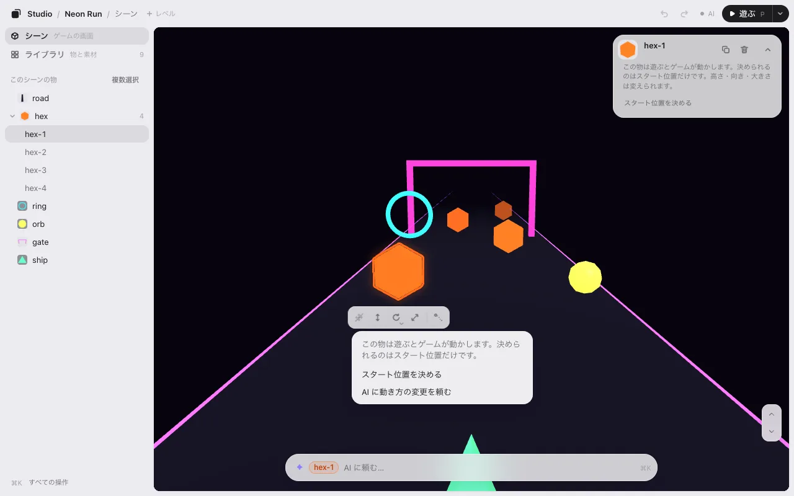

# 編集

ゲームの中の物をクリックして、ドラッグする。それがほとんどです。このページでは、そのほかを説明します。選んだ物の下の帯、カメラ、メニュー、ライブラリ、保存です。

エディタは 3 つでできています。左の列（**シーン** と **ライブラリ**）、真ん中のゲーム、下の AI に頼む欄です。色はそれぞれ 1 つの意味です。**オレンジはあなたの手**（選んだ物）、**紫は AI の手**（AI がさっき変えた物）。

## 選ぶ

- 物を **クリック**（タップ）すると選べます。同じ所をもう一度クリックすると、後ろの物が選べます。
- **何もない所**（空・海・地面）をクリックすると、選択を外します。地面のような大きな物は、うっかりつかまないよう、シーンの一覧から選びます。
- <kbd>Esc</kbd> は 1 段ずつ戻ります。開いているメニューを閉じ、道具を置き、選択を外します。

## 動かす・高さ・回す・大きさ

選んだ物をドラッグすると動きます。下の帯には 4 つの道具があります。押してから、どこでもドラッグします（物の上でなくてかまいません）。

| 道具 | キー | ドラッグすると |
|---|---|---|
| 移動 | <kbd>M</kbd> か <kbd>1</kbd> | 地面に沿って動く |
| 高さ（3D） | <kbd>H</kbd> か <kbd>2</kbd> | 上下に動く |
| 回す | <kbd>T</kbd> か <kbd>3</kbd> | 左右で回る（15° ずつ） |
| 大きさ | <kbd>S</kbd> か <kbd>4</kbd> | 右か上で大きくなる |

道具は <kbd>Esc</kbd> を押すか、別の道具を選ぶまで持ったままです。ドラッグ中は帯の横に数字が出ます。

**道具が薄いとき。** 4 つの道具はいつも同じ場所にあります。選んだ物に使えない道具は薄くなります。重ねると理由が、押すと代わりにできることが出ます。

- **ゲームが動かしている物**（ランゲームの障害物、回るコインなど）: **スタート位置を決める** で動かせます。置いた所がスタート位置になり、遊ぶとそこからゲームが動かします。ゲームが向きや大きさを変えている物は、ここでは決められません。**AI に頼む** でコードを変えてもらえます。
- **地面・道路・空** は、うっかり動かさないよう固定しています: **動かせるようにする**。
- **ゲームのルールで固定された物**: **AI にルールの変更を頼む**。

**回し方・大きさの変え方。** **回す** と **大きさ** の角の小さな ▾（またはボタンの長押し）で選べます。

- 3D の回し方は **横に回す**・**前後に倒す**・**左右に倒す**。<kbd>R</kbd> で次に切り替わります。物の真ん中で回るので、場所は変わりません。
- いくつか選んでいるときは、**並びごと**（ひとまとまりで。すき間も変わる）か **その場で**（それぞれの場所のまま）。

**キーで。** 矢印キーで少しずつ動きます（<kbd>Shift</kbd> でもっと細かく）。<kbd>Q</kbd> と <kbd>E</kbd> で 15° 回ります。<kbd>Page Up</kbd> と <kbd>Page Down</kbd> で上げ下げ。<kbd>+</kbd> と <kbd>−</kbd> で大きさ。

**数字で。** 右上のカードに **位置**・**向き**・**大きさ** が出ます。数字を左右にドラッグすると変わり（<kbd>Shift</kbd> で細かく）、クリックすると打ち込めます。カードの **–** で 1 行にたためます。

## ピタッと置く

3D では、物は下にある物の上に乗ります。

- **高さ** で下へドラッグすると、下の面で止まります。もう少し引くと突き抜けます。
- <kbd>End</kbd> で選んだ物を床に落とします（Mac のノートでは <kbd>fn</kbd><kbd>→</kbd>）。右クリックのメニューにもあります。
- ドラッグ中に <kbd>Ctrl</kbd> か <kbd>⌥</kbd> を押したままにすると、吸着せずに動かせます。

マス目に合わせたい、90° ずつだけ回したい、というときは AI に頼んでください。「1 m のマス目に合わせて」。このゲーム用にそうしてくれます。

## 見回す（3D）

| したいこと | やり方 |
|---|---|
| 見回す | 何も選んでいない所をドラッグ。道具を持っているときは <kbd>⌥</kbd> ドラッグ・右ドラッグ・2 本指 |
| 寄る・引く | ホイールかピンチ |
| 飛ぶ | 何も選んでいないとき <kbd>W</kbd> <kbd>A</kbd> <kbd>S</kbd> <kbd>D</kbd>。選んでいるときは右ボタンも押したまま。<kbd>Shift</kbd> で速く |
| 上がる・下がる | <kbd>E</kbd> と <kbd>Q</kbd>（何も選んでいないとき）、またはゲームの角の ↑ ↓ |
| 全体を見る | <kbd>F</kbd> |
| 開いた時の眺めに戻る | <kbd>Shift</kbd><kbd>F</kbd> |

<kbd>W</kbd> と <kbd>S</kbd> は水平に進みます。見下ろしていても、同じ高さのまま上を滑っていきます。

## 戻す・複製・削除

| | Mac | Windows |
|---|---|---|
| 戻す | <kbd>⌘</kbd><kbd>Z</kbd> | <kbd>Ctrl</kbd><kbd>Z</kbd> |
| 進む | <kbd>⇧</kbd><kbd>⌘</kbd><kbd>Z</kbd> | <kbd>Ctrl</kbd><kbd>Y</kbd> |
| 複製 | <kbd>⌘</kbd><kbd>D</kbd> | <kbd>Ctrl</kbd><kbd>D</kbd> |
| 削除 | <kbd>⌫</kbd> | <kbd>Delete</kbd> |
| 全部選ぶ | <kbd>⌘</kbd><kbd>A</kbd> | <kbd>Ctrl</kbd><kbd>A</kbd> |

**戻す** と **進む** は上のバーにもあります。**複製** は元の物の隣に置きます。もう一度押すと、同じ間隔でもう 1 つ。

## 右クリックのメニュー

どれでも右クリック（スマホは長押し）すると、その場でできることが出ます。

- **物の上で:** 名前を変える・複製・削除・床に落とす・ライブラリで見る。2D では いちばん手前へ・いちばん奥へ も。最後に **✦ 灯台を変えるよう AI に頼む…**。
- **何もない所で:** 貼り付け・全部選ぶ・選択を外す・全体を見る。最後に **✦ ゲームを変えるよう AI に頼む…**。

メニューの項目は 2 種類で、押す前に見分けられます:

- **普通の項目** は、エディタの中ですぐに起きます。<kbd>⌘</kbd><kbd>Z</kbd> で戻せます。下の入力欄に文を書くことはありません。
- **✦ の項目**（紫・「AI に頼む…」）は、下の入力欄に頼みの書き出しを入れて、カーソルをそこに置くだけです。直したり続きを書いたりして、<kbd>Enter</kbd> を押すまで送りません。

**名前を変える**（または <kbd>F2</kbd>）を押すと、物のカードの名前がその場で入力欄になります。<kbd>Enter</kbd> で決まり、<kbd>Esc</kbd> でやめます。新しい名前はすぐに全部の場所に出て、保存すると AI がコードの名前も変えます。コードに名前の無い物には、代わりに **✦ 名前を AI に頼む…** が出ます。

## いくつか選ぶ

- <kbd>Shift</kbd> を押しながらクリックで、1 つ足す・外す。
- 何もない所から <kbd>Shift</kbd> を押しながらドラッグで、四角で囲む。
- スマホでは一覧の **複数選択**、終わったら **完了**。
- 右クリックの **同じ種類を全部選ぶ** で、同じ種類の物をまとめて。

いくつか選ぶと、まとめて動かし・回し・大きさを変えられます。

## すべての操作・すべてのキー

- <kbd>⌘</kbd><kbd>K</kbd>（<kbd>Ctrl</kbd><kbd>K</kbd>）ですべての操作の一覧が開きます。「ライブラリ」「遊ぶ」のように打つと見つかります。文で書くと AI に届きます。
- <kbd>?</kbd> でキーボードショートカットがすべて出ます。

## ライブラリ

左の **シーン** を **ライブラリ** に切り替えると、ゲームを作っているものがすべて並びます。物と、ゲームが使う画像・モデル・音です。左の絞り込みで **すべて**・**3D**・**2D**・**音**・**動き**・**その他** に分けられます。

タイルを押すと詳しく出ます。どの物がそのファイルを使っているか、使われていない・見つからないファイルはどれか。

- 物の **シーンに足す** は、見ている所に複製を置きます。ファイルを物にするには新しいコードが要るので、ファイルのボタンは **✦ シーンに入れるよう AI に頼む…** です。頼みが下の入力欄に入り、<kbd>Enter</kbd> を押すまで送りません。
- **差し替え…** でファイルを別のものに替えます。**素材を足す** で新しいファイルを入れます。
- **ゲームで見る** で、それを選んだままシーンに戻ります。
- タイルを選んで下の欄に書くと、それについて AI に頼めます。

## AI に頼む

下の欄は AI に頼むためのものです。したいことを書いて <kbd>Enter</kbd>。

- 選んだ物について: 「これをあと 3 つ並べて」「光らせて」
- ゲーム全体について: 「島のまわりに灯台を 3 つ」

打つ前に、欄の右はしに AI がいるかが出ます（狭い画面では欄の上）。

- **● Claude が見ています**: 送ったものは数秒で届きます。**● Claude が作業中です**: 頼みに取りかかっています。
- **Claude が開いているか分かりません**・**Claude が見ていません**: それでも書けます。メモとして残り、Claude が読むまでゲームは変わりません。**開き方** を押すと、どうすればいいかが出ます。
- Codex なら: **Codex で「見て」と打つと読みます**。

名前はあなたの AI です（分からないときは「あなたの AI」）。文を押すと、その意味が 1 行で出ます。

AI がいるときは、欄の上の行が **Claude が取りかかっています** → AI 自身の言葉 → 返事、と進みます。
いないときは、起きたことをそのまま言います: **Claude へのメモとして残しました。Claude が読むまでゲームは変わりません。**

AI が作業している間は欄のまわりに紫の光が走り、ひとことの返事が上に出ます。終わるとゲームはひとりでに新しくなり、カメラも選択もそのまま、変わった物だけが紫に光ります。気に入らなければ **AI の直しを戻す** の 1 回で元どおりです。

## 保存

何かを変えると、上のバーの **▶ 遊ぶ** の隣に **保存 · 1** が出ます。数字はまだ保存していない変更の数です。

**保存**（<kbd>⌘</kbd><kbd>S</kbd>）を押して、AI に戻ってください。

### 保存で何が起きるか

ゲームはコードでできていて、エディタはコードを書き換えません。代わりにこうします。

1. **保存すると、変えたことを書き留めます。** ゲームのフォルダの小さなファイル `placement.json` にです。「灯台は今ここ、これだけ回して、この大きさ」という一覧だと思ってください。変える前にどこにあったかも書くので、AI はコードの中でその物を見つけられます。
2. **AI がその一覧を読んで、** ゲームに入れます。最初の 1 回だけ、ゲームが始まる時に `placement.json` を読む 1 行をゲームに足します。それからは、保存するたびにゲームに出ます。数字を直接コードに書いてほしければ、AI にそう言ってください。

ライブラリで差し替えたり足したりしたファイルは、もう 1 つの一覧 `library.json` に同じように書きます。くわしくは [しくみ](how-it-works.md)。

### なくさない

- 保存するまで、変更は下書きとして残っています。タブを閉じても消えません。
- 地面を動かした、25 m 動かした、のような大きな変更は、先に **保存の前に確かめてください** と聞きます。**元に戻して保存** か **このまま保存** を選べます。

次へ: [遊ぶ](play.md)
