# 編集

ゲームの中の物をクリックして、ドラッグする。それがほとんどです。このページでは、そのほかを説明します。選んだ物の下の帯、カメラ、メニュー、ライブラリ、保存です。

エディタは 3 つでできています。左の列（**シーン** と **ライブラリ**）、真ん中のゲーム、下の AI に頼む欄です。色はそれぞれ 1 つの意味です。**オレンジはあなたの手**（選んだ物）、**紫は AI の手**（AI がさっき変えた物）。もう 1 つ、落ち着いた **砂色** は、ルールの外に手で置いた物の印です（下で説明します）。

## 選ぶ

- 物を **クリック**（タップ）すると選べます。同じ所をもう一度クリックすると、後ろの物が選べます。
- **何もない所**（空・海・地面）をクリックすると、選択を外します。地面のような大きな物は、うっかりつかまないよう、シーンの一覧から選びます。
- **シーン** の一覧（や ⌘K、ライブラリの **ゲームで見る**）から選んでも、物がもう画面に見えていればカメラは動きません。見えていない時だけ、その物の所へ寄せます。その時も、物が豆粒になるほど引きません。選択を外してもカメラは動きません。
- <kbd>Esc</kbd> は 1 段ずつ戻ります。開いているメニューを閉じ、道具を置き、選択を外します。

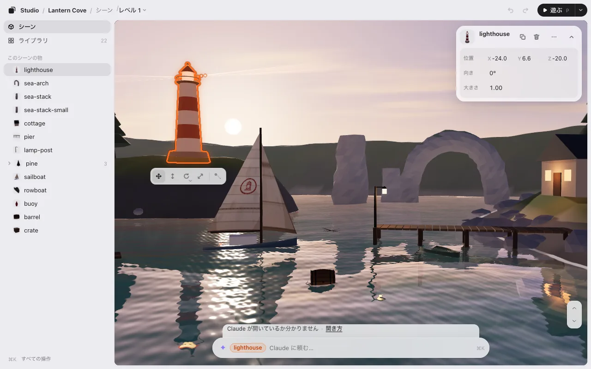

## 動かす・高さ・回す・大きさ

選んだ物をドラッグすると動きます。下の帯には 4 つの道具があります。押してから、どこでもドラッグします（物の上でなくてかまいません）。

| 道具 | キー | ドラッグすると |
|---|---|---|
| 移動 | <kbd>M</kbd> か <kbd>1</kbd> | 地面に沿って動く |
| 高さ（3D） | <kbd>H</kbd> か <kbd>2</kbd> | 上下に動く |
| 回す | <kbd>T</kbd> か <kbd>3</kbd> | 左右で回る（15° ずつ） |
| 大きさ | <kbd>S</kbd> か <kbd>4</kbd> | 右か上で大きくなる |

道具は <kbd>Esc</kbd> を押すか、別の道具を選ぶまで持ったままです。ドラッグ中は帯の横に数字が出ます。

**ゲームが動かす物・使えない道具。** 4 つの道具はいつも同じ場所に、同じ絵で並びます。物を選んだとき、知っておくことがあれば帯のすぐ下（または上）に小さな 1 行が出ます。

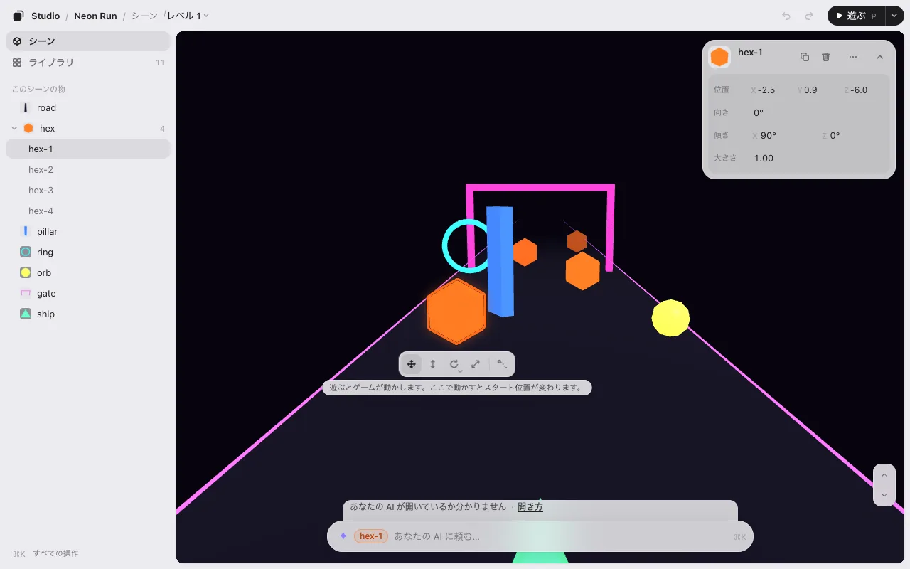

- **ゲームが動かしている物**（ランゲームの障害物、回るコインなど）: **移動** はいつもどおり使えます。置いた所がスタート位置になり、遊ぶとそこからゲームが動かします。
- ゲームが向きや大きさを変えている物の **回す**・**大きさ** は薄くなり、押しても何も起きません。変えたいときは下の欄で AI に頼めます。
- **地面・道路・空** は、うっかり動かさないよう固定しています。道具の帯の下の 1 行がそう言い、その **動かせるようにする** で解除できます。
- **ゲームのルールで固定された物**: 道具は薄くなります。理由は同じ 1 行に出ます。

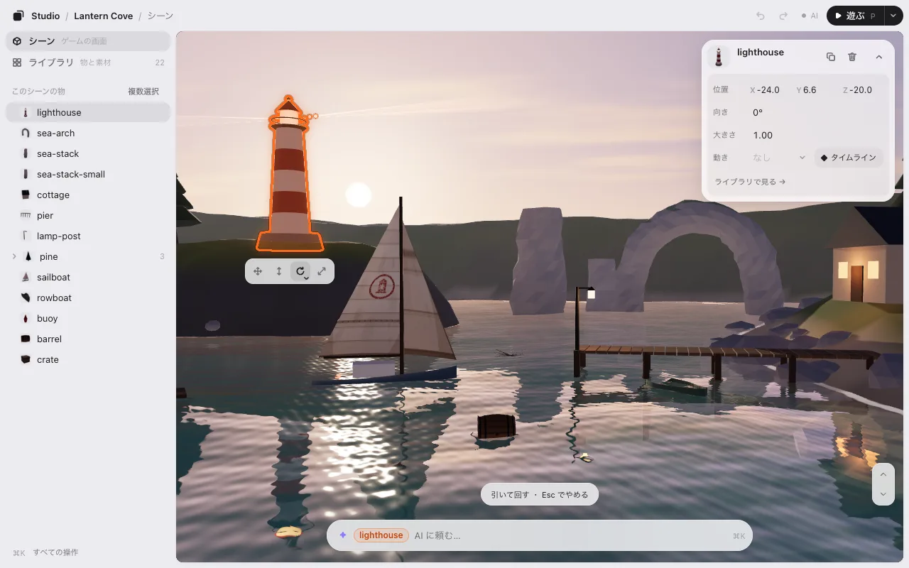

**回し方・大きさの変え方。** **回す** と **大きさ** の角の小さな ▾（またはボタンの長押し）で選べます。

- 3D の回し方は **横に回す**・**前後に倒す**・**左右に倒す**。<kbd>R</kbd> で次に切り替わります。物の真ん中で回るので、場所は変わりません。
- いくつか選んでいるときは、**並びごと**（ひとまとまりで。すき間も変わる）か **その場で**（それぞれの場所のまま）。

**キーで。** 矢印キーで少しずつ動きます（<kbd>Shift</kbd> でもっと細かく）。<kbd>Q</kbd> と <kbd>E</kbd> で 15° 回ります。<kbd>Page Up</kbd> と <kbd>Page Down</kbd> で上げ下げ。<kbd>+</kbd> と <kbd>−</kbd> で大きさ。

**数字で。** 右上のカードに **位置**・**向き**・**大きさ** が出ます。数字を左右にドラッグすると変わり（<kbd>Shift</kbd> で細かく）、クリックすると打ち込めます。カードの **–** で 1 行にたためます。

## ピタッと置く

3D では、物は下にある物の上に乗ります。

- **高さ** で下へドラッグすると、下の面で止まります。もう少し引くと突き抜けます。
- <kbd>End</kbd> で選んだ物を床に落とします（Mac のノートでは <kbd>fn</kbd><kbd>→</kbd>）。右クリックのメニューにもあります。
- ドラッグ中に <kbd>Ctrl</kbd> か <kbd>⌥</kbd> を押したままにすると、吸着せずに動かせます。

マス目に合わせたい、90° ずつだけ回したい、というときは AI に頼んでください。「1 m のマス目に合わせて」。このゲーム用にそうしてくれます。

## 見回す（3D）

| したいこと | やり方 |
|---|---|
| 見回す | 何も選んでいない所をドラッグ。道具を持っているときは <kbd>⌥</kbd> ドラッグ・右ドラッグ・2 本指 |
| 寄る・引く | ホイールかピンチ |
| 飛ぶ | 何も選んでいないとき <kbd>W</kbd> <kbd>A</kbd> <kbd>S</kbd> <kbd>D</kbd>。選んでいるときは右ボタンも押したまま。<kbd>Shift</kbd> で速く |
| 上がる・下がる | <kbd>E</kbd> と <kbd>Q</kbd>（何も選んでいないとき）、またはゲームの角の ↑ ↓ |
| 全体を見る | <kbd>F</kbd> |
| 開いた時の眺めに戻る | <kbd>Shift</kbd><kbd>F</kbd> |

<kbd>W</kbd> と <kbd>S</kbd> は水平に進みます。見下ろしていても、同じ高さのまま上を滑っていきます。

## 戻す・複製・削除

| | Mac | Windows |
|---|---|---|
| 戻す | <kbd>⌘</kbd><kbd>Z</kbd> | <kbd>Ctrl</kbd><kbd>Z</kbd> |
| 進む | <kbd>⇧</kbd><kbd>⌘</kbd><kbd>Z</kbd> | <kbd>Ctrl</kbd><kbd>Y</kbd> |
| 複製 | <kbd>⌘</kbd><kbd>D</kbd> | <kbd>Ctrl</kbd><kbd>D</kbd> |
| 削除 | <kbd>⌫</kbd> | <kbd>Delete</kbd> |
| 全部選ぶ | <kbd>⌘</kbd><kbd>A</kbd> | <kbd>Ctrl</kbd><kbd>A</kbd> |

**元に戻す** と **やり直す** は上のバーにもあります。**複製** は元の物の隣に置きます。もう一度押すと、同じ間隔でもう 1 つ。

## 右クリックのメニュー

どれでも右クリック（スマホは長押し）すると、その場でできることが出ます。

- **物の上で:** 名前を変える・複製・削除・地面に置く・ライブラリで見る。2D では いちばん手前へ・いちばん奥へ も。最後に **✦ 灯台を変えるよう Claude に頼む…**（名前はあなたの AI）。
- **何もない所で:** 貼り付け・全部選ぶ・選択を外す・全体を見る。最後に **✦ ゲームを変えるよう AI に頼む…**。

メニューの項目は 2 種類で、押す前に見分けられます:

- **普通の項目** は、エディタの中ですぐに起きます。<kbd>⌘</kbd><kbd>Z</kbd> で戻せます。下の入力欄に文を書くことはありません。
- **✦ の項目**（紫・「AI に頼む…」）は、下の入力欄に頼みの書き出しを入れて、カーソルをそこに置くだけです。直したり続きを書いたりして、<kbd>Enter</kbd> を押すまで送りません。

**名前を変える**（または <kbd>F2</kbd>）を押すと、物のカードの名前がその場で入力欄になります。<kbd>Enter</kbd> で決まり、<kbd>Esc</kbd> でやめます。新しい名前はすぐに全部の場所に出て、保存すると AI がコードの名前も変えます。コードに名前の無い物には、代わりに **✦ 名前を AI に頼む…** が出ます。

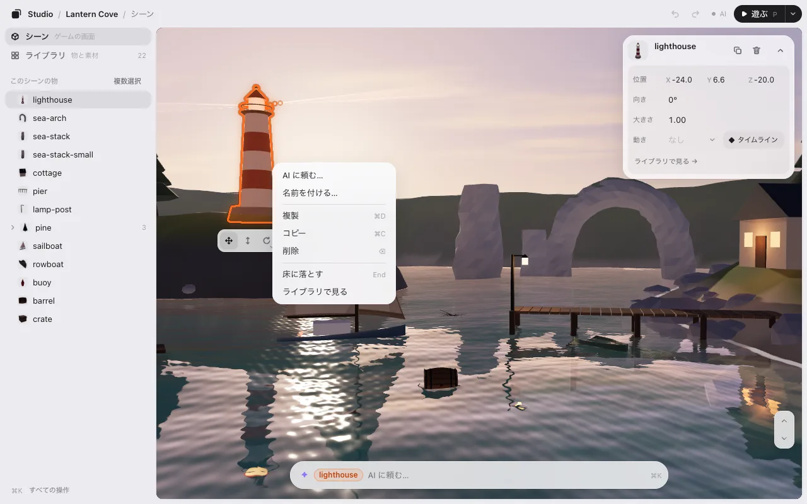

## いくつか選ぶ

- <kbd>Shift</kbd> を押しながらクリックで、1 つ足す・外す。
- 何もない所から <kbd>Shift</kbd> を押しながらドラッグで、四角で囲む。
- スマホでは一覧の **複数選択**（ライブラリでは **+** の中）、終わったら **完了**。パソコンにはこのボタンはありません。<kbd>Shift</kbd> で足せます。
- カードの **⋯** の **同じ種類を全部選ぶ** で、同じ種類の物をまとめて（**ライブラリで見る** もここ）。

いくつか選ぶと、まとめて動かし・回し・大きさを変えられます。

## すべての操作・すべてのキー

- <kbd>⌘</kbd><kbd>K</kbd>（<kbd>Ctrl</kbd><kbd>K</kbd>）ですべての操作の一覧が開きます。「ライブラリ」「遊ぶ」のように打つと見つかります。文で書くと AI に届きます。
- <kbd>?</kbd> でキーボードショートカットがすべて出ます。
- <kbd>P</kbd> で遊びます。遊んでいる間の <kbd>P</kbd> は「止める・続ける」。編集に戻るのは **編集** のボタンです。くわしくは [遊ぶ](play.md)。

## ライブラリ

左の **シーン** を **ライブラリ** に切り替えると、ゲームを作っているものがすべて並びます。物と、動きと、ゲームが使う画像・モデル・音です。種類ごとに見出しと数が付きます: **物 · 15**・**動き · 2**・**素材 · 7**。物は 1 つずつ数えます（pine ×3 は 3）。**ライブラリ** の横の数・**すべて**・見出しの数は、いつも同じ数え方で合います。左の絞り込みで **すべて**・**3D**・**2D**・**音**・**動き**・**その他** に分けられます（そのゲームにある物だけ）。

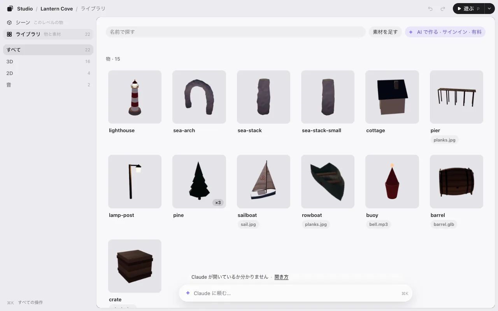

素材がまだ無いゲームでは **素材 · 0** と、ファイルを落とす所が 1 つ出ます。

タイルを押すと詳しく出ます。どの物がそのファイルを使っているか、使われていない・見つからないファイルはどれか。

- 物の **シーンに置く** は、見ている所に複製を置きます。ファイルを物にするには新しいコードが要るので、ファイルのボタンは **✦ シーンに置くよう Claude に頼む…** です。頼みが下の入力欄に入り、<kbd>Enter</kbd> を押すまで送りません。
- **差し替え…** でファイルを別のものに替えます。**素材を足す** で新しいファイルを入れます。
- **シーンで見る** で、それを選んだままシーンに戻ります。
- **✦ Claude に頼む…**（あなたの AI の名前）で、下の欄にカーソルが入ります。欄にはそのタイルの名前が付いています。
- 固定している物（地面・道路・空）は、名前の下に **固定しています** と出ます。

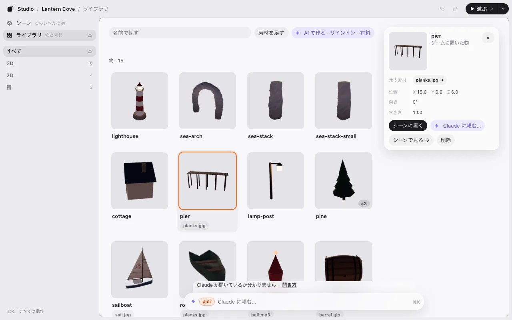

## AI に頼む

下の欄は AI に頼むためのものです。したいことを書いて <kbd>Enter</kbd>。

- 選んだ物について: 「これをあと 3 つ並べて」「光らせて」
- ゲーム全体について: 「島のまわりに灯台を 3 つ」

打つ前に、欄の右はしに AI がいるかが出ます（横の窓とスマホでは点だけ。押すと文が出ます）。

- **● Claude が見ています**: 送ったものは数秒で届きます。**● Claude が作業中です**: 頼みに取りかかっています。
- **Claude が開いているか分かりません**・**Claude が見ていません**: それでも書けます。メモとして残り、Claude が読むまでゲームは変わりません。**開き方** を押すと、どうすればいいかが出ます。
- Codex なら: **Codex で「見て」と打つと読みます**。

名前はあなたの AI です（分からないときは「あなたの AI」）。文を押すと、その意味が 1 行で出ます。

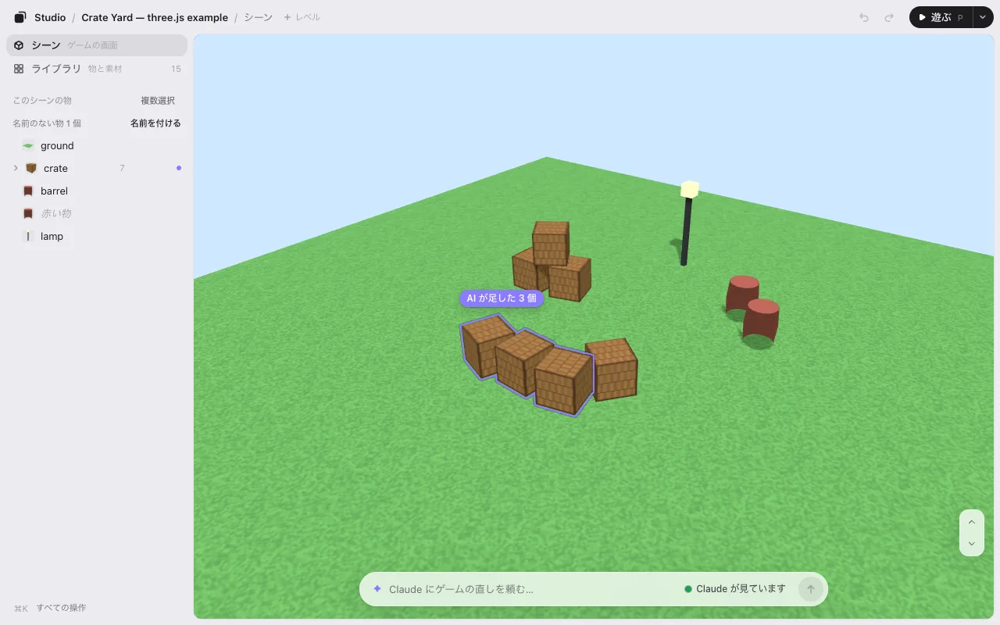

AI がいるときは、欄の上の行が **Claude が取りかかっています** → AI 自身の言葉 → 返事、と進みます。
いないときは、起きたことをそのまま言います: **Claude へのメモとして残しました。Claude が読むまでゲームは変わりません。**

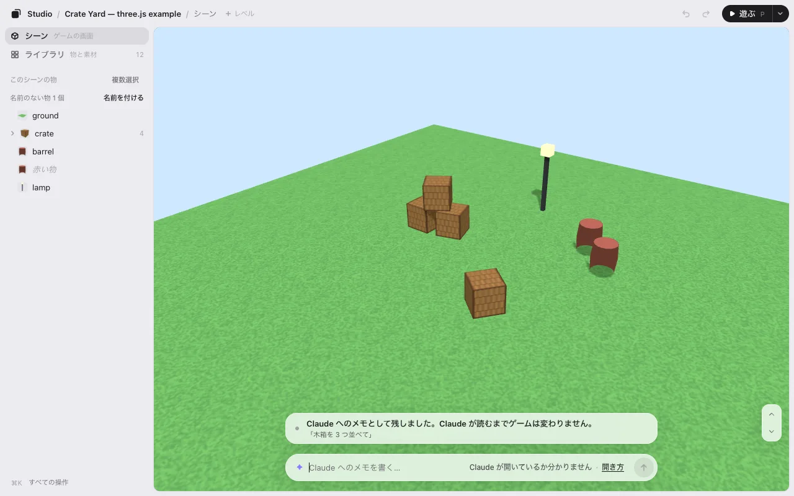

AI が作業している間は欄のまわりに紫の光が走り、ひとことの返事が上に出ます。終わるとゲームはひとりでに新しくなり、カメラも選択もそのまま、変わった物だけが紫に光ります。気に入らなければ **AI の変更を元に戻す** の 1 回で元どおりです。

## ルールで並んだ物

AI がルールで並べた物（「六角形を 6 m おきに 4 つ」「結晶を野原にばらまいて」）は、一覧で 1 つの名前の下に札 **ルール** を付けて並びます。押すと、カードの位置の所が **ルール** になります: **直線 · 4 個**（または **ランダム · 12 個**）と、ルールの数字（**個数**、**間** など）。自分で置いた物は今のままです（数字がそのまま場所です）。

- **ルールの数字を回す**（左右にドラッグ・押すと入力）か、**ゲームの中で 1 つをそのままドラッグ** します。ルールの数字が変わり、ほかの物も付いてきて、ルールのままです。ドラッグの間は小さな札が言います: **間 4 → 2.5 m**。紫の輪がルールの決めた場所を、道具の帯の下の 1 行がドラッグで何が起きるかを、触る前に見せます（ゲームの中で指を乗せるだけでも輪が出ます）。
- **どう動かしてもルールのままです。** ルールに数字の無い向き（道から離す・持ち上げる・回す）に街灯を 1 本ドラッグすると、そのルールの街灯が全部付いてきます（**横 +1.0 m · 全部**）。指を離すと、下の欄の上の 1 行に、ほかの物の付いてき方が出ます: **全部同じ · ジグザグ · だんだん · この 1 個だけ**（キー 1〜4。指を乗せるとその形に並び、押しても <kbd>⌘</kbd><kbd>Z</kbd> は 1 回のまま）。ルールはそれを **ずらし** として持ち、カードのルールの数字の下に並べます（**横 · ジグザグの幅 1.5 m**）。だから、あとで本数を増やしても、増えた物にも同じずらしが付きます。
- **ゆらぎ**: カードの ⋯ → **ゆらぎを足す（横・向き・大きさ）** で、1 個ずつ少しだけ、決まった乱数でばらつきます（ゲームを開くたびに同じ形）。その行の ⋯ → **ばらつきを変える** で、別のばらつきになります。
- **✦ ルールに書き込む**（4 つの横と、ずらしの行）を押すと、AI に頼む欄に頼みが入ります。AI がそのずらしを、ゲームの言葉のルールの数字（**道からの距離 6.6 m** など）にして、その後はその向きのドラッグでその数字が変わります。
- **<kbd>⌥</kbd> を押しながらドラッグ**（またはドラッグの後に **この 1 個だけ**）すると、その 1 個だけが動きます。輪が紫から砂色に変わり、1 行が **街灯 3 を手で置きました（ほかはルールのまま）· ルールに戻す · ⌘Z** と言います。ほかはルールのままです。
- **手で置いた物は、何も押さなくても分かります**: ゲームの中で、その物の頭に小さな手の札が出ます。そのルールの物を選ぶ（指を乗せる）と、手で置いた物に砂色の輪と札 **手で置いた**、ルールならここ＝紫の中抜きの輪、その間に細い点線が出ます。**ルールに戻す** を押すと戻る場所です。その物のカードは **手で置いた · 街灯のルールの外** と **ルールに戻す**。位置の数字はほかの数字と同じ白で、その下にルールの数字が並びます。
- **まとめて戻す**: カードのルールの所に **✋ 手で置いた物 2 個 · 全部ルールに戻す**（数に指を乗せるとゲームの中で光り、押すとその物を選びます）。<kbd>⌘</kbd><kbd>Z</kbd> 1 回で戻ります。一覧では、ルールの行に **✋ 2**、その物の行に **手で置いた** が付きます。
- **座標にする** を押すと、ルールが座標になります。ルールの物の全部が、それぞれの位置を持つ普通の物になり、1 個ずつ動かせます。

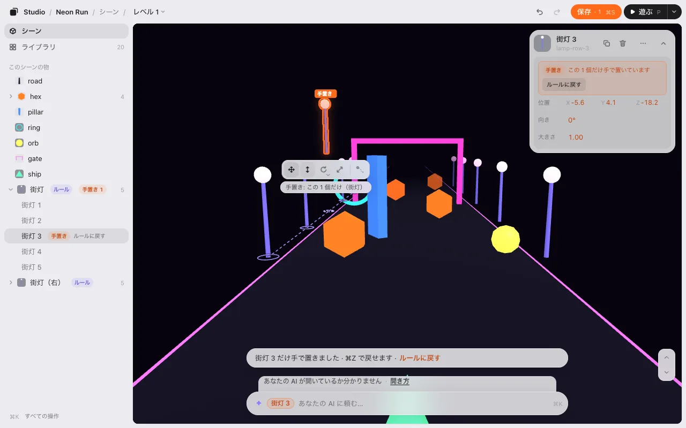

どれも <kbd>⌘</kbd><kbd>Z</kbd> 1 回で戻り、**保存** の数に入ります（**保存しました: 六角形の間 → 4 m**）。保存の後、AI がその全部（新しい数字・ずらし・手で置いた物・描いた四角）をゲームのコードのルールに書き込み、コードが同じことを言うようになったら、エディタが `placement.json` から消します。ルールはコードの 1 か所にだけあります。その時に物は動きません。動きそうな時は 1 行がどこかを言い（**いちばんずれた所: 街灯 3（0.4 m）**）、AI が直します。**AI の変更を元に戻す** で全部元どおりです。

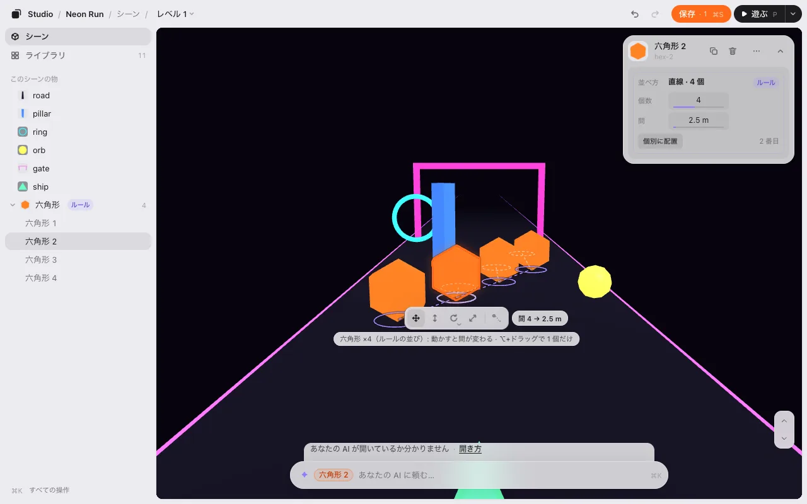

### 手で置いた物をルールにする

街灯を 1 本ずつ手で並べたけれど、列として数字で直したくなった。そんな時は、その物（自分で置いた物を何個か）を選んで、カードの **✦ ルールにする** を押します。下の欄に **近いルールにして** と入るので（「6 m おきの列で」と足してもかまいません）、送ります。AI がいちばん近いルール（列・格子・円・ランダム）を書いて入れ替えます。手で置いた物は隠れ、ルールの物が紫に光って並び、カードにルールの数字が出ます。

- **どれだけ近いかはエディタが測ります**（AI の言葉ではありません）。カードに **最大のずれ: lamp-3（0.6 m）**、ゲームの中には手で置いていた場所に橙の点、ルールの物までの細い線、いちばん遠い物に **lamp-3 · 0.6 m**。**元の配置と比べる** で印を消したり出したりできます。
- <kbd>⌘</kbd><kbd>Z</kbd> 1 回で手で置いた物に戻ります。近いルールが無い時（手でばらばらに置いた物）は、AI は入れ替えずに 1 行で言います。
- 比べる印は **保存** まで出ています。保存の後、AI が手で置いた物をゲームのコードから消します（ルールがその場所に入っています）。

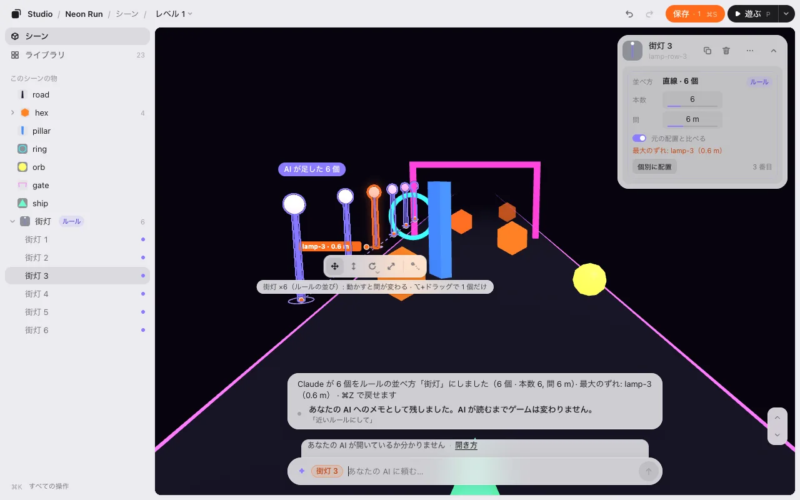

### 置かない所

ルールの数字の下の **置かない所** に、そのルールが物を置かない所が並びます。ゲームの中では地面に赤い斜線で見えます。自分で描いた四角（**手で描いた**）は縁が橙、ゲームのルールが決める所（「道の上」・**ルール**）は縁が紫の点線です。

- **＋ 四角を描く** を押して、地面をドラッグします（スマホは 1 本指。<kbd>Esc</kbd> でやめる）。描いている間に、そのルールの物が四角の外へ逃げ、1 行が何個動いたかを言います。四角の角を引くと大きさ（<kbd>Shift</kbd> で高さ）、真ん中を引くと場所が変わります。
- **✦ 言葉で指定** を押すと、AI に頼む欄にルールと **置かない所** が入ります。「プレイヤーから 5 m 以内には置かない」のように書くと、AI がゲームのルールにして一覧に足します（足された行が紫に光ります）。**5 m** のような数字は回せます（一覧の数字か、ゲームの中の縁の ◇）。
- スイッチでオフ（一覧には残る）、**×** で四角や AI が足した所を外します。**⋯ ほかのルールにも** で同じ所をほかのルールにも足せます。置かない所は、その下に並んでいるルールにだけ効きます。
- 自分で置いた物は、置かない所でも動きません。中にあると、カードの **手で置いた** の所に **置かない所の中です** と出ます。置ける所が足りない時は一覧に **12 個のうち 1 個は置ける所がありません**、ゲームの中では置くはずだった所に赤い × が出ます。

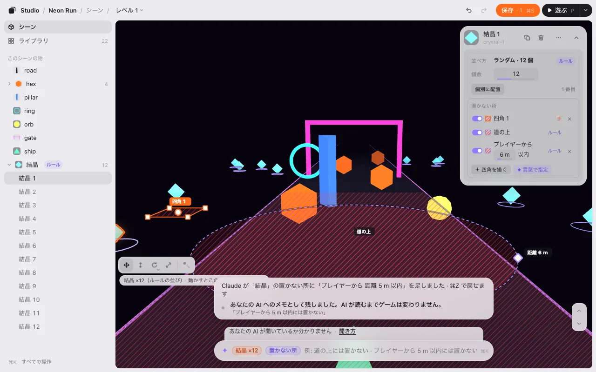

## 横の窓とスマホ

Claude アプリのチャットの横の枠と、スマホでは、下にあるものは全部、ゲームの下の **シート 1 枚** です。

- 上の札で 1 つずつ見せます: **シーン**（一覧）・**選んだ物**（そのカード）・その物に動きがあれば **動き**。
- AI の欄は、いつもシートのいちばん下の 1 行。AI がいるかどうかは、欄の中の点です（緑 = 見ています）。点を押すと文が出ます。
- AI の返事はゲームの上のほうに出て、数秒で消えます。欄を押すと、もう一度出ます。
- シートの上のバー（または欄の左の ▾）を押すと、欄だけにたためます。▴ でまた開きます。

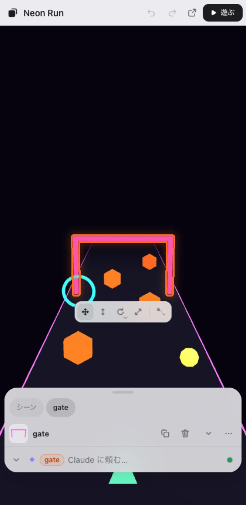

## 保存

何かを変えると、上のバーの **▶ 遊ぶ** の隣に **保存 · 1** が出ます。数字はまだ保存していない変更の数です。

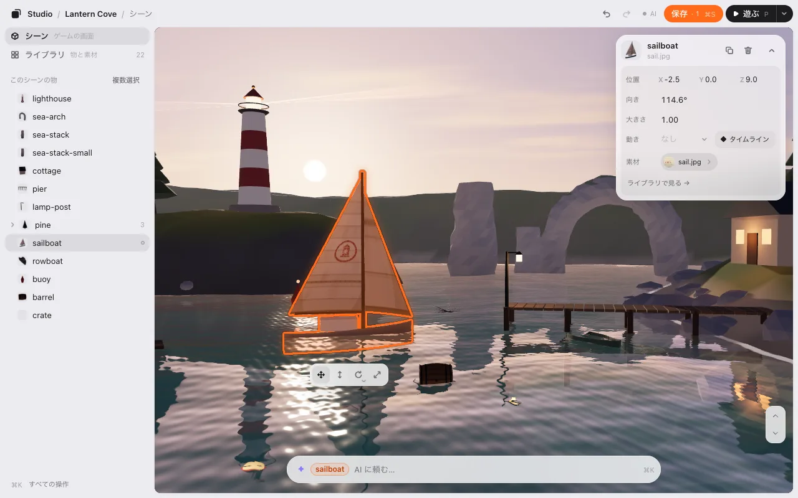

**保存**（<kbd>⌘</kbd><kbd>S</kbd>）を押すと、頼む欄の上の 1 行が、何を保存したかを物の名前で言い、ゲームに入ったら知らせます。

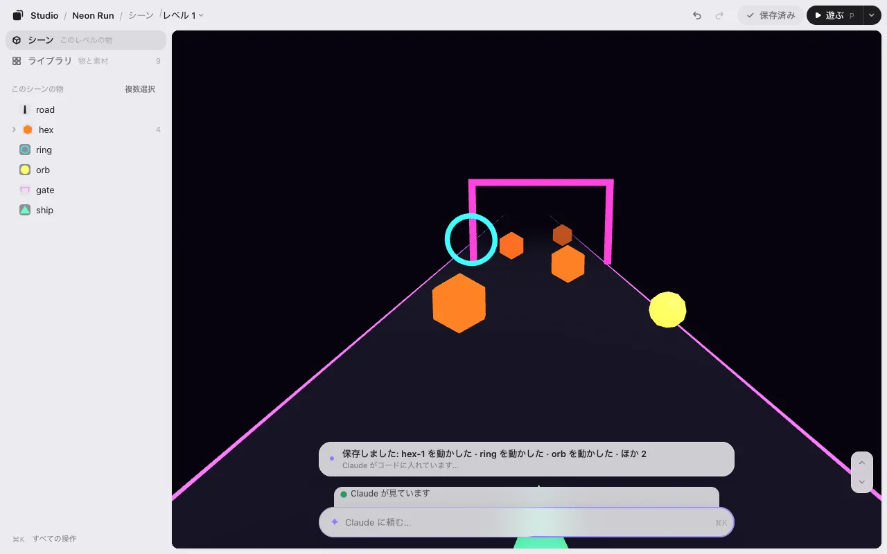

- 「**保存しました: gate を動かした · gate の動き · …**」の下に「**Claude がコードに入れています…**」。4 つ以上の時は、3 つと「**ほか 2**」。
- AI が終えたら「**✓ 保存しました: gate を動かした · … · ゲームに入りました**」（押した時と同じ名前で）。**▶ 遊ぶ** で試せて、**AI の変更を元に戻す** もあります。
- AI が開いていない時は「**保存しました。Claude が開いたら、コードに入れます**」。何も消えません。開き方は頼む欄の下の言葉にあります。

### 保存で何が起きるか

ゲームはコードでできていて、エディタはコードを書き換えません。代わりにこうします。

1. **保存すると、変えたことを書き留めます。** ゲームのフォルダの小さなファイル `placement.json` にです。「灯台は今ここ、これだけ回して、この大きさ」という一覧だと思ってください。変える前にどこにあったかも書くので、AI はコードの中でその物を見つけられます。
2. **AI がその一覧を読んで、** ゲームに入れます。最初の 1 回だけ、ゲームが始まる時に `placement.json` を読む 1 行をゲームに足します。それからは、保存するたびにゲームに出ます。数字を直接コードに書いてほしければ、AI にそう言ってください。ルールで並んだ物は、いつもコードに入ります: AI が変えた所をルールそのものに書き込み、一覧からは消えます。

ライブラリで差し替えたり足したりしたファイルは、もう 1 つの一覧 `library.json` に同じように書きます。くわしくは [しくみ](how-it-works.md)。

### なくさない

- 保存するまで、変更は下書きとして残っています。タブを閉じても消えません。
- 地面を動かした、25 m 動かした、のような大きな変更は、先に **保存の前に確かめてください** と聞きます。**元に戻して保存** か **このまま保存** を選べます。

次へ: [遊ぶ](play.md)
