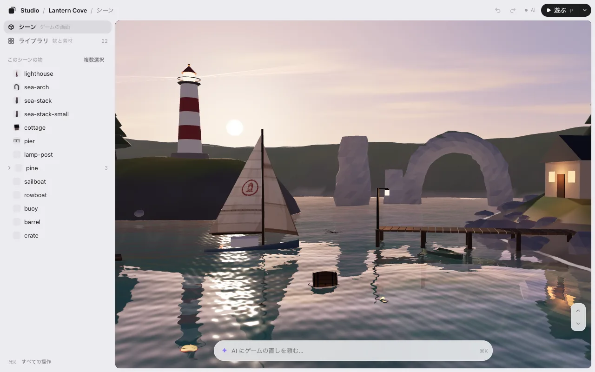

# はじめる

1 行で入れて、`/arrange` でゲームを開きます。2 分ほどです。

## 必要なもの

- 手元のパソコンで動く **Claude Code**（Claude アプリかターミナル）か **Codex**。クラウドのセッションではプラグインが読み込まれません。
- **Node.js 22.13 以降。** ターミナルで `node --version` を打つと分かります。古ければ [nodejs.org](https://nodejs.org) から最新の LTS を入れてください。
  **Node.js は 22.23.4 以降（24 系なら 24.22.1 以降）に上げてください。** [2026 年 10 月のセキュリティの直し](https://nodejs.org/en/blog/vulnerability/october-2026-security-releases)が入っています。

ほかに入れるものはありません。

## 1 行で入れる

Claude Code か Codex に、この 1 行を貼ってください。

```
Install KUMODeck Game Studio for me by following https://github.com/kumodeck/game-studio/blob/main/INSTALL.md
```

AI がゲームスタジオを入れて、エディタを開きます。フォルダが空なら、見本のゲームから始めます。

Claude Code では 1 つだけ質問があります。「新しい版が出たら自動で入れますか？」 はいと答えると、新しい版がひとりでに届きます（次のセッションから使えます）。あとで変えられます。[更新](#更新) を見てください。

### 自分で入れる

**Claude Code**（ターミナルで）:

```
claude plugin install game-studio --marketplace kumodeck/game-studio
```

Claude Code の中なら、`/plugin marketplace add kumodeck/game-studio` のあと `/plugin install game-studio@game-studio`。

**Codex**（ターミナルで）:

```
codex plugin marketplace add kumodeck/game-studio && codex plugin add game-studio@game-studio
```

Codex の中なら、`/plugins` を打って **KUMODeck Game Studio** を選びます。そのあと新しいセッションを始めてください。

## ゲームを開く

ゲームのフォルダ（`index.html` があるところ）で AI を開いて、こう打ちます。

| Claude Code | Codex |
|---|---|
| `/arrange` | `$arrange`、または「arrange のエディタを開いて」 |

「木の場所を直したい」のように、ふつうの言葉で頼んでもかまいません。AI がゲームのつくりを確かめて、エディタを開きます。



### まだゲームがないとき

**空のフォルダ** で AI を開き、`/arrange` と打ちます。聞かれるのは 1 つだけ。「見本から始めますか？ 3D か 2D を選んでください。」 小さな見本のゲームがフォルダに入り、エディタが開きます。試すのは 3 つです。

1. どれかをクリックして、ドラッグする。
2. 下の欄に「これをあと 3 つ」のように書いて、Enter。
3. **保存** を押す。

見本は始まる時に配置を読むので、保存したものはすぐゲームに入ります。

## エディタのリンク

エディタは手元のパソコンの `http://127.0.0.1:…` で動きます。リンクは AI が返事に書きます。

- **ターミナルや Codex** では、ブラウザでひとりでに開きます。
- **Claude アプリ** では、チャットの横のブラウザの枠に開きます。見えないときは <kbd>⌘</kbd><kbd>⇧</kbd><kbd>B</kbd>（Windows は <kbd>Ctrl</kbd><kbd>Shift</kbd><kbd>B</kbd>）。
- 枠は細いので、右上の **大きく開く**（↗）で同じエディタを大きな窓で開けます。AI に頼むのも保存も、そちらで同じようにできます。
- いつものブラウザがよければ、AI に「ブラウザで開いて」と言ってください。このゲームでは次からもそうします。

リンクには合言葉が入っている（`?t=` のあと）ので、このパソコンでしか開けません。人に渡さないでください。なくしたら、AI にもう一度リンクを聞いてください。くわしくは [よくある質問](faq.md#エディタのリンク)。

## 更新

**Claude Code:** 入れる時に「はい」と答えたなら、更新はひとりでに届きます。あとで変えるには、`/plugin` から **Marketplaces → game-studio → Enable auto-update**（止めるなら **Disable auto-update**）。今すぐ更新するなら:

```
claude plugin update game-studio@game-studio
```

**Codex** はプラグインを自動で更新しません。更新するには:

```
codex plugin marketplace upgrade game-studio
```

## 外す

**Claude Code:**

```
claude plugin uninstall game-studio@game-studio && claude plugin marketplace remove game-studio
```

**Codex:**

```
codex plugin remove game-studio@game-studio && codex plugin marketplace remove game-studio
```

ゲームのフォルダには、エディタが書いたもの（`placement.json`・`library.json`・`.studio` フォルダ）が残ります。要らなければ消してください。

次へ: [編集](editing.md)
