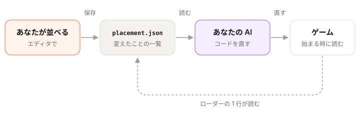

# しくみ

ゲームスタジオは、ゲームのコードを書き換えません。変えたことを書き留め、それを AI がコードに入れます。そのしくみです。



## placement.json

保存すると、エディタはゲームのフォルダに `placement.json` を書きます。変えた物だけが並びます。

```json
{
  "version": 1,
  "tool": "placement",
  "dim": "3d",
  "objects": {
    "tree-01": { "p": [3.25, 0, -4.1], "r": 1.5708, "s": 1.2,
                 "was": { "p": [2.0, 0, -4.1], "r": 0, "s": 1 } }
  }
}
```

- 物はゲームの中の名前で書きます（`tree-01`）。
- `p` は位置、`r` は回した角度、`s` は大きさ。
- `was` は変える前の値です。AI はこの数字をコードの中で探して、直す行を見つけます。
- 複製した物は `added`、消した物は `removed` に入ります。ローダーはすぐに見せます（複製は見た目だけ、消した物は隠す）。AI がコードに入れると、複製も元の物と同じように動きます。
- 動き・レベル・UI も同じファイルです。形のすべては [CONTRACT.md](../../../../CONTRACT.md)（英語）にあります。

**`library.json`** はファイルについて同じことをします。差し替えたもの（`replace`）、足したもの（`added`）、何も使っていないもの（`unused`）。エディタがファイルを消すことはありません。削除 を押すと、AI が先にあなたに聞きます。

## ゲームに入れる 2 つの道

**1. ローダー（ふつうはこちら）。** 最初に保存した時、AI は小さなファイル `studio-placement.js` と、ゲームが始まる時に `placement.json` を読む 1 行を足します。

```js
await applyPlacement(scene, './placement.json');
```

それからは、コードを直さなくても、保存するたびにゲームに出ます。`placement.json` がなければ、この行は何もしません。見本には最初から入っています。

**2. 数字をコードに書く。** ファイルを足したくなければ、AI に「数字をコードに書いて」と言ってください。コードの中の `was` を探して、新しい数字に書き換えます。このゲームでは次からもそうします。Godot のゲームはいつもこちらです。

## .studio フォルダ

エディタと AI は、ゲームのフォルダの `.studio/` にメモを置きます。

| ファイル | 中身 |
|---|---|
| `adapter.js` | three.js 以外のエンジンで、エディタとゲームをつなぐもの。AI が書きます |
| `tools.js`・`studio.json` | エディタをゲームに合わせるために頼んだこと（マス目・90° ずつ・地面を固定） |
| `ui/` | エディタの見た目を変えたとき |
| `requests/` | 保存と、AI に頼んだことの 1 つずつ |
| `chat/` | 一時停止中の AI との話 |
| `play/` | 遊びながら送った絵（新しい 24 枚） |

## エディタがゲームを見るしかた

エディタはゲームを自分の中で開き、各ページに小さな編集用のスクリプトを足します。このスクリプトはエディタの中でだけ動きます。エディタの外では、ゲームはこれまでとまったく同じに動きます。three.js のゲームはそのまま使えます。Phaser・PixiJS・canvas・HTML のゲーム・Godot の Web 書き出しでは、ゲームスタジオに入っている例から AI が小さなアダプタを書き、エディタが動くかを確かめます。

## 手元に残るもの

- エディタは手元のパソコンの `127.0.0.1` で動きます。ほかの人は開けません。
- 読み書きするのはゲームのフォルダの中だけです。`placement.json`・`library.json`・`assets/` の新しいファイル・`.studio/` のメモ。
- どこにも何も送りません。追跡もアカウントもありません。
- ただ 1 つの例外は [AI で作る](make-with-ai.md) です。**作る** を押すと、書いた内容がファイルを作るために KUMODeck に送られます。

次へ: [よくある質問](faq.md)
