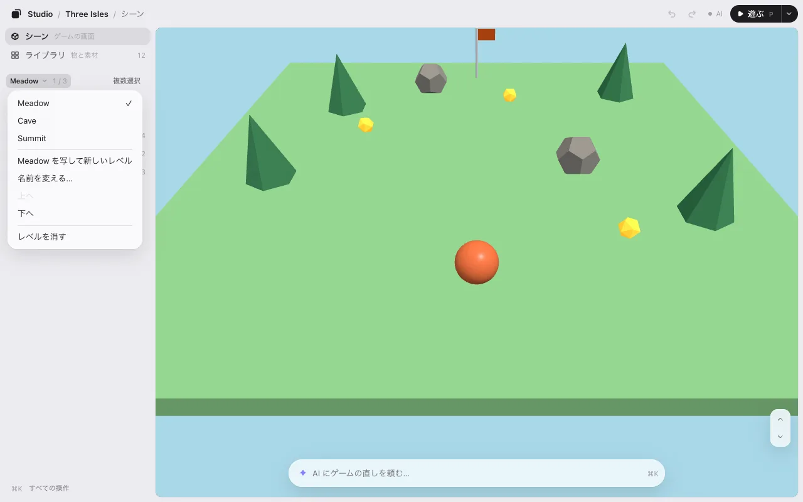
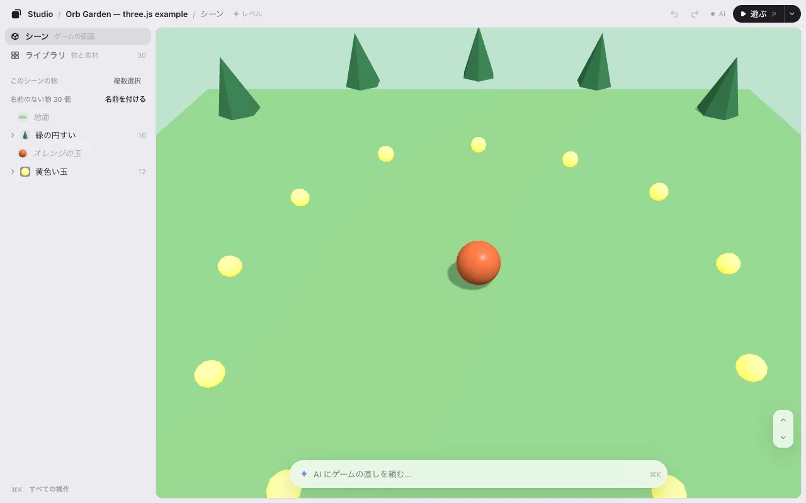

# レベル

今のレベルは、エディタのいちばん上の道しるべの最後に出ます（**Studio / Three Isles / シーン / Meadow ⌄**。ゲーム・シーン・レベルの順）。切り替える、新しく作る、複製する、名前を変える、並べ替える、ができます。

## レベルを切り替える

いちばん上の道しるべのレベルの名前（**Meadow ⌄**）を押すと、レベルのメニューが開き、ほかのレベルを選べます。ゲームはそのレベルで開きます。名前にマウスを乗せると、何番目か（「レベル 1 / 3」）が出ます。

キーボードでは <kbd>]</kbd> で次のレベル、<kbd>[</kbd> で前のレベルへ移ります。メニューのそのレベルの行にもキーが出ます。**すべての操作**（<kbd>⌘K</kbd>）には **レベル…**・**前のレベル**・**次のレベル** があります。

配置・動き・戻す の履歴は、レベルごとに別です。あるレベルで動かした物は、別のレベルにいる間も **保存 · N** に数えられています。

## 作る・名前を変える・並べ替える

メニューには:

- **新規レベル**: 空のレベルを「レベル 4」（次の番号）という名前で作り、すぐ開きます。地面・空・光は残り、その上に置いた物は無くなります。
- **複製**: 今のレベルの写しを「Meadow 2」という名前で作り、すぐ開きます。
- **名前を変える…**: その場で打ちます。<kbd>Enter</kbd> で決まり、<kbd>Esc</kbd> でやめます。
- **上へ** と **下へ**: 順番を変えます。
- **レベルを消す**: 隣のレベルに移ります。ゲームのコードにあるレベルなら、コードから外す前に AI が 1 回聞きます。
**新規レベル** か **複製** の後は、上に 1 行「レベル 4 を作りました。⌘Z で取り消し」と出ます。やめるときは <kbd>⌘</kbd><kbd>Z</kbd>（スマホではその行の **取り消す**）。違うレベルにするには、手で物を変えるか、下の入力欄で AI にどんなレベルにしたいかを頼みます。

どれも **保存 · N** の 1 つに数えます。保存すると、AI が新しいレベル・名前・順番をゲームに入れます。

## レベルを遊ぶ

**▶ 遊ぶ** は、画面に出ているレベルで遊びます。作っているレベルをそのまま試せます。遊んでいる間、道しるべのレベルの名前には ⌄ が付きません。切り替えは編集に戻ってから。

## レベルの無いゲームにレベルを足す

レベルの無いゲームにも、レベルは 1 つあります。いちばん上の道しるべは **Studio / ネオンオーブ / シーン / レベル 1 ⌄** です。**レベル 1 ⌄** を押すとメニューが開きます。選ぶまで何も起きません:

- **新規レベル**: 今の画面がレベル 1 になり、空のレベル 2 がすぐに開きます（地面・空・光は残ります）。
- **複製**: 今の画面がレベル 1 になり、それを写したレベル 2 がすぐに開きます。

上に 1 行「レベル 2 を作りました。⌘Z で取り消し」と出ます。保存すると、AI がレベルを切り替える数行をゲームに足します。それまで、エディタの外のゲームは今までどおりレベル 1 で遊べます。

スマホでは上に場所が無いので、**…**（すべての操作）の **レベル…** を使います。

## レベルが出ないとき

エディタは、ゲームがどんなレベルを持っているかをゲームから教わります。**レベル 1 ⌄** からレベル 2 を作るか、AI に頼んでください。「ゲームスタジオでレベルを出せるようにして」。ゲームがレベルを選ぶ所に、数行を足します。

次へ: [UI の編集](ui.md)
