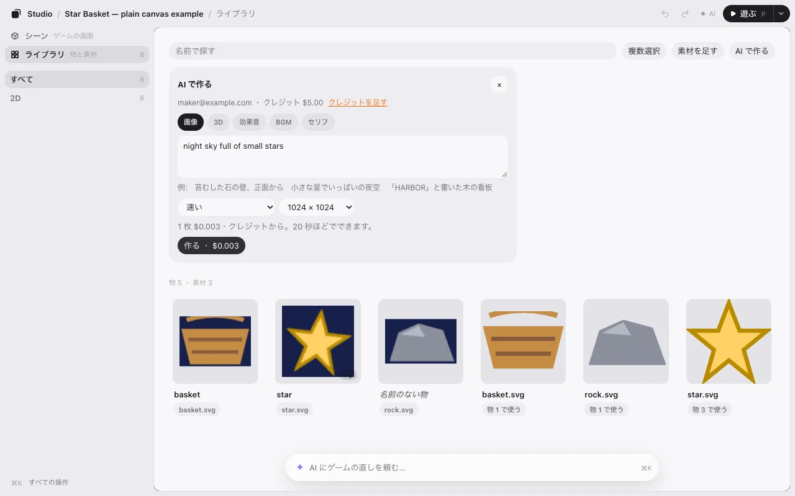
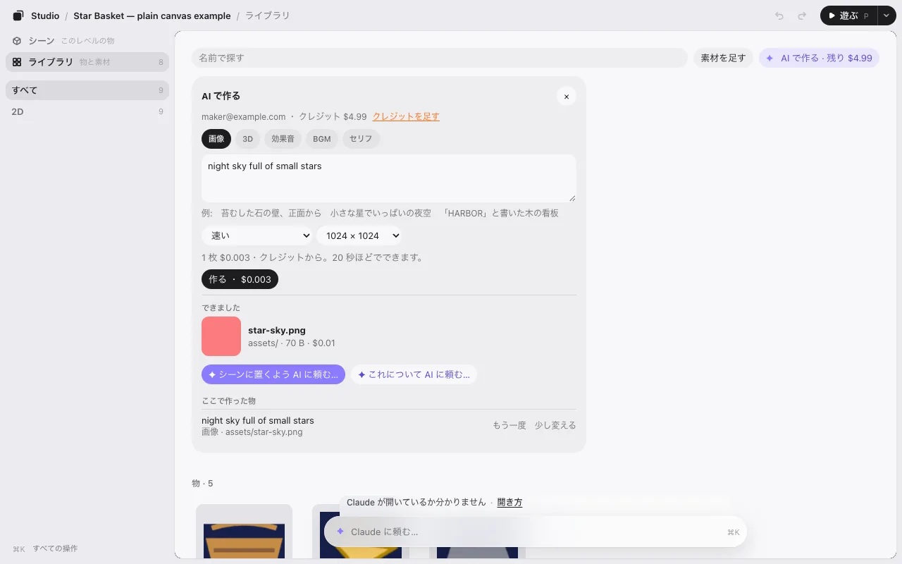
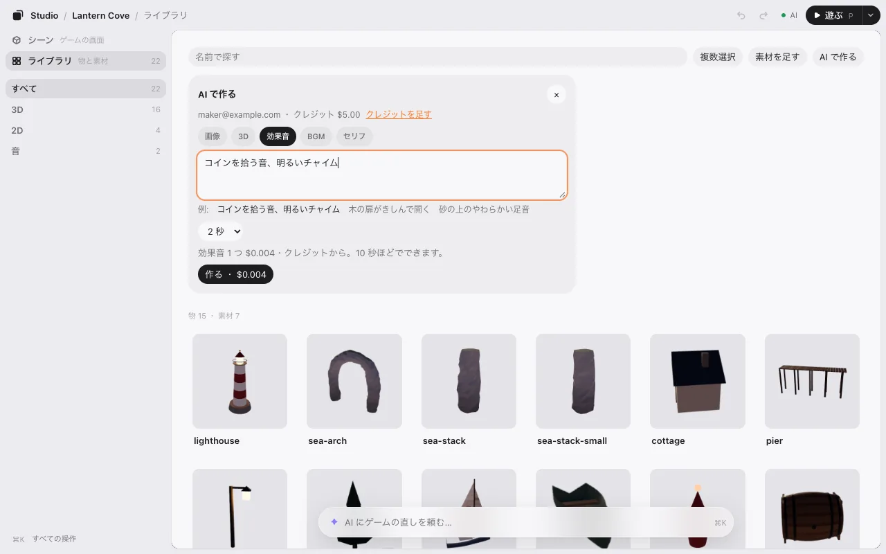

# AI で作る

絵や 3D モデルや音が要るときは、ライブラリでそのまま作れます。これは任意です。KUMODeck のアカウントが要り、クレジットがかかります。ゲームスタジオのそれ以外は、無料でアカウントなしで使えます。

## 作れるもの

| 種類 | できるもの | かかる時間（目安） |
|---|---|---|
| **画像** | 絵。速い・細かい・継ぎ目なしのタイル。512・1024・2048 px | 20 秒ほど |
| **3D** | モデル。色つき、または形だけ | 3 分ほど |
| **効果音** | 1・2・5 秒の効果音 | 10 秒ほど |
| **BGM** | 15・30・60 秒の曲。ループもできます | 1 分まで |
| **セリフ** | 5 つの声から選んだ声で話すセリフ | 10 秒ほど |

## KUMODeck にログインする

1. **ライブラリ** を開いて **AI で作る** を押します（スマホでは **+** の中）。
2. 最初はログインを聞かれます。ターミナルで実行し、ブラウザで「許可」を押してから、戻ってきてください。

```
npx kumodeck login
```

3. **ログインした** を押します。

ログインの情報は手元のパソコンに置かれます。エディタがそれをページやゲームに見せることはありません。

## 作る



1. 種類を選んで、**何を作るか** に書きます。例から始めることもできます。
2. 選ぶものを選びます。値段はボタンに出ます（**作る ・ $0.004** のように）。
3. **作る** を押します。押すまでは、何も送らず、何もかかりません。

最初の 1 回だけ、KUMODeck の規約の AI の部分に同意を求められます。何を作るかはあなたが決めること、できたものを人が作ったものや本物の写真として見せないこと、費用はクレジットから引かれること、です。

できたものは、ゲームの `assets` フォルダの新しいファイルになります。上書きはしません。**シーンに足す** でゲームに置くか、AI に使うよう頼んでください。



作ったものは **ここで作った物** に残ります。**もう一度** と **少し変える** で、同じ言葉と選んだものが入力に戻ります。



## 値段

AI の提供元の値段そのまま（上乗せなし）を、KUMODeck のクレジットから米ドルで支払います。

| 種類 | 値段 |
|---|---|
| 画像・速い | 1 メガピクセルあたり $0.003（1024 × 1024 が 1） |
| 画像・細かい | $0.03、1 メガピクセルを超えた分は 1 メガピクセルあたり $0.015 |
| 画像・継ぎ目なしのタイル | 1 メガピクセルあたり $0.02 |
| 3D モデル | 色つき $0.20、形だけ $0.10 |
| 効果音 | 1 秒あたり $0.002 |
| BGM | 1 曲 $0.0376 |
| セリフ | 1,000 文字あたり $0.05 |

クレジットが足りないときは、いくら要っていくらあるかが出ます。**クレジットを足す** から足せます。

次へ: [しくみ](how-it-works.md)
