# 動き

舟を走らせる、扉を開ける、コインを回す。いくつかの時刻で物がどこにあるかを決めると、その間はエディタが埋めます。動きは 3D のゲームで使えます。

## 道具の帯から始める

いちばん早い方法: ゲームで物を選び、その下の道具の帯の右端の **動き** を押します（<kbd>A</kbd> でも）。

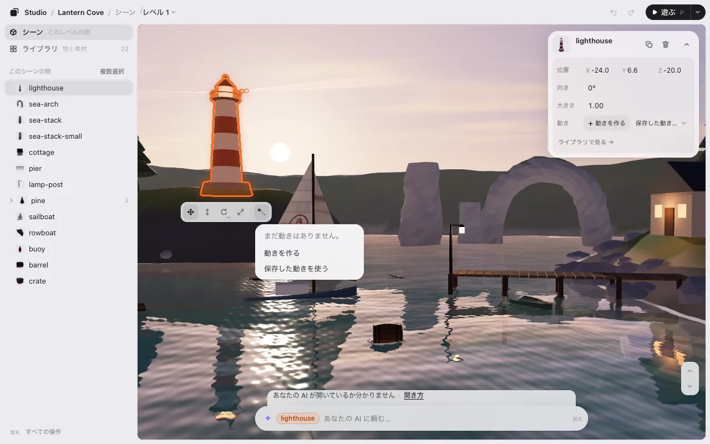

入口は 2 つだけです。決まった型の一覧はありません。動きは、やって見せて作ります。

- **動きを作る**: 今の場所・向き・大きさが始まり（0 秒）です。タイムラインが下に小さく開き、1 行が **〇〇 を、動いてほしい所までドラッグしてください（Esc でやめる）** と出ます。ドラッグして離すと、そこが 1 秒の姿になり、その場で再生して見せます。この 1 回のドラッグが 1 つの変更です（**保存 · 1**）。<kbd>⌘</kbd><kbd>Z</kbd> 1 回で全部戻ります。
- 続けて動かす・回す・大きさを変えるたびに、最後のポイントの 1 秒あとにポイントが足され、その 1 秒が再生されます。**終わる**（または <kbd>Esc</kbd>）で足すのをやめます。<kbd>⌘</kbd><kbd>Z</kbd> で 1 つずつ戻せます。
- **保存した動きを使う**: 前に作った動きを選びます（ライブラリに動きがある時だけ）。

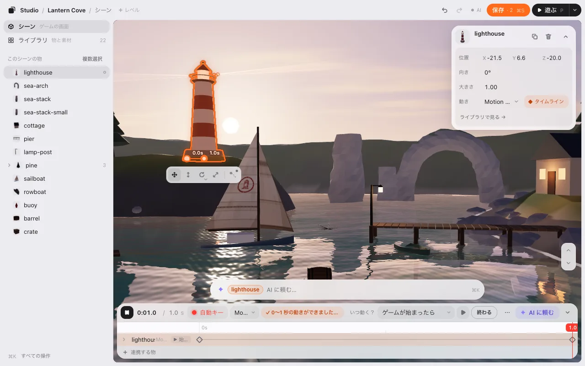

**終わる** のあと、タイムラインの上の行で、くり返し方といつ動くかを変えられます。

**▶ 見る** · くり返し **［1 回だけ ▾］** · いつ動く？ **［ゲームが始まったら ▾］**

- **くり返し** は **1 回だけ**・**ループ**・**行って戻る**。
- **いつ動く？** は [いつ動き出すか](#いつ動き出すか) です。
- **長さ** は、タイムラインの最後のポイントの位置です。秒はものさしの目盛りにだけ出ます。長くしたい時は最後のポイントを右へ、短くしたい時は左へドラッグします（ものさしの終わりの少し先まで、薄い所に置けます）。

ライブラリの **＋ 動きを作る** も同じです。動きのある物は、カードに **動き  ship の動き ›** のように、動きの名前の 1 行が出ます。押すとその動きがタイムラインで開き、いつ動くかはタイムラインの上の行に出ます。動きの無い物にはこの行は無く、入口は帯の「動き」のボタンだけです。1 つのポイントの時刻を変えたい時は、そのポイントをものさしの上で左右にドラッグします。

動きの付いた物では、ボタンに小さな点が付き、押すとその動きがタイムラインで開きます。

## 動きを外す・削除する

物のカードの **動き** の行を右クリックするか、行の右端の **⋯** を押します。
- **この物から外す**: この物だけが動かなくなります。動きはライブラリに残ります（ほかの物にも付いたまま）。
- **動きを削除**（赤）: 動きがライブラリからも、付いている全部の物からもなくなります。ほかの物にも付いている時だけ、先に 1 行で確かめます（**ほかの 2 つの物からも外れます**）。どちらも <kbd>⌘</kbd><kbd>Z</kbd> で戻せます。<kbd>Delete</kbd> キーは今までどおり選んだ物を消し、動きは消しません。

## タイムライン

動きのある物を選んで、カードの **動き** の行か、帯の「動き」のボタンを押します（<kbd>⌘</kbd><kbd>K</kbd> の **タイムライン** でも）。タイムラインはゲームの下に開きます（スマホではカードの上）。

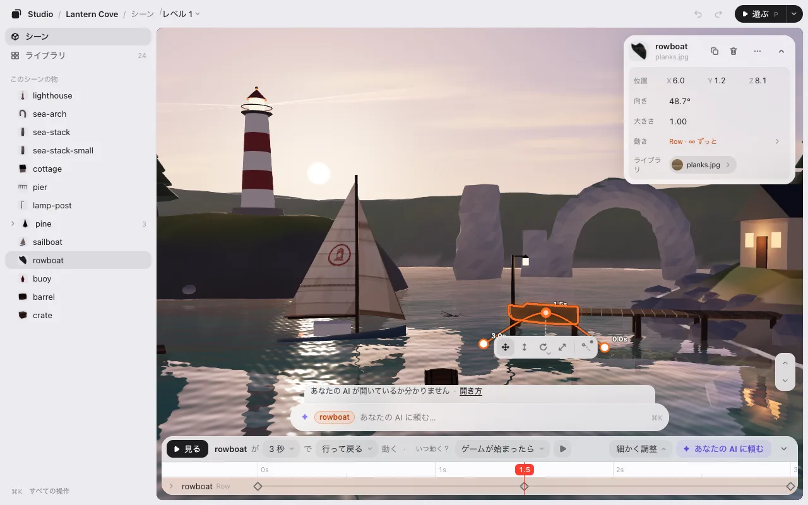

上は 1 行です。**▶ 見る**（<kbd>Space</kbd> でも）、**くり返し**（*［1 回だけ ▾］*）、**いつ動く？**、そして **細かく調整**・**✦ Claude に頼む**（名前はあなたの AI）・たたむ **⌄**。どの幅でも、行の言葉が切れることはありません（狭いと 2 段になり、▶ はアイコンだけになります）。その下には、いつもタイムラインそのもの（ものさし・行・ポイント）が出ています。動きの名前は行の左（物の名前の横）に出ます。

- **ものさし** が時間です。ドラッグするとその時刻が見えます（赤い線に秒が出ます）。動きの長さは最後のポイントの所までで、その先は薄くなります。<kbd>←</kbd> <kbd>→</kbd> で 0.1 秒（<kbd>Shift</kbd> で 1 秒）。
- 行は **選んでいる物**（いくつか選んでいればその物たち）と、それに [連携](#連携-いくつかの物を-1-本の動きに) した物です。物を選んでも行は動きません（選んだ行が橙に光ります）。連携した行は左の **⠿** を引いて並べ替えられます（並びは動きと一緒に保存されます）。行を開くと **位置**・**向き**・**大きさ** が別の行になります。
- **細かく調整** を押すと、行の横（タイムラインの中）に細かい設定が開きます。**● 動きを記録**・**動き**（この物のどの動きか・**＋ 動きを作る**・**名前を変える**・**この物から外す**）・**終わり方とくり返し**・**きっかけ**（ほかのきっかけ）・**試す**・**動く物一覧**（**＋ 連携する物** と **動く物を全部出す**。動く物が全部の行で並びます。**選んだ物だけにする** で戻ります）。一度開くと、次にタイムラインを開いた時も開いたままです。もう一度 **細かく調整** を押すと閉じます。

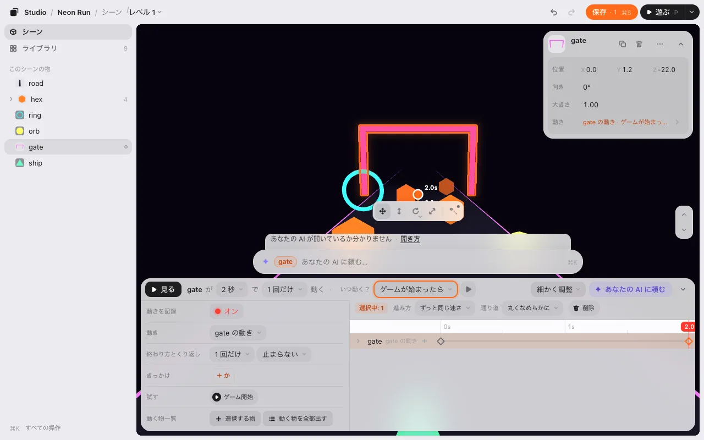

## ポイント

**ポイント** は「この時刻に、ここにいる」という印です。

1. 時刻の線を、たとえば 2 秒に動かす。
2. 物を動かす・回す・大きさを変える。

**● 動きを記録** がオン（最初はオン。**細かく調整** の中）なら、それで時刻の線にポイントが打たれます。最初の 1 つでは、0 秒（動かす前の場所）にもポイントが打たれます。何も動かさずにポイントを打つには <kbd>K</kbd>。

ポイントを直すには、クリックして選びます（<kbd>Shift</kbd> か <kbd>⌘</kbd> で足す、四角で囲む）。

- ものさしに沿ってドラッグすると時刻が変わります。
- <kbd>Delete</kbd>（または、選んだポイントの行の **削除**）で削除します。<kbd>⌘</kbd><kbd>C</kbd> と <kbd>⌘</kbd><kbd>V</kbd> で時刻の線にコピーします。
- 直すたびに、1 回ずつ戻せます。

**● 動きを記録** がオフ か、タイムラインをたたんでいるときは、物を動かすと動きごと動きます。

## 道

3D では、位置のポイントを通る物の道がシーンに描かれます。ポイントごとに点があり、地面まで点線が下りています。点をドラッグすると、そのポイントが地面に沿って動きます。<kbd>Shift</kbd> を押しながらドラッグで上下。

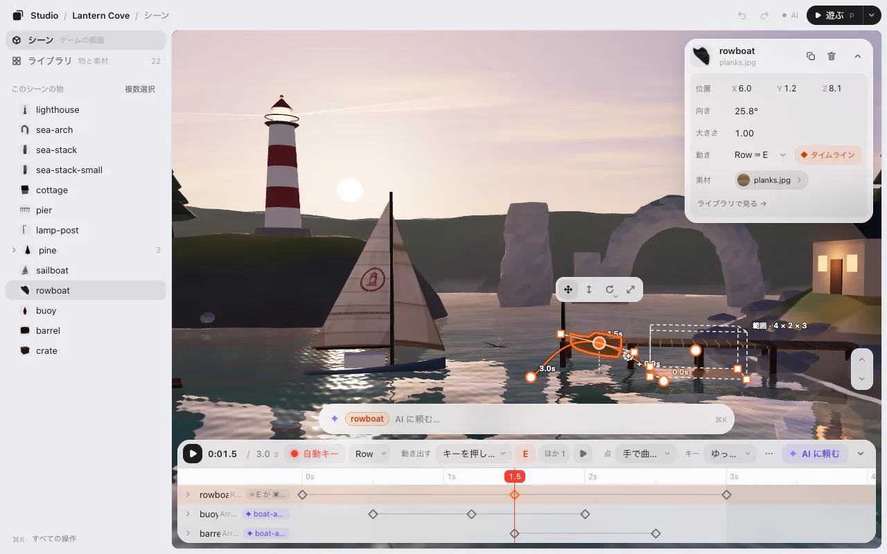

- **道を曲げる。** ポイントを選ぶと（タイムラインでも点でも）**取っ手** が 2 本出ます。片方をドラッグすると、そこで道が曲がります。もう片方もついてきます。<kbd>Alt</kbd> を押しながらだと片方だけ動き、鋭く曲がります。
- **角にする。** 点をダブルクリックします（選んだポイントの行の **通り道 → カクッとまっすぐ** でも）。道がまっすぐ入って、まっすぐ出ます。もう 1 度ダブルクリックでなめらかに戻ります。
- **道の途中にポイントを足す。** 線にマウスを乗せると、時刻つきの **＋** がついてきます。クリックすると、道の形を変えずにその時刻にポイントが打たれます。

## ポイントのつながり方

ポイントを選ぶと、上の行の下に **選択中: 1** の行が出ます。**進み方** で、次のポイントへの速さの付き方を選びます。

- **なめらかに（自然な加減速）**: ゆっくり出て、ゆっくり着く。最初はこれです。
- **ずっと同じ速さ**: 始めから終わりまで同じ速さ。
- **待ってからパッと飛ぶ**: そのまま止まっていて、次のポイントへ飛ぶ。

同じ行に **通り道**（位置のポイントを選んだ時。**丸くなめらかに**・**カクッとまっすぐ**）と **削除** があります。

上の行の **くり返し ［1 回だけ ▾］**（**細かく調整** の **終わり方とくり返し** にも）で、終わったあとを決めます。**1 回だけ**・**ループ**・**行って戻る**。

## いつ動き出すか

タイムラインの上の行の **いつ動く？** で、動きが始まる時を決めます。横の **▶** で、その時を試せます。動きを付けた直後・作り終えた直後は、このメニューに橙の輪が付きます（次に決める物）。

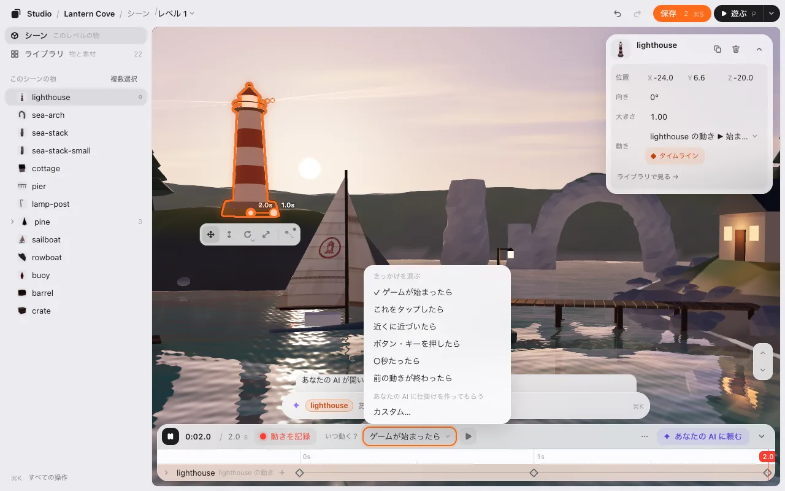

**きっかけを選ぶ** の中:

- **ゲームが始まったら**: ゲームが始まった瞬間から動きます。
- **これをタップしたら**: プレイヤーがこの物を直接さわった時（クリックでも）。
- **近づいたら**: 一定の距離に入った時。シーンに箱が出ます。白い点をドラッグして置きます（<kbd>Shift</kbd> を押しながらで上下）。隅をドラッグすると、反対の隅はそのままで大きさが変わります（<kbd>Shift</kbd> を押しながらで高さ）。
- **ボタン・キーを押したら**: 決めたキーや画面のボタンを押した時。
- **○秒たったら**: ゲームが始まってから決めた秒数のあと。
- **前の動きが終わったら**: ほかの動きと続けて動かしたい時（ほかに動きがある時だけ）。

**AI に仕掛けを作ってもらう** の中:

- **カスタム…**: 下のチャットの欄が、この動きを入れて開きます。「ぶつかったら赤くなって爆発」のように書くと、あなたの AI がゲームのコードにその仕掛けを作ります。メニューには **カスタム** と出ます。AI がもう作った物は **ぶつかったら（AI）**・**合図を受け取ったら（AI）** のように出ます。

**細かく調整** の **きっかけ** の **＋ 別のきっかけ** で、きっかけをもう 1 つ足せます。「キーを押したら **か** これをクリックしたら」のように、どれか 1 つで動き出します。**×** で外します。上の行には **ほか 1** と出ます。

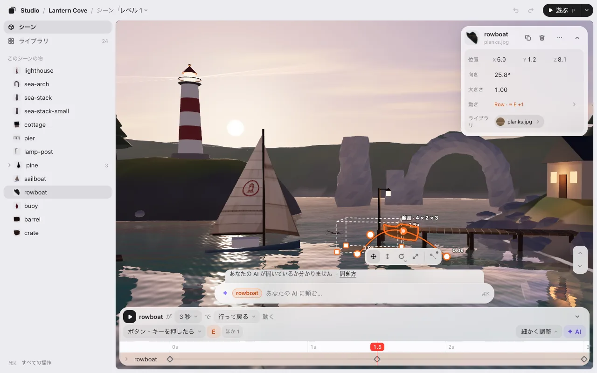

**ループ** か **行って戻る** の動きは、**終わり方とくり返し**（**細かく調整** の中）の **止まる** で終わる時を決めます（**1 回だけ** は自分で終わるので、この選び物はありません）。**止まらない**・**何回かしたら**・**合図を受け取ったら**。止まったあとは **その場で** か **最初の姿に戻る**。

## 試す

**いつ動く？** の横の **▶** を押すと、この動きの始まりが今起きたようにシーンが動きます。もう 1 度押すと止まります（スマホでは **細かく調整** の中だけ）。

**細かく調整** の **試す** には、このシーンで動きが始まるきっかけごとに ▶ が並びます（「ゲームが始まったら」「舟をクリック」など）。押すと、それが今起きたようにシーンが動きます。**止める** で終わります。

## 連携: いくつかの物を 1 本の動きに

タイムラインに出るのは選んでいる物だけです。ほかの物も一緒に動かしたい時（箱がはね、ブイが沈み、たるが桟橋から転がる、短いカットシーンのように）は、その物を連携します。

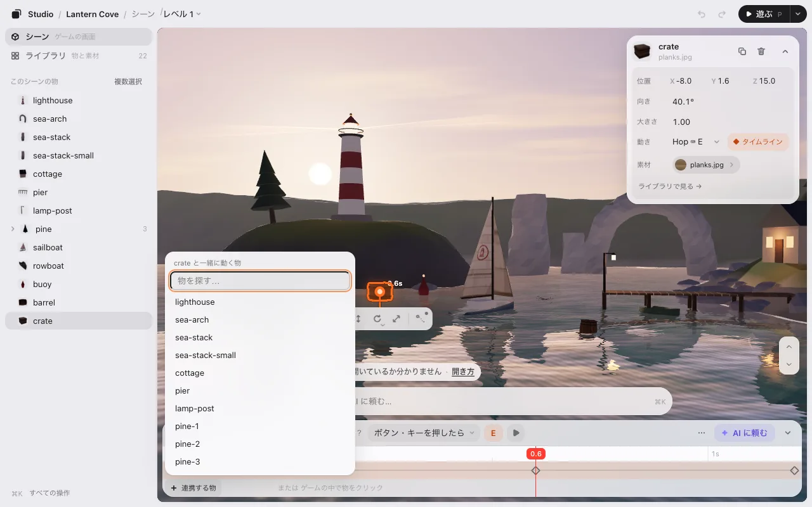

1. **細かく調整** を開き、**動く物一覧** の **＋ 連携する物** を押します（細かく調整が開いている間は、選んでいる物の行の右端の **＋** でも）。
2. 一覧から選びます（名前を打つと探せます）。一覧が開いている間は、ゲームの中で物をクリックしても選べます。選んでいる物はそのままです。
3. 同じ時刻の上に、その物の行ができます。**● 動きを記録** のまま動かすとポイントが打たれます。行の左上に **連携 · 2** と出ます。

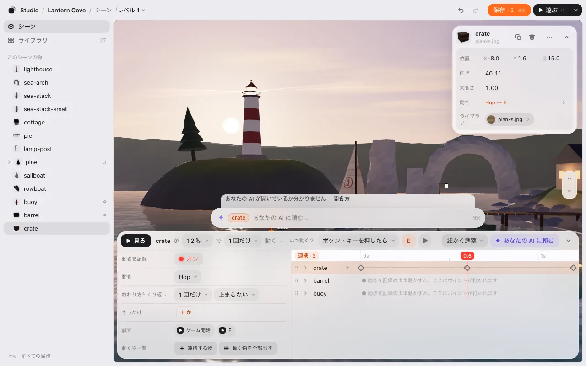

**いつ動く？** と **止まる** は一緒です。全部が一緒に動き出します。連携した物を選んでも同じ行が同じ並びで出ます（選んだ行が光るだけ）。並びは行の左の **⠿** を引いて変えます。連携した行の **×** で外します（その物の自分の動きは残ります）。最後の 1 つを外すと、動きは選んでいる物だけの物に戻ります。

ライブラリの連携した動きを物に落として連携することもできます。

## 動きのライブラリ

動きはすべてライブラリの **動き** にあります。タイルには道が描かれ、指を乗せると動きます。

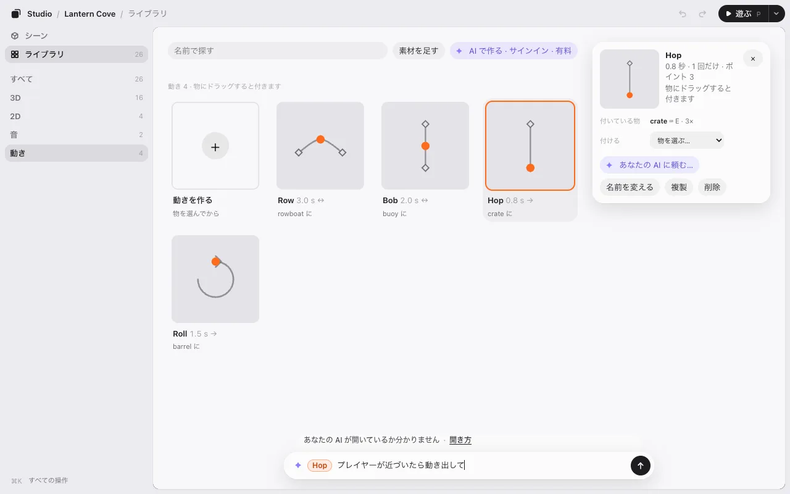

- **付ける** で、同じ動きを別の物にも付けます。ポイントを 1 回直すと、使っている物すべてが変わります。
- **複製** で、別に直せる複製を作ります。
- **Claude に頼む…**（名前はあなたの AI）で、動きを下の欄に入れます。「もっと大きく揺らして」のように頼めます。

## AI に頼んで動かす

ポイントを自分で打たなくてもかまいません。AI の使い方は 2 つです。

- **作った動きを使う。** タイムラインの **✦ Claude に頼む** を押します（物の右クリック、ライブラリの動きからでも）。下のチャットの欄に **crate · Hop** のように 2 つの名前の札が付き、カーソルが入ります。「プレイヤーが近づいたら動き出して」、続けて「もう少しゆっくり」と話せます。AI がゲームのコードでその瞬間につなぎます。

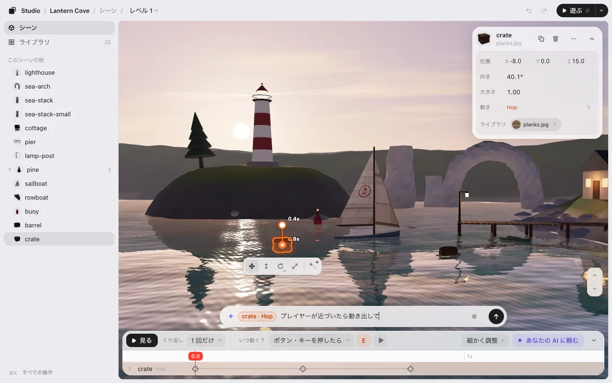
- **言葉で頼む。** 物を選んで下の欄に書きます。「舟をゆっくり揺らして」「青い柱を螺旋で」。場所で言う動き（ここからあそこへ・跳ねる）は、AI がポイントで作り、あなたの動きと同じくタイムラインに出ます。数字で言う動き（螺旋・波・回り続ける）やゲームに合わせる動き（プレイヤーを追う）は **コードの動き** になります。形はゲームのコードにあり、タイムラインには名前の行だけが出ます（ポイントはありません）。**▶ 遊ぶ** とゲームで動き、<kbd>⌘</kbd><kbd>Z</kbd> で外れます。形を変えたい時は、もう一度 AI に頼みます。
- **並べる。** 「道に沿って街灯を 6 m おきに 10 本」。AI がゲームのコードに並べ方を書き、エディタにすぐ出します。一覧には並べ方の名前で出ます（**街灯 1**、**2** …）。「もう少し詰めて」と頼むと画面の上で並びが変わります（<kbd>⌘</kbd><kbd>Z</kbd> 1 回で戻り、**保存** の数に入ります）。置かない所（「道の上には置かない」「プレイヤーの近くには置かない」）も同じように頼めます。

## ゲームの中で

動きは配置といっしょに `placement.json` に保存されます。ゲームが始まる時、配置を読む 1 行が動きも動かします。**▶ 遊ぶ** では、ゲームでの見え方そのままで見られます。

次へ: [レベル](levels.md)
