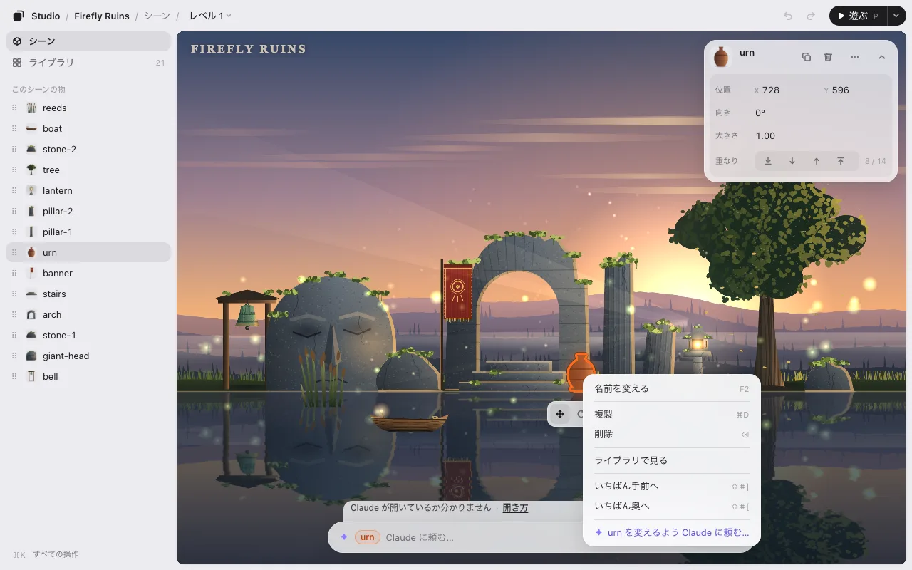

# Phaser・PixiJS・canvas・Godot のウェブゲーム

three.js のゲームは、そのままエディタで開けます。2D のゲームでは、先に AI が小さなつなぎ（アダプタ）を書きます。ゲームが物をどこに持っているかをエディタに教えるファイルです。ゲームスタジオに入っている例から書き始め、エディタが動くかを確かめます。そのあとは three.js のゲームと同じように、選んで、ドラッグし、回し、大きさを変えられます。

## エンジン

| あなたのゲーム | AI が書き始める例 | 見本のゲーム |
|---|---|---|
| Phaser 3 か 4 | `phaser.js` | [phaser-garden](../../../../examples/phaser-garden/)・[phaser-runner](../../../../examples/phaser-runner/)・[phaser-v3-hop](../../../../examples/phaser-v3-hop/) |
| PixiJS v8 | `pixi.js` | [pixi-garden](../../../../examples/pixi-garden/)・[pixi-bubbles](../../../../examples/pixi-bubbles/)・2D の見本 Firefly Ruins |
| canvas（`getContext('2d')`・p5.js・自作の小さなエンジン） | `canvas.js` | [canvas-stars](../../../../examples/canvas-stars/) |
| HTML の要素（DOM） | `dom.js` | [dom-board](../../../../examples/dom-board/) |
| Godot 4 の Web 書き出し（2D） | `godot/` | [godot-garden](../../../../examples/godot-garden/) |

例は [`skills/arrange/adapters/`](../../../../skills/arrange/adapters/) にあります。

## 始め方

ゲームのフォルダで AI を開き、`/arrange`（Codex は `$arrange`）と打ちます。AI がゲームのつくりを見て、`.studio/adapter.js` につなぎを書き、エディタを開きます。「このゲームの Game Studio のつなぎを書いて」と頼んでもかまいません。

つなぎはゲームのフォルダに置かれ、ゲームの中には入りません。エディタの外では、ゲームはこれまでどおりに動きます。

## Godot の Web 書き出し

Godot の Web 書き出しは WebAssembly で動くので、つなぎは 2 つに分かれます。Godot のプロジェクトに入れる小さな GDScript の自動読み込み（autoload）と、書き出したフォルダに置く JavaScript のファイルです。自動読み込みを足す前に、AI が聞きます。そのあと、もう一度 Web に書き出します。

**保存** を押すと、AI が新しい位置をシーン（`.tscn` のファイル）に書き、もう一度 Web に書き出します（このパソコンに Godot がないときは、何を書き出せばいいかを伝えます）。今使えるのは 2D のシーン（`Node2D`）だけです。

## 2D でできること

- 選ぶ・動かす・回す・大きさを変える・いくつか選ぶ・元に戻す。右クリックのメニューで前面へ・背面へ。[編集](editing.md) を見てください。
- ライブラリ: ゲームが使う画像と音、どの物がどの画像を出しているか。[ライブラリ](editing.md#ライブラリ) を見てください。
- **遊ぶ** と、遊びながら AI に頼むこと。その瞬間の絵と、画面に何があるかが AI に届きます。
- **保存**: `placement.json`、頼めばコードの数字に。[しくみ](how-it-works.md) を見てください。

タイムラインでの動きは、3D のゲームだけです。

## まだ使えないもの

Babylon.js・PlayCanvas・Unity WebGL・Godot の 3D のシーン。そのときは、何も映らないエディタを開く代わりに、AI がそう伝えます。

three.js のときは [three.js のレベルエディタとして使う](threejs-level-editor.md) へ。
