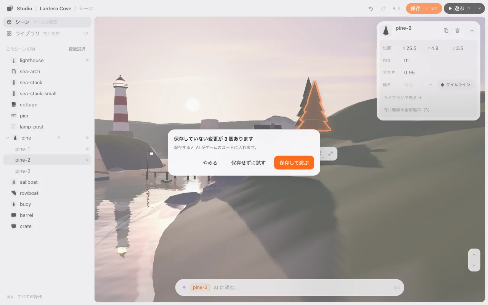
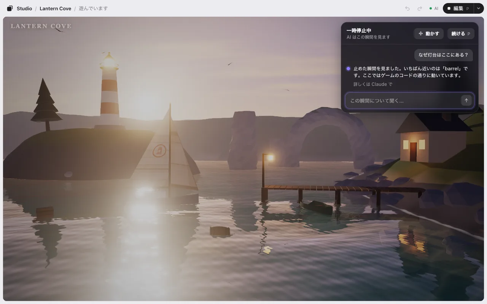

# 遊ぶ

**▶ 遊ぶ** を押すと、編集しているその場でゲームを遊べます。**編集** で戻ります。同じページなので、読み込み直しはありません。

## 遊ぶ と 編集

- **▶ 遊ぶ**（<kbd>P</kbd>）で、並べたとおりに遊びます。保存していなくてもです。上のバーには **遊んでいます** と出ます。
- 上のバーの **編集** で、遊ぶ前に触っていた編集のシーンに戻ります。遊ぶのをやめた瞬間のシーンではありません。配置も、カメラも、選んでいた物も、タイムラインとその時間も、レベルも、遊ぶ前のとおりです。遊んでいる間にゲームが動かした物（主人公、敵）も元の場所です。3D のゲームでは、ゲームが足した物・消した物（弾、拾ったコイン）も遊ぶ前のとおりになり、もう一度遊ぶとゲームに返ります。
- 付けた[動き](motion.md)も動きます。いつ動くか（始まった時・何秒後・キー・クリック・範囲に入った時・ゲームのコードからの合図）に関係なく、同じページのままです。編集 に戻ると止まり、物は元の場所に戻ります。
- スコアやタイマーのような、ゲームそのものの状態は配置ではありません。それも最初からにしたいときは、遊ぶ の ▾ の **最初から遊ぶ**（または <kbd>⌘</kbd><kbd>K</kbd>）。ゲームを開き直します。

### 保存していない変更があるとき

保存していない変更があるまま 遊ぶ を押すと、先に聞きます。

- **保存して遊ぶ**（<kbd>Enter</kbd>）: 保存して（AI がゲームのコードに入れます）、遊びます。
- **保存せずに試す**: 変更を入れたまま遊びます。編集 に戻っても変更は残り、**保存 · 3** もそのままです。
- **やめる**（<kbd>Esc</kbd>）: 編集 のまま。

遊ぶ から 編集 に戻る時は、何も聞きません。

ゲームに入っているローダー（`studio-placement.js`）が古いものでも、同じページのまま遊べます。エディタの中では、エディタと同じ版のローダーで動くからです。ゲームのファイルは書き換えないので、エディタの外（公開したゲームなど）では、ゲームに入っているローダーのままです。動きを付けたゲームを公開する前に、AI に新しいローダーをゲームにコピーしてもらってください。

## 止めて AI と話す

何かおかしなことが起きたら、<kbd>P</kbd> か **❚❚** を押します。遊んでいる間の <kbd>P</kbd> は、どこを最後に押していても「止める・続ける」だけです。編集には戻りません（戻るのは **編集** のボタン）。ゲームはその場で止まります。時計も、タイマーも、音も、すべて。横にチャットが開きます。

見えていることを何でも聞けます。なぜこうなった？ どう動いている？ 何を変える？ AI には止めた瞬間が届きます。ゲームの絵、カメラの位置、近くにある物、エラーです。何度でも送れます。

続けるには <kbd>P</kbd>・<kbd>Esc</kbd>・**続ける**。止めたちょうどそのコマから続きます。

スマホや細い窓では、**❚❚** は上のバーにあり、チャットは下に開きます。

## 止めた所で動かす

止めている間に **動かす**（<kbd>M</kbd>）を押すと、その瞬間のまま物を選んでドラッグできます。道具は 編集 と同じです。カメラはプレイヤーのまま。続けると、そこからゲームが進みます。

こうして動かした物は **この遊びだけ** です。次にゲームを開くと元に戻ります。残したいときは:

- **新しい位置を保存**: 編集 で動かしたのと同じように、その物の位置になります。**保存 · N** に数えられます。
- **元の位置に戻す**: 止めた時の位置に戻します。

ゲームが自分で動かしている物は残せません。その場合は **この瞬間だけ** と出ます。

**話す**（または何も選んでいないときの <kbd>Esc</kbd>）でチャットに戻ります。

> **編集 と 動かす のちがい。** 止めている時に **編集** を押すと、止めた瞬間ではなく、ふだんの配置に戻ります。その瞬間のまま変えたいときは **動かす** を使ってください。

## 遊びながら頼む

止めなくてもかまいません。<kbd>`</kbd>（1 の左のキー。日本語のキーボードでは <kbd>Shift</kbd><kbd>@</kbd>）か、角の小さな ✦ を押して、おかしい所を書いて <kbd>Enter</kbd>。ゲームは動いたままです。全画面でも使えます。

AI にはその瞬間といっしょに届きます。上の小さな行で、AI が何をしているか分かります。**AI が見ています** → **直しています** → 返事。ゲームが勝手に読み込み直すことはありません。直ったゲームにしたいときに **読み込み直す**（または <kbd>`</kbd> のあと <kbd>Enter</kbd>）。そのまま遊び続けてもかまいません。

AI から質問があると、答えがその場にボタンで出ます。くわしい返事は AI の窓にあります（行に **詳しくは Claude で** と出ます）。

次へ: [動き](motion.md)
