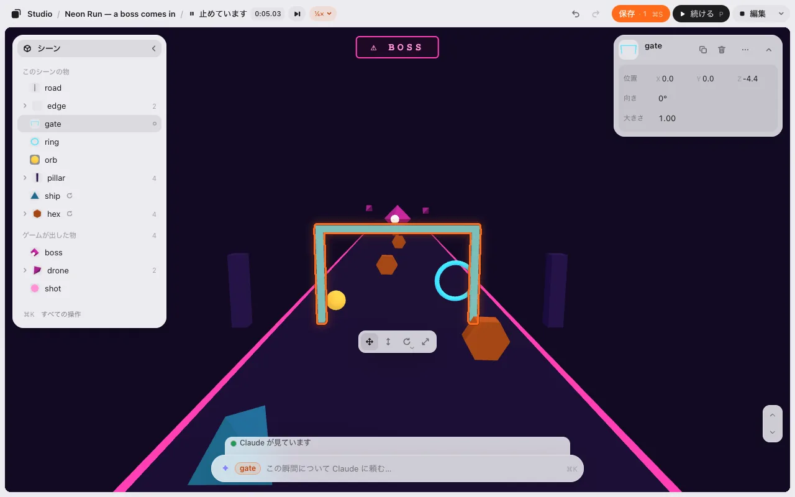
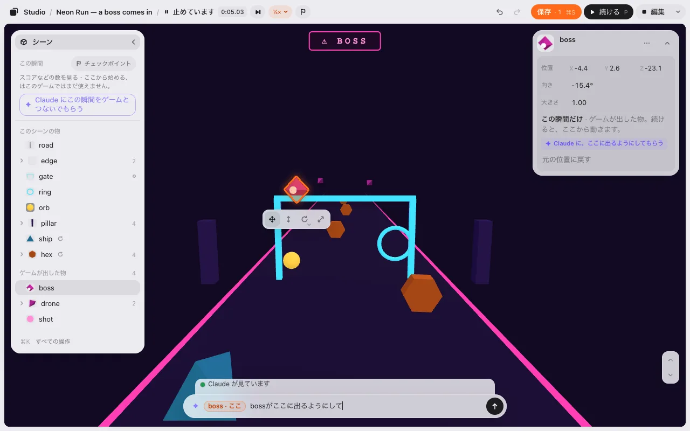
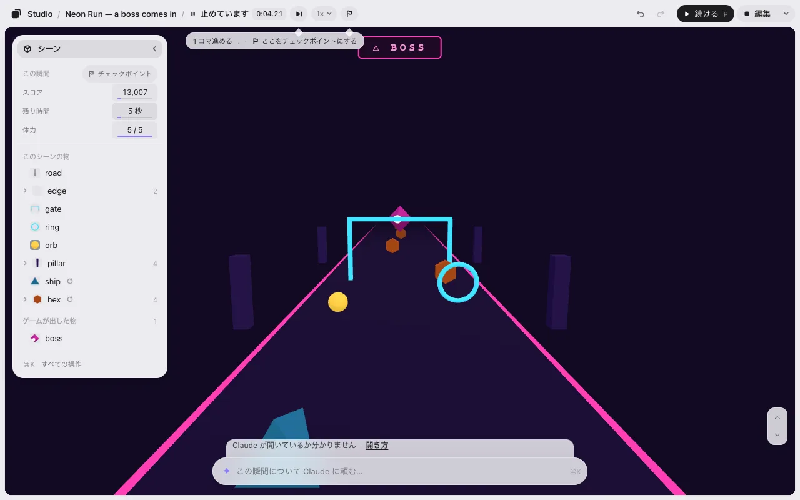
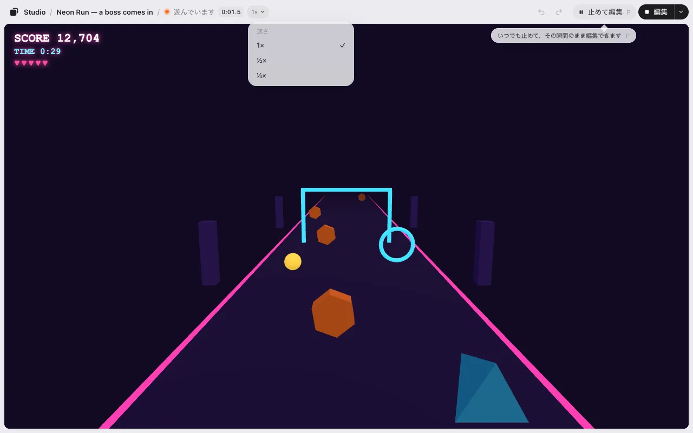

# 遊ぶ

**▶ 遊ぶ** を押すと、編集しているその場でゲームを遊べます。**編集** で戻ります。同じページなので、読み込み直しはありません。

## 遊ぶ と 編集

- **▶ 遊ぶ**（<kbd>P</kbd>）で、並べたとおりに遊びます。保存していなくてもです。上のバーには **遊んでいます** と出ます。
- 上のバーの **編集** で、遊ぶ前に触っていた編集のシーンに戻ります。遊ぶのをやめた瞬間のシーンではありません。配置も、カメラも、選んでいた物も、タイムラインとその時間も、レベルも、遊ぶ前のとおりです。遊んでいる間にゲームが動かした物（主人公、敵）も元の場所です。3D のゲームでは、ゲームが足した物・消した物（弾、拾ったコイン）も遊ぶ前のとおりになり、もう一度遊ぶとゲームに返ります。
- 付けた[動き](motion.md)も動きます。いつ動くか（始まった時・何秒後・キー・クリック・範囲に入った時・ゲームのコードからの合図）に関係なく、同じページのままです。編集 に戻ると止まり、物は元の場所に戻ります。
- スコアやタイマーのような、ゲームそのものの状態は配置ではありません。それも最初からにしたいときは、遊ぶ の ▾ の **最初から遊ぶ**（または <kbd>⌘</kbd><kbd>K</kbd>）。ゲームを開き直します。

### 保存していない変更があるとき

保存していない変更があるまま 遊ぶ を押すと、先に聞きます。

- **保存して遊ぶ**（<kbd>Enter</kbd>）: 保存して、遊びます。何を保存して、いつゲームに入ったかは、頼む欄の上の 1 行が言います（[保存](editing.md#保存)）。
- **保存せずに試す**: 変更を入れたまま遊びます。編集 に戻っても変更は残り、**保存 · 3** もそのままです。
- **やめる**（<kbd>Esc</kbd>）: 編集 のまま。

遊ぶ から 編集 に戻る時は、何も聞きません。

ゲームに入っているローダー（`studio-placement.js`）が古いものでも、同じページのまま遊べます。エディタの中では、エディタと同じ版のローダーで動くからです。ゲームのファイルは書き換えないので、エディタの外（公開したゲームなど）では、ゲームに入っているローダーのままです。動きを付けたゲームを公開する前に、AI に新しいローダーをゲームにコピーしてもらってください。

## 止めて編集

<kbd>P</kbd> か、上の帯の **編集** の隣の **❚❚ 止めて編集** を押します。どの画面でも同じ所にあります。初めて遊ぶときだけ、その下に 1 行で何ができるかが出ます。ゲームはそのちょうどの 1 コマで止まります。時計も、タイマーも、音も、すべて。そして、その瞬間がそのまま編集画面になります。

止めた 1 コマの上に、編集と同じ道具が出ます。一覧（ゲームの上に浮かぶので、絵は動きません。**‹** で畳めます）、カード、選んだ物の下の帯、下の欄、元に戻す / やり直す、保存。ゲームのスコア・残り時間・バナーは、止めた時のまま見えています（押せません）。上の帯は **❚❚ 止めています 0:42.30**。▶ 遊ぶ を押してからのゲームの時間で、1 コマずつ見えるように 100 分の 1 秒まで出ます。遊んでいる間は **● 遊んでいます 0:41.8** です。

### 置いた物と、ゲームが出した物

- **置いた物**（門・柱・足場など）は、編集と同じに動きます。動かすとシーンに入ります。**保存 · N** に数えられ、一覧に点が付き、<kbd>⌘</kbd><kbd>Z</kbd> で戻り、編集に戻っても残ります。
- **ゲームが動かす物・出した物**（自機・敵・ボス・弾など）は、カードに **この瞬間だけ** と出ます。動かすと、続けたときにそこからゲームが進みますが、シーンには入りません。**元の位置に戻す** で止めた時の位置に戻ります。一覧では、ゲームが動かす物に小さな **↻** が付き、ゲームが出した物は **ゲームが出した物** の見出しの下にまとまります（右に数。同じ名前は **drone** と右に **2** のように 1 行で、**▸** で開きます）。複製・削除はありません（ゲームのコードがまだ持っているため）。ずっと変えたいときは AI に頼みます。

ゲームが物を出す場所を変えたいときは、出てほしい所へ引いて、カードの **✦ Claude に、ここに出るようにしてもらう** を押します。下の欄に「**bossがここに出るようにして**」と札「**boss · ここ**」が入ります。送ると、Claude がゲームのコードを直します。返事は欄の上に **読み込み直す** と一緒に出ます。押すと止めた瞬間を出て、直ったゲームを最初から遊びます（**保存 · N** は残ります）。ボスは置いた所から出てきます。先に続けた時は、ゲームの上の 1 行に **読み込み直す** が出ます。

### この瞬間

一覧のいちばん上の **この瞬間** に、止めたコマでのゲームの数が並びます。スコア、残り時間、体力など、ゲームが数えているものです。カードの数と同じように変えられます。左右に引くか、押して打ちます。ゲームはその同じコマを新しい数で描き直し、時間は進みません。**残り時間** を 5 にして続ければ、5 秒後のゲームの終わりが見られます。

- **この瞬間だけ** です。シーンには入りません。**保存 · N** に数えず、どこにも書きません。止めている間は <kbd>⌘</kbd><kbd>Z</kbd> で戻ります。続けると、その数からゲームが進みます。始まりの数（30 秒を 90 秒に）を変えたいときは AI に頼みます。
- **頼んでもかまいません。** 下の欄に「残り時間を 5 秒にして」と送ると、AI がこの瞬間の数を変えます。<kbd>⌘</kbd><kbd>Z</kbd> で戻ります。
- 灰色の数は、見るだけで、ここでは変えられません。

数は、AI がゲームに 1 回足すと出るようになります。それまでは一覧に **スコアなどのゲームの数は、まだここに出ません。** と出ます。**✦ Claude にこの瞬間を編集できるようにしてもらう** を押すと、下の欄に「**この瞬間を編集できるようにして**」と札「**この瞬間**」が入ります。送ってください。Claude の返事の **読み込み直す** を押して、もう一度止めると出ます。試し版には AI がいないので、1 行だけ出ます。

### この瞬間について頼む

下の欄は「**この瞬間について Claude に頼む…**」です（Claude でなければ、あなたの AI の名前）。AI には止めた瞬間が届きます。ゲームの絵、カメラの位置、近くにある物、エラーです。なぜこうなった？ どう動いている？ 何を変える？ 何度でも送れます。この止めた瞬間での前のやりとりは **▴ 前の話 2** で見られます。

### ゆっくり・1 コマずつ

- **速さ**（上の帯の **1× ⌄**）で **1×**・**½×**・**¼×**。ボスが来る前にゆっくりにしておけば、ちょうどの瞬間で止めやすくなります。Studio がゲームの時計を持っているので、どのゲームも同じ遅さになります。ゆっくりの間は音を止めます。次の ▶ 遊ぶ は 1× に戻ります。
- **▶| 1 コマ進める**（<kbd>.</kbd>）は、止めている間に 1 コマ進めます。時間が 0:00.01〜0:00.02 進みます。押し続けると、選んだ速さで進みます。初めて止めた時だけ、**▶|** の下に小さく **1 コマ進める .** と出ます。

### 止めた瞬間からの出口

| | ▶ 続ける（<kbd>P</kbd>） | 編集 | 最初から遊ぶ（<kbd>⌘</kbd><kbd>K</kbd>） |
|---|---|---|---|
| 置いた物で、動かした物 | 動かした所 | 動かした所（シーンに入る・**保存 · 1**） | 動かした所 |
| ゲームが動かす物・出した物 | 置いた所からゲームが動かす | 無い（遊ぶ前のシーン） | まだ無い |
| スコア・残り時間 | 止めた時のまま（**この瞬間** で変えた時はその数） | — | ゲームの始まりの値 |

**▶ 続ける** は、止めたちょうどそのコマから続きます。**編集** は、止めた瞬間ではなく遊ぶ前のシーンに戻ります（止めた瞬間を変えるのは **❚❚ 止めて編集** です。止めている間は控えめなボタンです）。編集に戻ると、止めた瞬間についての AI の返事は欄の上から消えます。<kbd>Esc</kbd> では続きません。編集と同じく、選んでいる物を外します。

編集から **▶ 遊ぶ** を押すと、同じゲームの続きです（スコアもボスも続き）。上の帯の時間も続きから進みます。**0:00** から始まるのは **最初から遊ぶ** と **読み込み直す** だけです。

スマホや細い窓では、上の帯に時間・速さ・**❚❚**・**編集** が並び、止めている間は **▶ 続ける** です。一覧は下からのシートで開きます。ゲームが動かす物・出した物を選ぶと、下の欄の真上に 1 行 **この瞬間だけ** と出ます（ゲームが出した物を動かした後は **✦ Claude に、ここに出るようにしてもらう** も）。全画面のときは上の帯が見えないので、**❚❚** はゲームの右下に出ます。押すと全画面を出て、止めた瞬間になります。

試し版でも止められます。ボスが来る **Neon Run** でも試せます。AI はいないので、下の欄と ✦ はありません。

## 遊びながら頼む

止めなくてもかまいません。<kbd>`</kbd>（1 の左のキー。日本語のキーボードでは <kbd>Shift</kbd><kbd>@</kbd>）を押して、おかしい所を書いて <kbd>Enter</kbd>。ゲームは動いたままです。全画面でも使えます。キーだけです（スマホでは上の帯の **✦**）。<kbd>?</kbd> のキーの一覧に「**止めずに Claude に頼む**」と出ます。

AI にはその瞬間といっしょに届きます。上の小さな行で、AI が何をしているか分かります。**AI が見ています** → **直しています** → 返事。ゲームが勝手に読み込み直すことはありません。直ったゲームにしたいときに **読み込み直す**（または <kbd>`</kbd> のあと <kbd>Enter</kbd>）。そのまま遊び続けてもかまいません。

AI から質問があると、答えがその場にボタンで出ます。くわしい返事は AI の窓にあります（行に **詳しくは Claude で** と出ます）。

次へ: [動き](motion.md)
