# 遊ぶ

**▶ 遊ぶ** を押すと、編集しているその場でゲームを遊べます。**編集** で戻ります。同じページなので、読み込み直しはありません。

## 遊ぶ と 編集

- **▶ 遊ぶ**（<kbd>P</kbd>）で、並べたとおりに遊びます。保存していなくてもです。上のバーには **遊んでいます** と出ます。
- 上のバーの **編集** で、遊ぶ前に触っていた編集のシーンに戻ります。遊ぶのをやめた瞬間のシーンではありません。配置も、カメラも、選んでいた物も、タイムラインとその時間も、レベルも、遊ぶ前のとおりです。遊んでいる間にゲームが動かした物（主人公、敵）も元の場所です。3D のゲームでは、ゲームが足した物・消した物（弾、拾ったコイン）も遊ぶ前のとおりになり、もう一度遊ぶとゲームに返ります。
- 付けた[動き](motion.md)も動きます。いつ動くか（始まった時・何秒後・キー・クリック・範囲に入った時・ゲームのコードからの合図）に関係なく、同じページのままです。編集 に戻ると止まり、物は元の場所に戻ります。
- スコアやタイマーのような、ゲームそのものの状態は配置ではありません。それも最初からにしたいときは、遊ぶ の ▾ の **最初から遊ぶ**（または <kbd>⌘</kbd><kbd>K</kbd>）。ゲームを開き直します。

### 保存していない変更があるとき

保存していない変更があるまま 遊ぶ を押すと、先に聞きます。

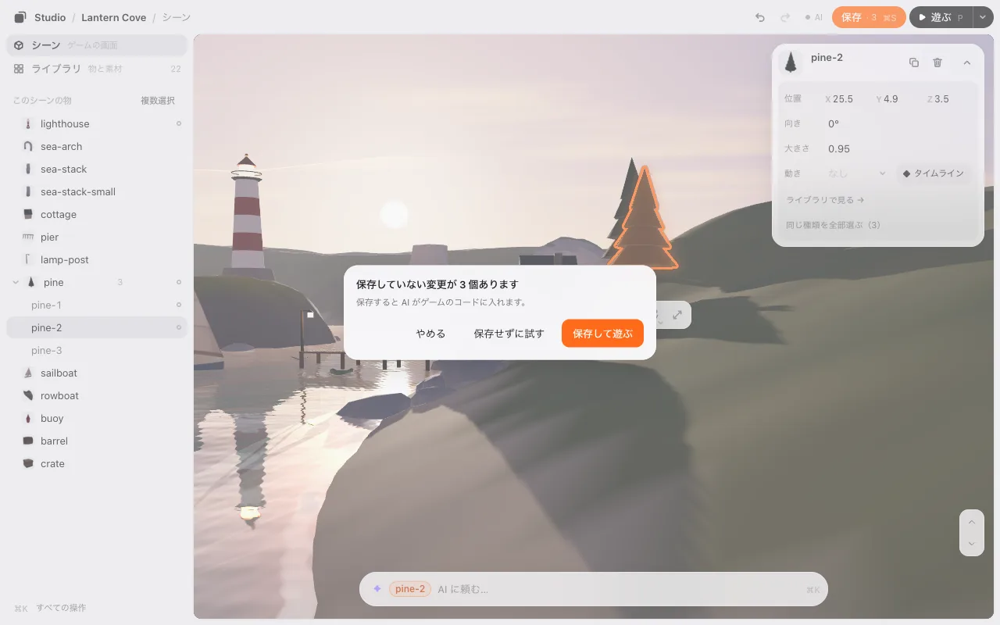

- **保存して遊ぶ**（<kbd>Enter</kbd>）: 保存して、遊びます。何を保存して、いつゲームに入ったかは、頼む欄の上の 1 行が言います（[保存](editing.md#保存)）。
- **保存せずに試す**: 変更を入れたまま遊びます。編集 に戻っても変更は残り、**保存 · 3** もそのままです。
- **やめる**（<kbd>Esc</kbd>）: 編集 のまま。

遊ぶ から 編集 に戻る時は、何も聞きません。

ゲームに入っているローダー（`studio-placement.js`）が古いものでも、同じページのまま遊べます。エディタの中では、エディタと同じ版のローダーで動くからです。ゲームのファイルは書き換えないので、エディタの外（公開したゲームなど）では、ゲームに入っているローダーのままです。動きを付けたゲームを公開する前に、AI に新しいローダーをゲームにコピーしてもらってください。

## 止めて編集

<kbd>P</kbd> か、上の帯の **編集** の隣の **❚❚ 止めて編集** を押します。どの画面でも同じ所にあります。初めて遊ぶときだけ、その下に 1 行で何ができるかが出ます。ゲームはそのちょうどの 1 コマで止まります。時計も、タイマーも、音も、すべて。そして、その瞬間がそのまま編集画面になります。

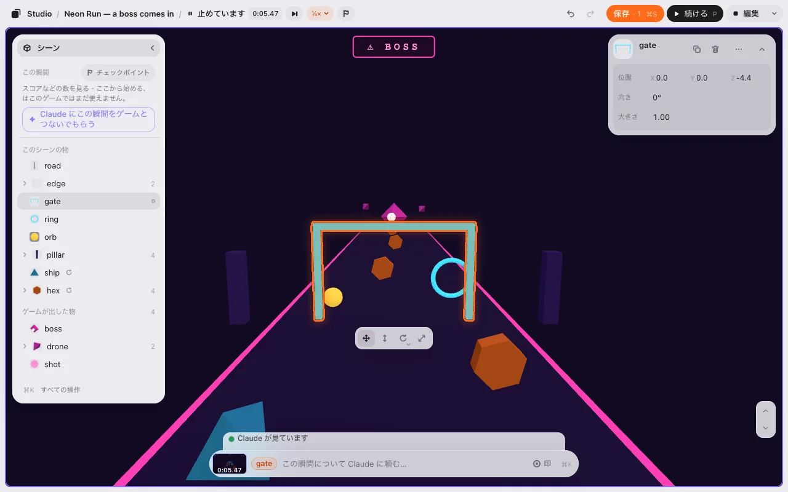

止めた 1 コマの上に、編集と同じ道具が出ます。一覧（ゲームの上に浮かぶので、絵は動きません。**‹** で畳めます）、カード、選んだ物の下の帯、下の欄、元に戻す / やり直す、保存。ゲームのスコア・残り時間・バナーは、止めた時のまま見えています（押せません）。上の帯は **❚❚ 止めています 0:42.30**。▶ 遊ぶ を押してからのゲームの時間で、1 コマずつ見えるように 100 分の 1 秒まで出ます。遊んでいる間は **● 遊んでいます 0:41.8** です。

### 置いた物と、ゲームが出した物

- **置いた物**（門・柱・足場など）は、編集と同じに動きます。動かすとシーンに入ります。**保存 · N** に数えられ、一覧に点が付き、<kbd>⌘</kbd><kbd>Z</kbd> で戻り、編集に戻っても残ります。
- **ゲームが動かす物・出した物**（自機・敵・ボス・弾など）は、カードに **この瞬間だけ** と出ます。動かすと、続けたときにそこからゲームが進みますが、シーンには入りません。**元の位置に戻す** で止めた時の位置に戻ります。一覧では、ゲームが動かす物に小さな **↻** が付き、ゲームが出した物は **ゲームが出した物** の見出しの下にまとまります（右に数。同じ名前は **drone** と右に **2** のように 1 行で、**▸** で開きます）。複製・削除はありません（ゲームのコードがまだ持っているため）。ずっと変えたいときは AI に頼みます。

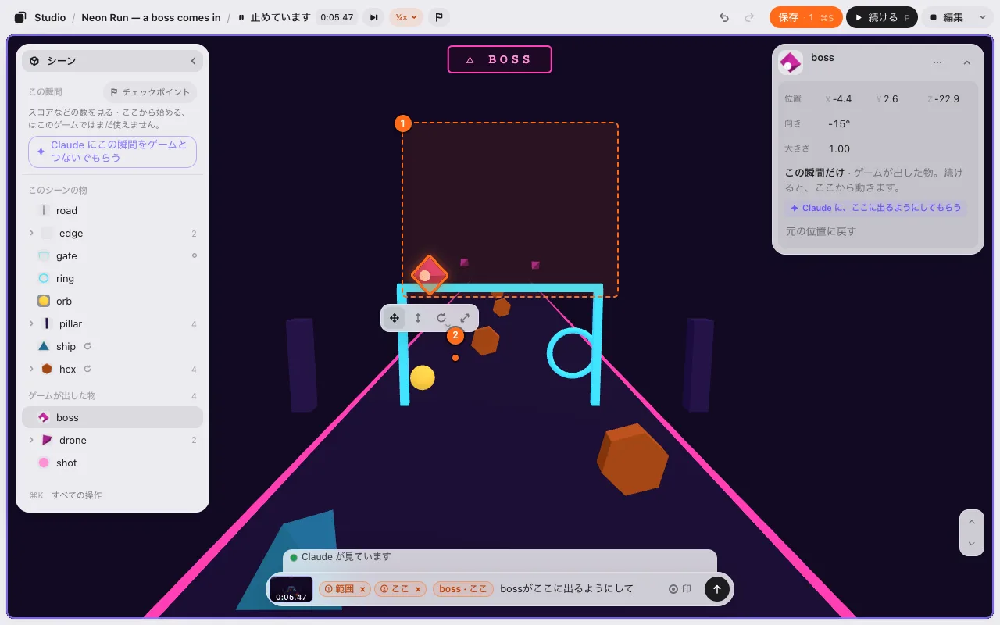

ゲームが物を出す場所を変えたいときは、出てほしい所へ引いて、カードの **✦ Claude に、ここに出るようにしてもらう** を押します。下の欄に「**bossがここに出るようにして**」と札「**boss · ここ**」が入ります。送ると、Claude がゲームのコードを直します。返事は欄の上に **▶ 0:05.02 から試す** と一緒に出ます。押すと、同じ瞬間から直したところを見られます（[同じ瞬間から試す](#同じ瞬間から試す)）。**保存 · N** は残ります。先に続けた時は、ゲームの上の 1 行に **読み込み直す** が出ます。

### この瞬間

一覧のいちばん上の **この瞬間** に、止めたコマでのゲームの数が並びます。スコア、残り時間、体力など、ゲームが数えているものです。右の **⚑ チェックポイント** で、この瞬間を残せます（[チェックポイント](#チェックポイント)）。カードの数と同じように変えられます。左右に引くか、押して打ちます。ゲームはその同じコマを新しい数で描き直し、時間は進みません。**残り時間** を 5 にして続ければ、5 秒後のゲームの終わりが見られます。

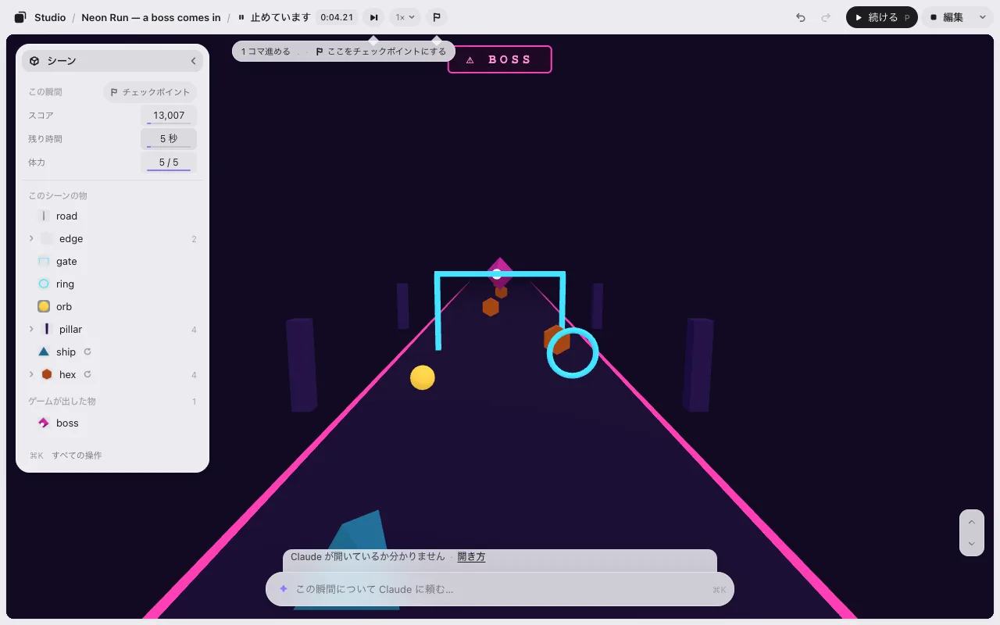

- **この瞬間だけ** です。シーンには入りません。**保存 · N** に数えず、どこにも書きません。止めている間は <kbd>⌘</kbd><kbd>Z</kbd> で戻ります。続けると、その数からゲームが進みます。始まりの数（30 秒を 90 秒に）を変えたいときは AI に頼みます。
- **頼んでもかまいません。** 下の欄に「残り時間を 5 秒にして」と送ると、AI がこの瞬間の数を変えます。<kbd>⌘</kbd><kbd>Z</kbd> で戻ります。
- 灰色の数は、見るだけで、ここでは変えられません。

この瞬間は、AI がゲームと 1 回つなぐと使えるようになります。数とチェックポイントを 1 回でまとめてつなぎます。それまでは一覧に **スコアなどの数を見る・ここから始める、はこのゲームではまだ使えません。** と出ます。**✦ Claude にこの瞬間をゲームとつないでもらう** を押すと、下の欄に「**この瞬間の数を出して、ここから始められるようにして**」と札「**この瞬間**」が入ります。送ってください。Claude の返事の **▶ … から試す** を押すと出ます。止めた瞬間から初めて直しを頼んだ時も、Claude が直すのと一緒につなぎます。試し版の **Neon Run** は、はじめからつながっています。数の無い試し版のゲームには **この瞬間** は出ません。

### この瞬間について頼む

止めると、下の欄にもうカーソルが入っています。そのまま書けます。欄は「**この瞬間について Claude に頼む…**」です（Claude でなければ、あなたの AI の名前）。欄の左に、止めた 1 コマの小さな絵と時刻（**0:05.02** など）が付きます。書いた言葉と一緒に、この絵が AI に届きます。ゲームの縁の細い紫の線は、止めた瞬間にいるしるしです（編集の時は線がありません）。

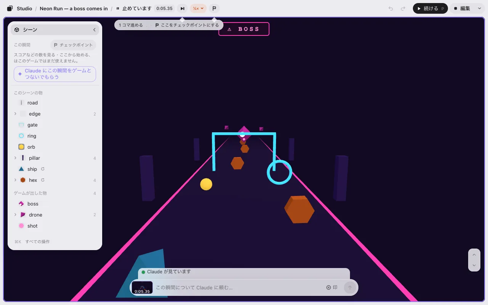

AI には止めた瞬間が届きます。その絵、カメラの位置、近くにある物、エラーです。なぜこうなった？ どう動いている？ 何を変える？ 何度でも送れます。この止めた瞬間での前のやりとりは **▴ 前の話 2** で見られます。

止めてすぐやめたくなったら、そのまま <kbd>P</kbd> で続きます。1 文字書くか欄を押すまでは、<kbd>P</kbd>・<kbd>.</kbd>・<kbd>N</kbd>・<kbd>Esc</kbd> はキーとして効きます。書き始めたら文字になります。<kbd>Esc</kbd> を押すかゲームを押すと、また効きます。スマホでは、キーボードは勝手に開きません。書く時に欄を押してください。狭い欄では「**Claude に頼む…**」とだけ出ます。

#### 絵を指す

「ここ」と言いたい時は、欄の **◎ 印**（または <kbd>N</kbd>）を押します。ゲームをクリックすると点、ドラッグすると範囲を囲めます。印には番号が付き、欄に「**① ここ**」「**② 範囲**」の札が入ります。「① からボスを出して」のように書けます。札の **×** か <kbd>⌘</kbd><kbd>Z</kbd> で印を消せます（残りの番号は付け直されます）。もう一度 **◎ 印** か <kbd>N</kbd>（または <kbd>Esc</kbd>）で印を付けるのをやめます。言葉を送った時もやめます。印は続けるまで残ります。スマホでは、一度使うまで **◎** の横に名前が出ます。

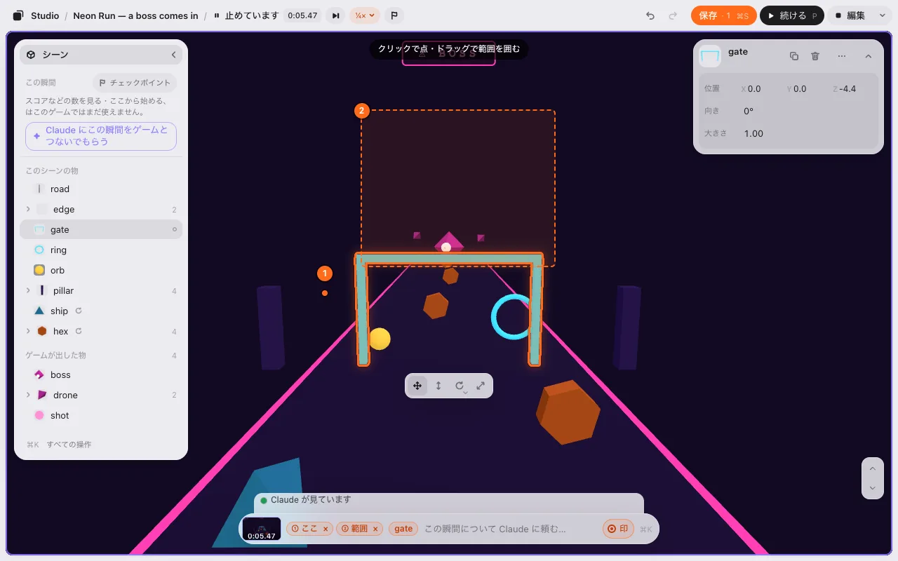

#### AI に届くもの

欄の小さな絵を押すと、言葉と一緒に届くものが見えます。止めた絵（と印を描いた写し）、選んだ物・印を付けた物（ゲームが出した物が先）とそれを出しているゲームのコードの行（**出している所** `game.js:121` など。何も無い所の印は **① 地面の 1 点** のように場所を言います）、この瞬間の数とエラー、そして **0:05.02 からやり直せるように残します** です。頼んだ瞬間をエディタが残すので、直した後にそこから試せます。まだ途中から始められないゲームでは **時刻だけ: 0:05.02** です。<kbd>Esc</kbd> で閉じます。AI は絵とコードの両方を見てから直し、直した後に同じ瞬間を開いて確かめ、何をしたかを 1 行で返します。

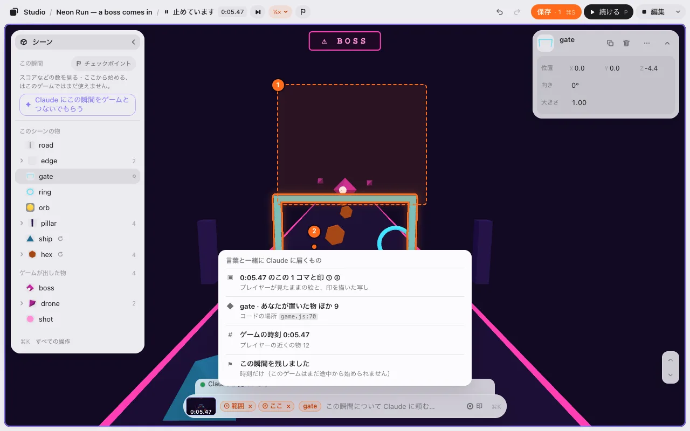

#### 同じ瞬間から試す

AI がゲームを直すと、返事は 1 行です。何をしたか、その下に小さく直したファイル。横に次のボタンが出ます。

- **▶ 0:05.02 から試す**: 新しいコードでゲームを開き直し、頼んだ瞬間で止まったままにします。話も印も残るので、「もう少し左」とすぐ続けられます。エディタは勝手に読み込み直しません。試すのはあなたが決めます。
- **前 / 後**: 頼んだ時の絵（印付き）と、新しいコードの同じ瞬間を並べます。まだ試していなければ、先に試します。**このまま · 続ける** でそこから遊び、**Claude の変更を戻す** でコードを戻します。
- **↶ 元に戻す**: ゲームのファイルを AI が直す前にすぐ戻します。止めた瞬間はそのままです。**▶ … から試す** で確かめられます。戻すのはその返事の直しだけです。「もう少し左」の後なら、1 回目の直しまで戻り、両方の前までは戻りません。

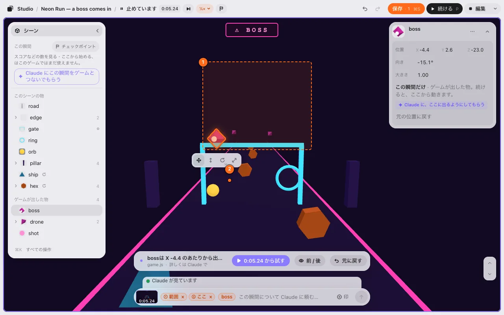

同じ瞬間とは、同じ状態のことです。スコア・残り時間・ゲームが出した物は、その時のままです。なので物を出す場所の直し（もう出ているボスなど）は、続けた後の次の物から見えます。**▶ 試す** は「**boss はもう出ていたので、直しは次から見えます。**」のように言い、**前 / 後** も後の絵の下で同じことを言って **▶ 続けて見る** を出します。ゲームがまだ途中から始められない時は、**▶ 試す** は最初から遊んで同じ時刻で止め、**同じ時刻・新しい遊び** と出します。止めた瞬間から初めて直しを頼んだ時に、AI が途中から始めるための仕組みも一緒に入れるので、次からはその瞬間そのものが開きます。

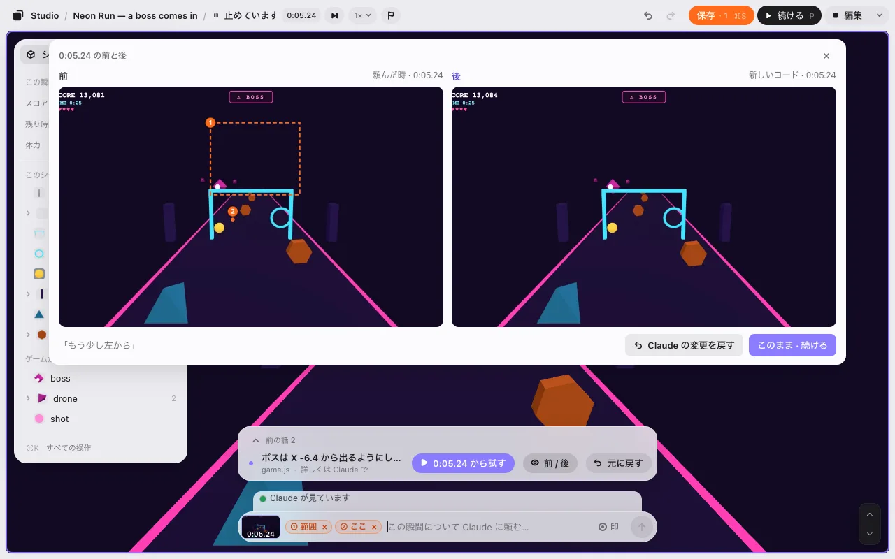

### ゆっくり・1 コマずつ

- **速さ**（上の帯の **1× ⌄**）で **1×**・**½×**・**¼×**。ボスが来る前にゆっくりにしておけば、ちょうどの瞬間で止めやすくなります。Studio がゲームの時計を持っているので、どのゲームも同じ遅さになります。ゆっくりの間は音を止めます。次の ▶ 遊ぶ は 1× に戻ります。
- **▶| 1 コマ進める**（<kbd>.</kbd>）は、止めている間に 1 コマ進めます。時間が 0:00.01〜0:00.02 進みます。押し続けると、選んだ速さで進みます。初めて止めた時だけ、**▶|** と **⚑** の下に小さく **1 コマ進める . · ⚑ ここをチェックポイントにする** と出ます。

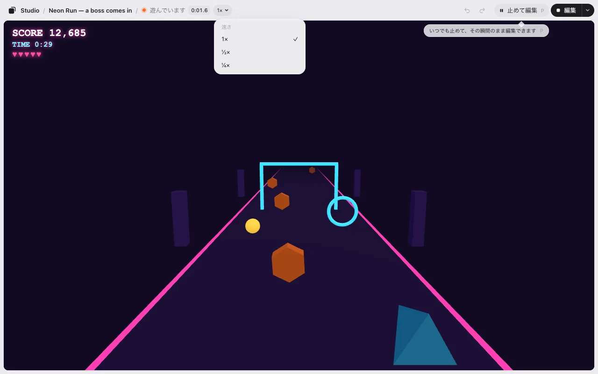

### チェックポイント

ボスの前で止めたら、その瞬間を残しておけます。次からは、そこまで遊び直さずに、そこから始められます。

1. 止めている間に、**この瞬間** の右の **⚑ チェックポイント**（または上の帯の速さの右の **⚑**）を押します。下に名前の欄が開き、ゲームの時間（**0:04** など）が入っています。「**ボスの前**」のように名前を打って <kbd>Enter</kbd>。下の欄に **チェックポイント「ボスの前」を残しました** と出ます。
2. 好きなように変えます。編集で物を動かしても、AI にボスを直してもらってもかまいません。
3. **▶ 遊ぶ ⌄** を開いて **⚑ ボスの前から遊ぶ** を選びます（<kbd>⌘</kbd><kbd>K</kbd> にもあります）。ゲームがその瞬間で開きます。スコア、残り時間、敵、ボスがそのままで、上の帯の時間もそこから進みます。

- **この瞬間に動かした物と数も残ります。** ボスを左の車線へ動かし、**残り時間** を 10 にしてから残すと、ボスは左・残り 10 秒で開きます。名前の欄の下にもそう出ます。

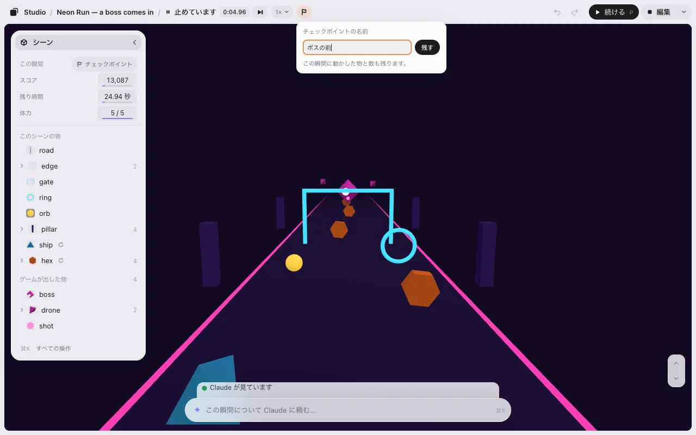

- **シーンはいつも今のものです。** チェックポイントが残すのはゲームのその瞬間で、置いた物の並びではありません。残した後に動かした門は、動かした所に立っています。
- **名前を変える・消す** は、**▶ 遊ぶ ⌄** の行の **⋯** から。**遊ぶ ⌄** には、今のレベルのチェックポイントが新しい順に並びます。
- **AI に直してもらった後** は、返事の **▶ … から試す** で頼んだ瞬間から確かめるか、**▶ 遊ぶ ⌄** の **⚑ ボスの前から遊ぶ** で直ったゲームをボスの前で開けます。
- チェックポイントはエディタの中だけのものです（ゲームのフォルダの `.studio/checkpoints/`）。公開するゲームには入りません。

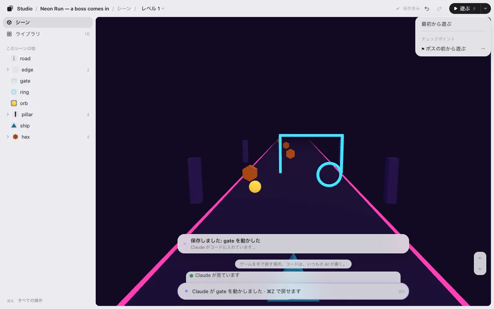

**この瞬間** の数といっしょに、AI がゲームとつなぎます。それまでは **⚑** を押すと **このゲームは、まだ途中から始められません。** と、同じ **✦ Claude にこの瞬間をゲームとつないでもらう** が出ます。押して送り、Claude の返事の **▶ … から試す** を押してください。試し版にはチェックポイントを残せません（**⚑** がそう言います）。自分の Studio なら残せます。

ゲームが大きく変わってチェックポイントが開けない時は、最初から始まり、上に **ゲームが変わって、このチェックポイントは開けません** と 1 行出ます。**✦ Claude に直してもらう** を押すと、ゲームが止まって下の欄に頼みが入ります。Claude が、古いチェックポイントを読めるようにゲームを直します。

### 止めた瞬間からの出口

| | ▶ 続ける（<kbd>P</kbd>） | 編集 | 最初から遊ぶ（<kbd>⌘</kbd><kbd>K</kbd>） |
|---|---|---|---|
| 置いた物で、動かした物 | 動かした所 | 動かした所（シーンに入る・**保存 · 1**） | 動かした所 |
| ゲームが動かす物・出した物 | 置いた所からゲームが動かす | 無い（遊ぶ前のシーン） | まだ無い |
| スコア・残り時間 | 止めた時のまま（**この瞬間** で変えた時はその数） | — | ゲームの始まりの値 |

**▶ 続ける** は、止めたちょうどそのコマから続きます。**編集** は、止めた瞬間ではなく遊ぶ前のシーンに戻ります（止めた瞬間を変えるのは **❚❚ 止めて編集** です。止めている間は控えめなボタンです）。編集に戻ると、止めた瞬間についての AI の返事は欄の上から消えます。<kbd>Esc</kbd> では続きません。編集と同じく、選んでいる物を外します。

編集から **▶ 遊ぶ** を押すと、同じゲームの続きです（スコアもボスも続き）。上の帯の時間も続きから進みます。**0:00** から始まるのは **最初から遊ぶ** と **読み込み直す** だけです。

スマホや細い窓では、上の帯に時間・速さ・**❚❚**・**編集** が並び、止めている間は **▶ 続ける** です。一覧は下からのシートで開きます。**この瞬間** は 1 行に畳まれていて（押すと数が開きます）、右に **⚑ チェックポイント** があります。編集に戻ると、一覧のいちばん上の **⚑ チェックポイント · 1** から開けます（スマホには **▶ 遊ぶ ⌄** がありません）。ゲームが動かす物・出した物を選ぶと、下の欄の真上に 1 行 **この瞬間だけ** と出ます（ゲームが出した物を動かした後は **✦ Claude に、ここに出るようにしてもらう** も）。全画面のときは上の帯が見えないので、**❚❚** はゲームの右下に出ます。押すと全画面を出て、止めた瞬間になります。

試し版でも止められます。ボスが来る **Neon Run** では、**この瞬間** の **残り時間** を 5 にして続けてみてください。止めた瞬間には絵の付いた下の欄も出るので、頼み方を試せます。ただ試し版は AI につながっていないので、送ると **試し版では AI にはつながっていません。Claude Code や Codex でゲームを開くと頼めます。** と 1 行出て、何も送りません。✦ はありません。

## 遊びながら頼む

止めなくてもかまいません。<kbd>`</kbd>（1 の左のキー。日本語のキーボードでは <kbd>Shift</kbd><kbd>@</kbd>）を押して、おかしい所を書いて <kbd>Enter</kbd>。ゲームは動いたままです。全画面でも使えます。キーだけです（スマホでは上の帯の **✦**）。<kbd>?</kbd> のキーの一覧に「**止めずに Claude に頼む**」と出ます。

AI にはその瞬間といっしょに届きます。上の小さな行で、AI が何をしているか分かります。**AI が見ています** → **直しています** → 返事。ゲームが勝手に読み込み直すことはありません。直ったゲームにしたいときに **読み込み直す**（または <kbd>`</kbd> のあと <kbd>Enter</kbd>）。そのまま遊び続けてもかまいません。

AI から質問があると、答えがその場にボタンで出ます。くわしい返事は AI の窓にあります（行に **詳しくは Claude で** と出ます）。

## クリップを作る

作った所・直した所を見せたいときは、上の帯の **● クリップ**（元に戻す・やり直すの右）を押します。ゲームのこの先 8 秒が、X に貼れる動画になります。

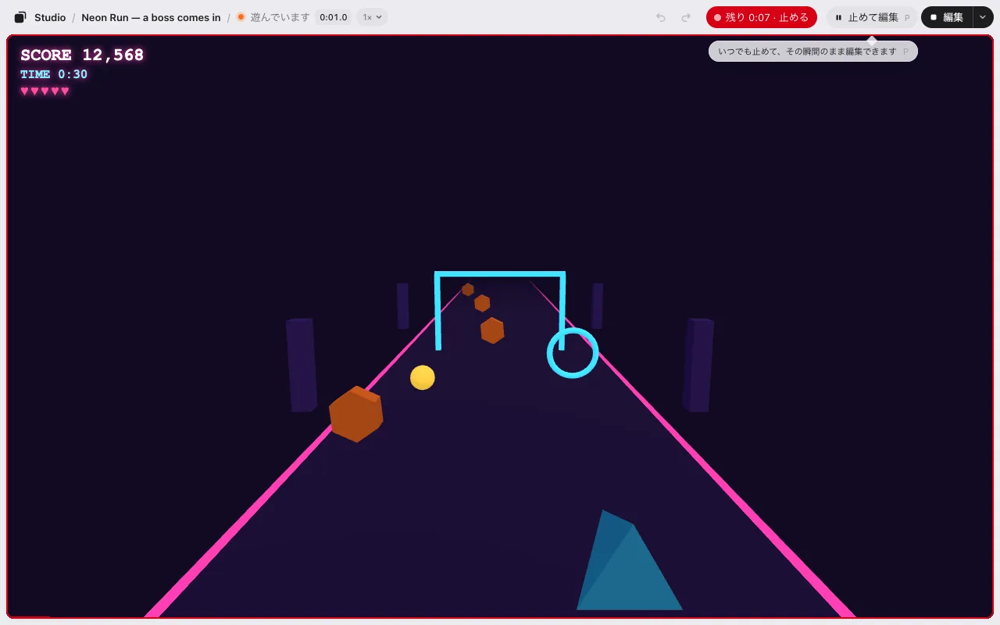

- 録っている間、ボタンは赤く、時間が出ます（**0:03 · 止める**）。ゲームの縁の赤い線の中だけが動画になります。ゲームの絵と、その上の HTML（スコアや体力の棒）は入ります。エディタ・アドレス・フォルダの名前は入りません。
- もう一度押すと早めに止まります。パソコンが重いときも、動画は押してから 1 秒で終わります。
- 編集中に押すと、遊ぶ を始めてから録ります。止めているゲームは続きから動きます。
- **⌄** で形（**横 1280×720**、スマホの画面向けの **縦 720×1280**）・長さ（6・8・12 秒）・最後の 1 秒の **Made with KUMODeck Game Studio** を選べます。選んだ物は覚えます。
- **縦** は切り抜きではありません。録る間だけゲームに縦の窓を渡すので、窓に合わせるゲームは縦に並び直します。スマホでは、横を選ばない限り縦で録ります。

できると、保存した所と、いっしょに貼る文が 1 行に出ます。

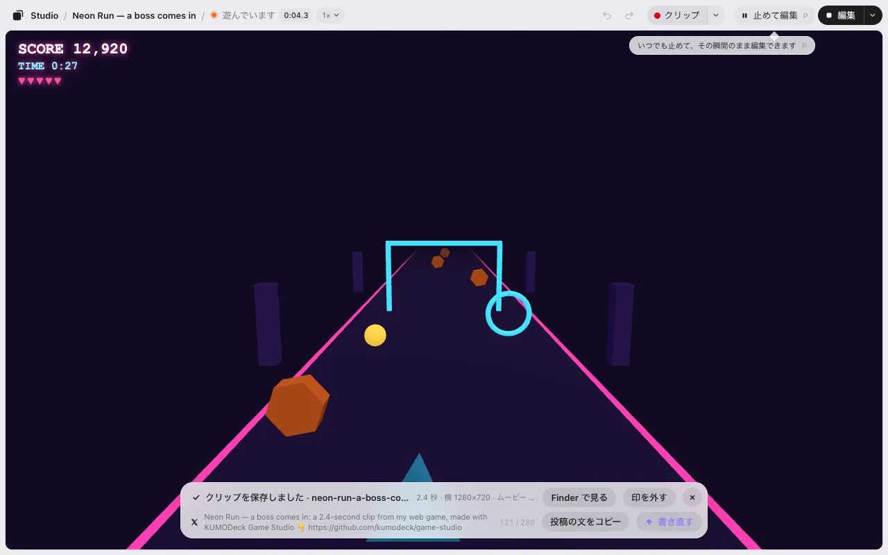

- **クリップを保存しました · neon-run-clip-1.mp4**。保存先は **ムービー › KUMODeck**（Windows と Linux は **ビデオ › KUMODeck**）。ゲームのフォルダには入れません。**Finder で見る** で開きます。
- 下の段は貼るための文（英語）で、X の数え方の長さ（**102 / 280**）が横に出ます。**投稿の文をコピー** でコピーし、X に貼って、動画をドラッグして入れます。
- **✦ 書き直す** で、AI に文を書き直してもらえます。X の 280 に収まった時だけ、元の文と入れ替わります。AI がつながっている時だけ出ます。
- スマホでは **共有…** で、動画をスマホの共有の画面に渡せます（そこで X を選べます）。動画を共有できないスマホでは、代わりに **この端末に保存** が出ます。
- 動画の最後の 1 秒の右下に小さく **Made with KUMODeck Game Studio** とアドレスが入り、文にもアドレスが入ります。**印を外す** で、このクリップと文の両方から外れます。次のクリップも、**⌄** で付け直すまで外れたままです。
- このパソコンの外には何も送りません。エディタは投稿しません。貼るのはあなたです。

動画は 1280 × 720 の MP4（H.264）・30 コマ / 秒で、音はありません。まだ録れない物: WebGPU で描くゲーム（**クリップは今は WebGL のゲームだけです** と出ます）、別のサイトの画像を描くゲーム（画像をゲームのフォルダに置くよう AI に頼めます）。ゲームの上の HTML は、AI に届く絵と同じ描き方です（箱・字・画像。影やグラデーションは描きません）。

試し版では、動画はダウンロードになります（**クリップをダウンロードしました**）。

### 直した所をクリップに: Before / After

止めて AI に頼み、AI がコードを直したら（[この瞬間について頼む](#この瞬間について頼む)）、返事の **Before / After** を開きます。After が出たら **● Before / After をクリップに** を押します。

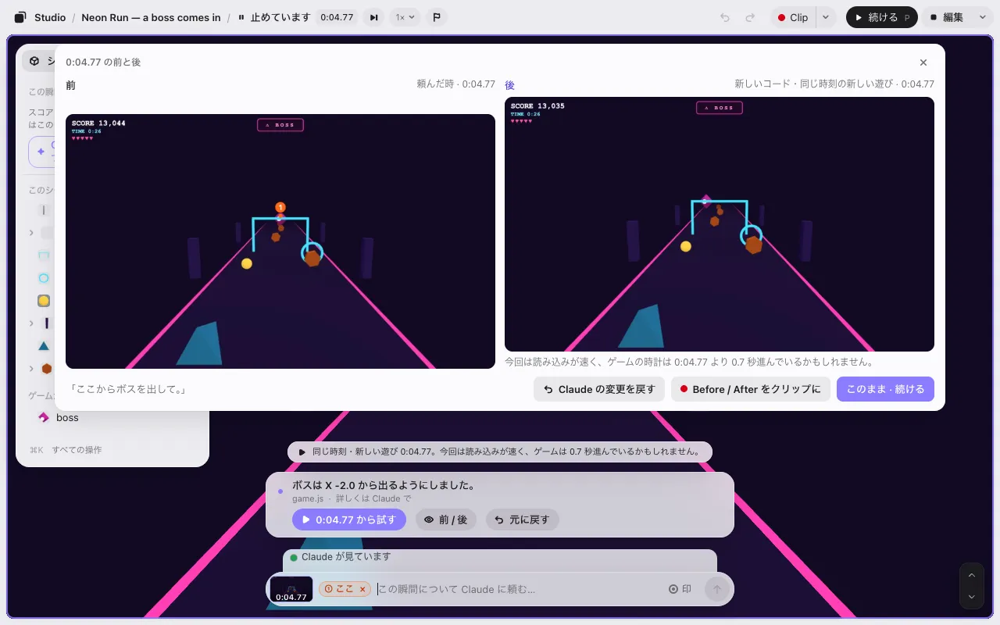

- 10 秒の動画になります。まず頼んだ時の 1 コマ（印と頼んだ言葉つき）が 2 秒（**Before**）。ワイプして、同じ瞬間から新しいコードで 8 秒遊びます（**After**）。最後の 1 秒に印が入ります。
- 動画の中の字は多くて 3 つです: **Before**・**After**・頼んだ言葉。言葉を出したくない時は **⌄** の **Before / After に頼んだ言葉を出す** を外します。
- 投稿の文もできています（英語）: “Paused my game at 0:05, marked a spot and told Claude “bring the boss in from here”. It fixed the code. Before → After 👇”。ここでも **✦ 書き直す** が使えます。
- After の間は操作してもかまいません。何もしなければ、ゲームがそのまま進みます。

次へ: [動き](motion.md)
