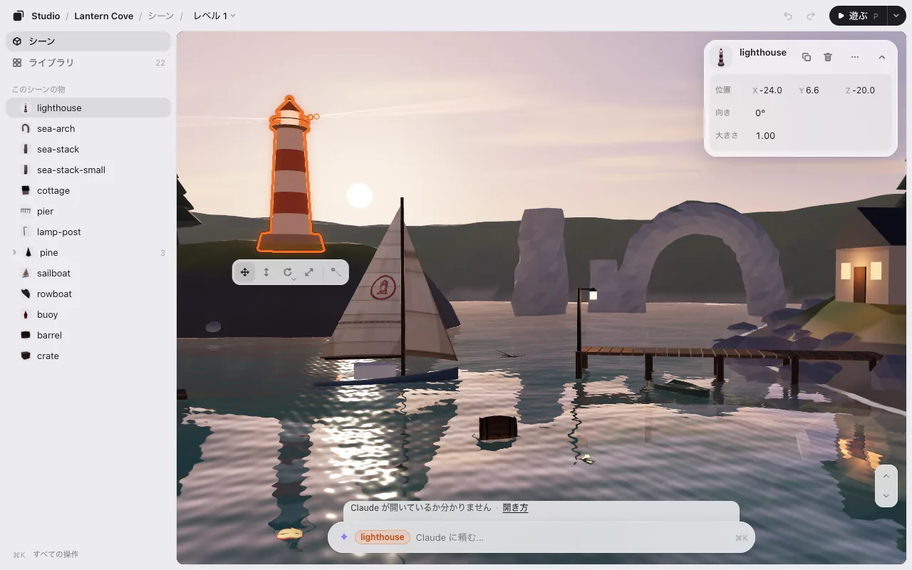

# three.js のレベルエディタとして使う

ゲームスタジオは、three.js のゲームを動いているままの形で開き、手で並べられるようにします。物を選んでドラッグし、回し、大きさを変えて、保存。ゲームに先に何かを足す必要はありません。無料で、手元のパソコンで動き、Claude Code や Codex と並べて使います。配置をコードに入れるのは、いつもの AI です。



## できること

- **選んで動かす。** ゲームの中の物をクリックしてドラッグ。下の帯で動かす・持ち上げる・回す・大きさを変える（キー <kbd>1</kbd>〜<kbd>4</kbd>）。カードに正確な数字が出ます。[編集](editing.md) を見てください。
- **見回す。** 何も選んでいないときは <kbd>W</kbd> <kbd>A</kbd> <kbd>S</kbd> <kbd>D</kbd> でカメラが飛びます（<kbd>E</kbd> / <kbd>Q</kbd> で上下）。[見回す](editing.md#見回す3d) を見てください。
- **ピタッと置く・複製・いくつか選ぶ。** 物は下にある物の上に乗ります。1 つを複製して同じ物を並べ、いくつか選んでまとめて動かせます。[ピタッと置く](editing.md#ピタッと置く) を見てください。
- **レベルを切り替える。** ゲームのレベルを行き来し、新しく作り、複製し、名前と順番を変えます。[レベル](levels.md) を見てください。
- **素材をひと目で。** ライブラリに、ゲームが使うモデル・画像・音と、どの物がどのファイルを使うか、何も使っていないファイルが並びます。[ライブラリ](editing.md#ライブラリ) を見てください。
- **物を動かす。** 帆を張って進む舟、開く扉。いくつかの時点での位置を決めると、間はエディタが埋めます。[動き](motion.md) を見てください。
- **遊ぶ・止める。** 編集している場所でそのまま遊び、1 コマで止め、ゲームが出した物も動かせます。[遊ぶ](play.md) を見てください。

## three.js のゲームとの合わせ方

- **物は名前で。** エディタはシーンの中の物を見つけ、名前で並べます（`lighthouse`・`tree-01`）。名前のない物も使えます。
- **コードはあなたの物のまま。** エディタがコードを書き換えることはありません。**保存** すると、変えた物だけが `placement.json` に入り、AI がゲームの始まりにそれを読む 1 行を足します。

```js
await applyPlacement(scene, './placement.json');
```

- **コードの数字に入れることも。** ファイルを増やしたくなければ、AI に「数字をコードに書いて」と頼みます。
- **ルールで並んだ物。** AI がルールで並べた物（「六角形を 4 つ、6 m おきに 1 列」）はルールのままです。1 つをドラッグすると、ルールの数字が変わります。[ルールで並んだ物](editing.md#ルールで並んだ物) を見てください。

くわしくは [しくみ](how-it-works.md)。

## three.js エディタとのちがい

three.js エディタは、自分の中でシーンを作って JSON に保存します。ゲームスタジオは、あなたのコード・物理・読み込みのまま動いているゲームの上で使い、変えた所は AI がプロジェクトに書き入れます。合うほうを使ってください。ぶつかることはありません。

## 試す

- **入れずにブラウザで:** このサイトの試し版で、見本のゲームでエディタを試せます。AI にはつながっておらず、変えたものはブラウザの中だけに残ります。
- **自分のゲームで:** [はじめる](getting-started.md) のあと、[Claude Code](claude-code.md) か [Codex](codex.md) へ。

three.js ではないときは [Phaser・PixiJS・canvas・Godot のウェブゲーム](phaser-pixijs-godot.md) へ。
