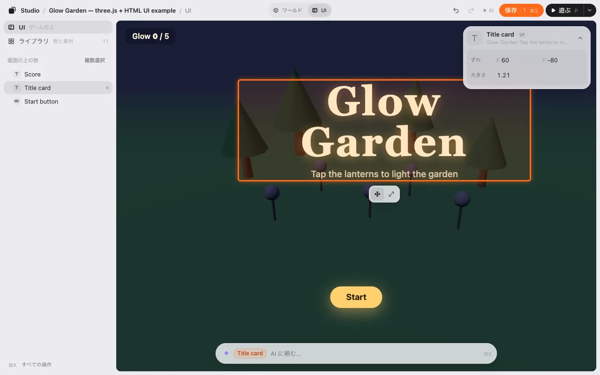
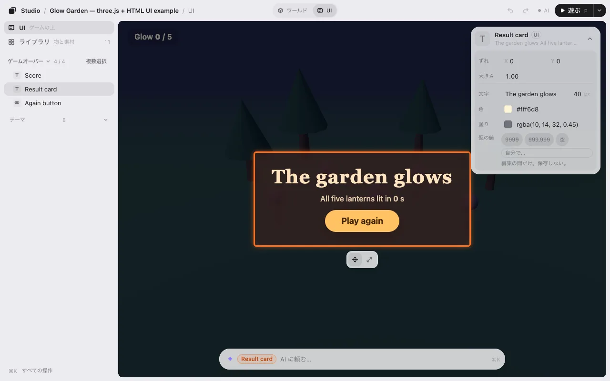
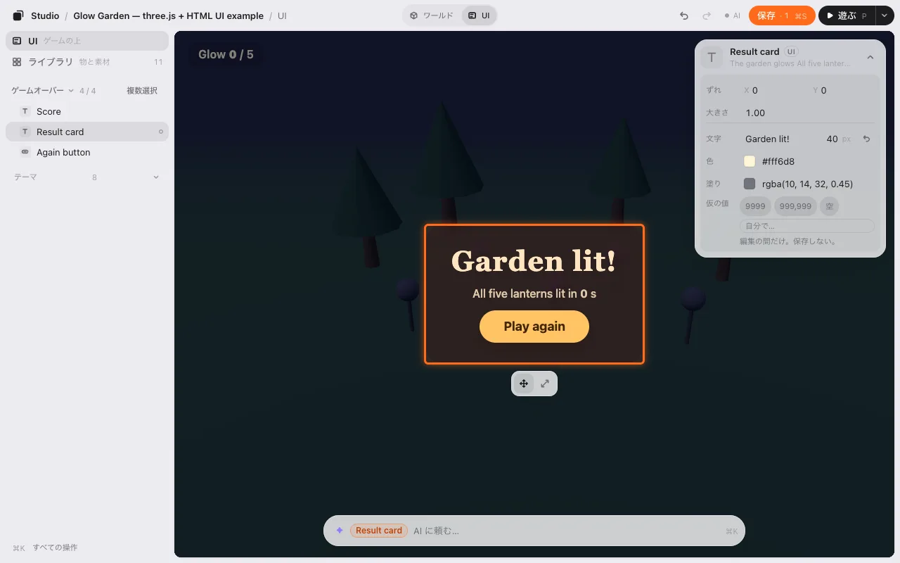
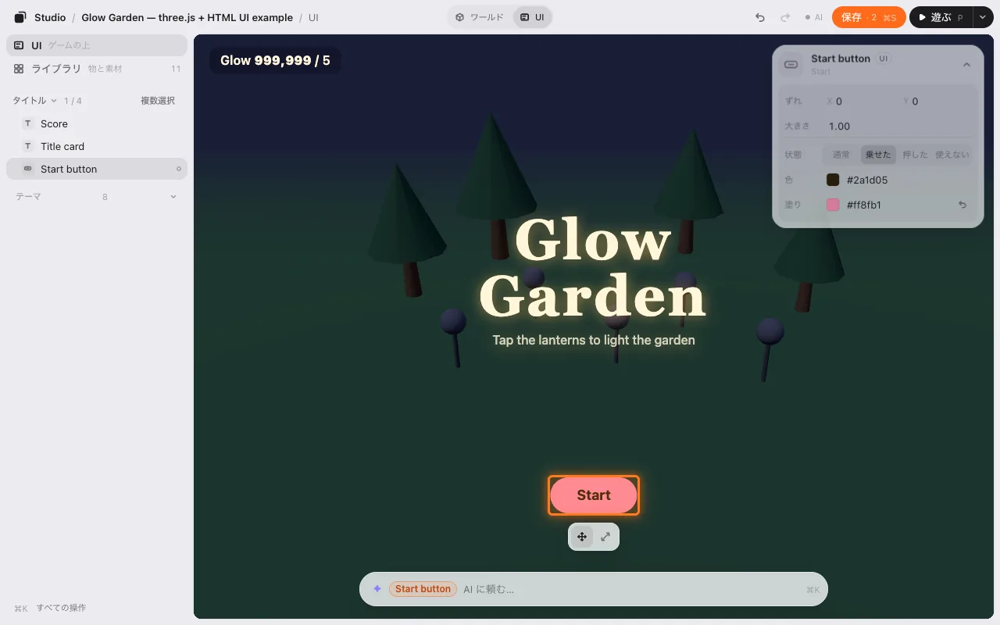
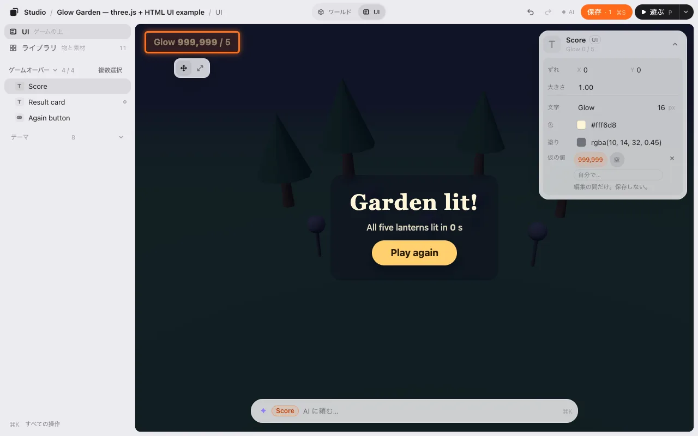
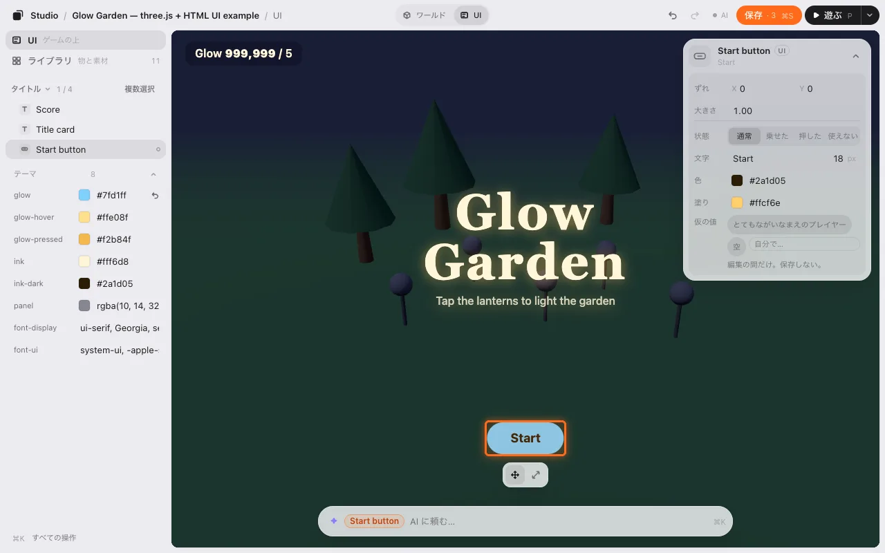

# UI の編集

多くのゲームには、世界の上に文字やボタンの層があります。タイトル、スコア、スタートボタン。これも動かしたり、大きさを変えたり、文字や色を直したりできます。タイトル・プレイ中・ポーズ・ゲームオーバーなど、ゲームのどの画面も見られます。

HTML で作った UI で使えます。[まだできないこと](#まだできないこと) も見てください。

## シーン と UI

エディタで編集できる UI がゲームにあると、上のバーに **シーン | UI** が出ます。**UI**（<kbd>U</kbd>）を押すと UI を編集します。世界は暗くなり、一覧は **UI** になります。

- UI をクリックして選び、ドラッグで動かします。
- 下の帯に **移動** と **大きさ** があります。<kbd>+</kbd> と <kbd>−</kbd>、カードの **大きさ** でも変えられます。真ん中の位置は変わりません。
- 戻す・進む は 2 つの層をまたいで使えます。

**シーン**（<kbd>U</kbd>）で戻ります。シーンを編集している間、ゲームの UI はじゃまにならないよう隠れています。切り替えの隣の目（<kbd>Shift</kbd><kbd>U</kbd>）で薄く見えます。クリックはシーンに通ります。

スマホでは、切り替えはゲームの上の 2 つの絵です。

## 画面

画面が 2 つ以上あるゲームでは、一覧の頭に今の画面の名前が出ます: **タイトル ⌄ 1 / 4**。押してほかの画面（**プレイ中**・**ポーズ**・**ゲームオーバー**）を選びます。ゲームにその画面が出て、一覧はその画面の物になります。このためにゲームは動きません。Play を押すと、ゲームはいつもの最初の画面から始まります。

## 文字と色

UI を選ぶと、カードのずれと大きさの下に、直せる物が出ます。

- **文字**: その言葉と、文字の大きさ（px）。
- **色**: 文字の色。**塗り**: 箱の色（ボタンや、地のある箱）。
- **↺** で、ゲームの元の値に戻ります。

1 つ直すごとに、戻す 1 回分、保存の数 1 つです。

### ボタン: 通常・乗せた・押した・使えない

ボタンには **状態** もあります。**乗せた** を押すとマウスを乗せた時の見た目、**押した** は押している間、**使えない** は押せない時の見た目になります。そのままでも動かせます。そこで **色** や **塗り** を直すと、その見た目だけが変わります。

## 仮の値

編集の間ゲームは止まっているので、スコアは 0 のままです。大きな数や長い名前でもはみ出さないか見るには、スコアを選んで **仮の値** を選びます: **999,999**、**とてもながいなまえのプレイヤー**、**空**、または自分で入れる。仮の値は編集の間だけです。保存はされません。

## テーマ

ゲームが色やフォントを CSS の変数にまとめていると、一覧の下の **テーマ** にそれが並びます。1 つ直すと、それを使う UI が全部いっしょに変わります。

## シーン | UI が出ないとき

エディタが扱えるのは、ゲームが印を付けた UI だけです。AI に頼んでください。「ゲームスタジオで UI を編集できるようにして」。タイトルやスコアなど、ゲームの HTML の 1 つずつと、それぞれの画面に印を付けます。**テーマ** の行がほしい時は、色をテーマにまとめるようにも頼んでください。

## 保存

保存すると、それぞれをどこに動かしたか、どの大きさにしたか、新しい文字と色、テーマを書きます。ゲームは始まる時に、ほかの配置といっしょにそれを読みます。エディタがあってもなくても、タイトルは置いた所に、書いた文字で出ます。そのあと AI がゲームのコードに書けます。

## まだできないこと

- HTML の UI だけです。ゲームの中で描く HUD（Phaser・PixiJS・three.js）は次の段で。
- 回す・複製・削除、新しい文字・ボタン・画像を置くことは、まだできません。
- 画面の幅ごとの大きさはまだ 1 つだけです（スマホだけの配置はまだ）。
- ゲームが自分で位置を変える物（動くスコアなど）は一覧に出ません。

次へ: [AI で作る](make-with-ai.md)
